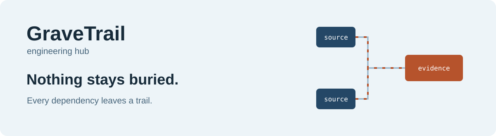
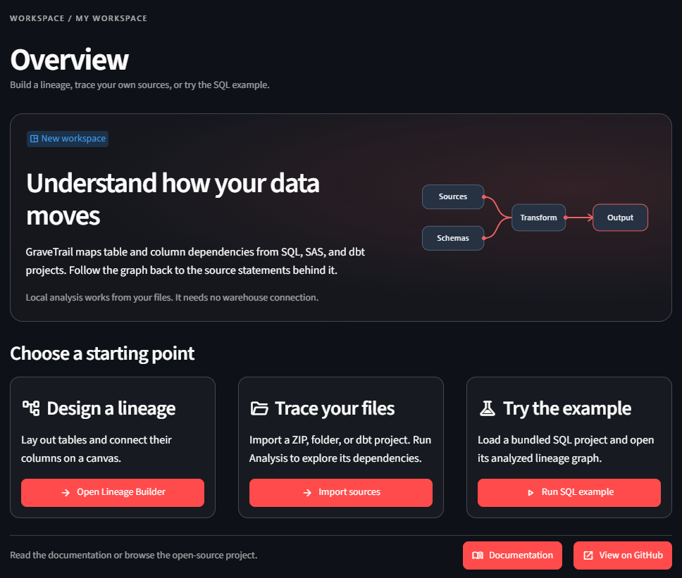
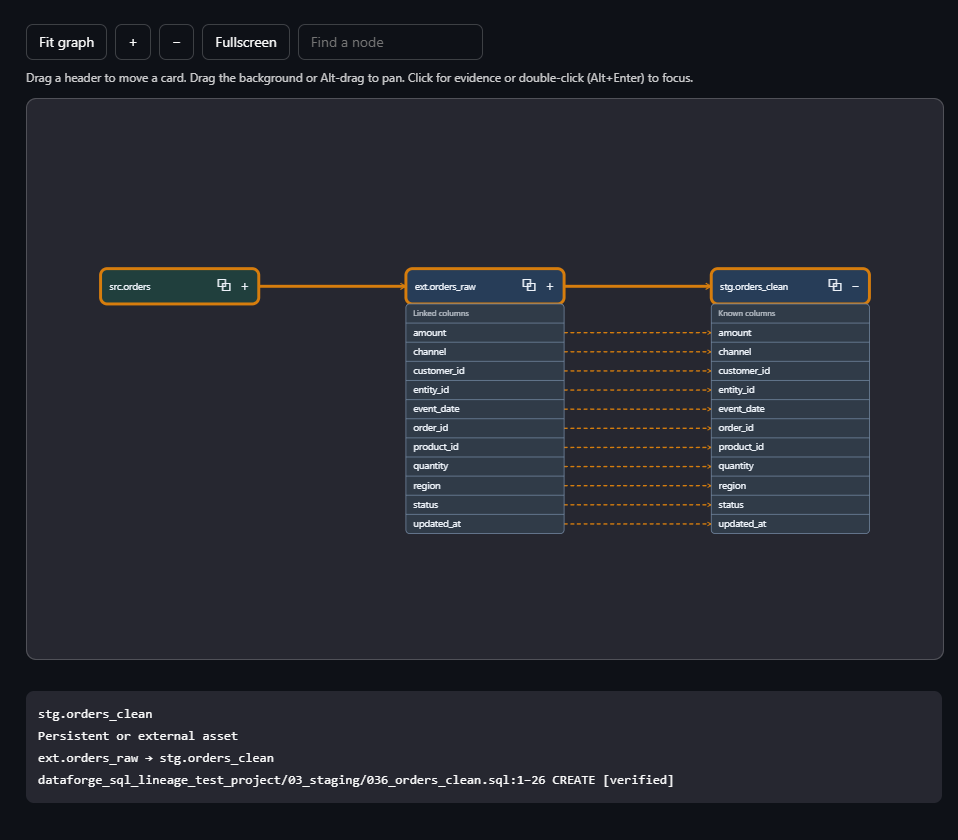
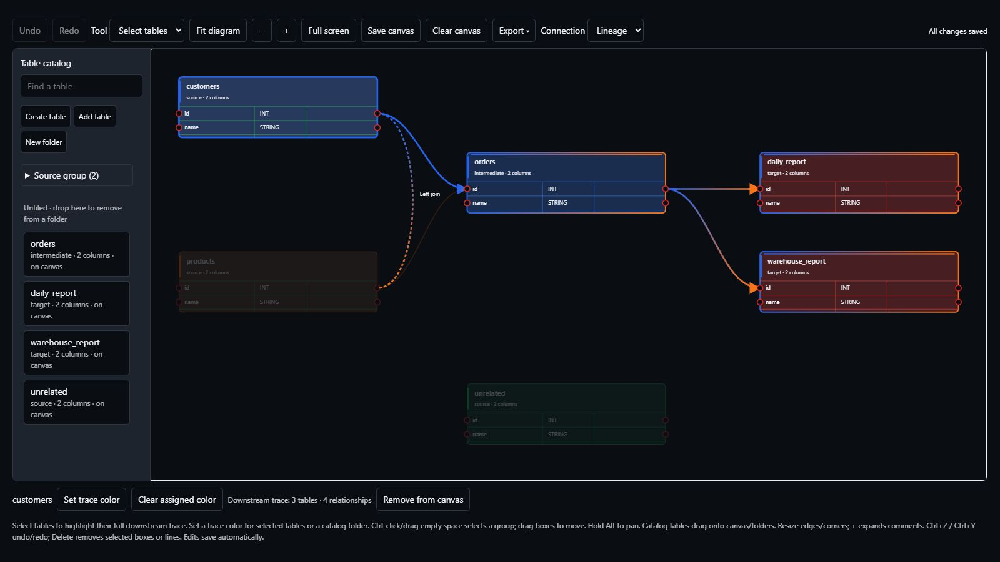

<p align="center">
  <a href="https://sahasilak.github.io/GraveTrail/"><strong>🚀 Explore the live GraveTrail documentation →</strong></a>
</p>

<p align="center">
  
</p>

<p align="center">
  <a href="https://www.python.org/downloads/"></a>
  <a href="LICENSE"></a>
  <a href="https://github.com/SahasilAK/GraveTrail/actions/workflows/tests.yml"></a>
  <a href="https://github.com/SahasilAK/GraveTrail/actions/workflows/docs.yml"></a>
  <a href="https://github.com/SahasilAK/GraveTrail/releases/latest"></a>
</p>

<p align="center">
  <a href="https://sahasilak.github.io/GraveTrail/"><strong>Documentation hub</strong></a> ·
  <a href="docs/getting-started/quick-start.md">Quick start</a> ·
  <a href="docs/user-guide/lineage-builder.md">Lineage builder</a> ·
  <a href="docs/CLI_GUIDE.md">CLI</a> ·
  <a href="docs/MCP_INTEGRATION.md">MCP</a> ·
  <a href="CONTRIBUTING.md">Contribute</a>
</p>

# Nothing stays buried. Every dependency leaves a trail.

<a name="gravetrail"></a>
<a name="nothing-stays-buried"></a>
<a name="every-dependency-leaves-a-trail"></a>

GraveTrail turns SQL, SAS and supported dbt project artifacts into explorable
lineage, dependencies and source evidence. Follow where data comes from, what
depends on it, and which code to investigate before making a change.

<a name="from-scattered-scripts-to-source-evidence"></a>



| From Overview | What you can do |
| --- | --- |
| **Open Lineage Builder** | [Design an editable diagram](docs/user-guide/lineage-builder.md) from table schemas and column relationships. |
| **Import sources** | [Import SQL, SAS or dbt files](docs/user-guide/sources.md), select a SQL source type where applicable, and [analyze the inventory](docs/user-guide/analysis.md). |
| **Run SQL example** | [Trace a bundled pipeline](docs/getting-started/quick-start.md#2-run-the-sql-example) in an empty workspace. |

<details>
<summary><strong>See GraveTrail with the included SQL project</strong></summary>



*Real application, disposable workspace, repository sample data. Try the
[interactive lineage example](docs/examples/interactive-lineage.md).*

</details>

## Follow the questions

- **Where does this table come from?** Explore upstream inputs and temporary steps. Expand a table to see its output columns and links to neighboring tables.
- **What could this change affect?** Follow downstream consumers before investigating them.
- **Where is the proof?** Inspect the original statement, source version and line range.
- **How is this column used?** Trace its transformations in the default column graph or open Direct references for occurrences in source files.
- **What connects this dbt project?** Inspect models, versions, resources and macro impact.
- **How do I share my findings?** Export reports, graph images or interactive HTML.

## Design lineage on a canvas



Open **Workspace → Lineage builder** to create or import reusable table schemas,
then explicitly add tables to a canvas catalog. Drag and resize table boxes,
connect columns and joins, organize folders, and highlight complete downstream
paths with table/group colors. Multi-selection, undo/redo, Alt-to-pan, and
right-click menus support larger designs.

Save named designs directly from the canvas and confirm overwrites when needed.
Clearing saves a backup and empties the current diagram/catalog while preserving
workspace schemas. Export SVG/PNG, offline interactive HTML, schema reports, or
editable JSON so another user can continue the work.

The [lineage builder guide](docs/user-guide/lineage-builder.md) covers the workflow,
shortcuts, safe clearing and sharing.

<a name="know-the-boundaries"></a>

Lineage supports investigation and migration planning. It does not execute a
migration or guarantee arbitrary code is correct. Dynamic SQL, runtime macros,
ambiguous names and unsupported syntax can leave explicit gaps.

<a name="choose-local-analysis-or-optional-ai"></a>

## Local analysis; optional AI

Supported static analysis runs locally after installation. It needs **no AI account,
API key or paid model service**, including for large projects. Imported SQL, SAS,
Jinja and Python are inspected as text, never executed.

Optional AI independently extracts inferred lineage from selected source and authorized
context. An external provider receives that content; a localhost gateway may forward
it upstream. Installation normally downloads dependencies. Read
[local operation and disclosure](docs/concepts/local-and-ai.md) for the separate
static-analysis, HTML-export and documentation-site offline boundaries.

<a name="start-in-minutes"></a>

## Start with the documented version

Use development commit **313587e** to reproduce the walkthroughs and screenshots.

Install Python 3.11+, Git and [uv](https://docs.astral.sh/uv/getting-started/installation/):

```sh
git clone https://github.com/SahasilAK/GraveTrail.git
cd GraveTrail
git checkout 313587e3217104dddc9e094a7a78cb79bf1ed64b
uv sync --locked --extra dev
uv run gravetrail-ui --home ./.dataforge
```

<a name="try-a-real-project"></a>

Open [the local application](http://127.0.0.1:8501), then select **Run SQL example**
from **Overview**. The app imports the sample, analyzes it and opens the upstream
graph for `pub.all_kpis`. To practice importing, [upload a sample ZIP](docs/getting-started/quick-start.md#3-try-a-manual-zip-import).

Follow the [first-lineage tutorial](docs/getting-started/quick-start.md) for evidence,
coverage and export steps, or the [dbt tutorial](docs/examples/dbt.md). Use the same
explicit home for UI, CLI and MCP. **Stop the UI before another process opens its DuckDB home.**

Locked uv includes the tested Streamlit/Pillow compatibility override. Wheel installs
need `dependency-overrides.txt`; read [installation choices](docs/getting-started/installation.md)
before using pip, Docker or older release binaries.

<a name="find-your-guide"></a>

## Find your trail

| Your next task | Guide |
| --- | --- |
| Install and complete an example | [Get started](docs/getting-started/index.md) |
| Import, analyze, explore and share | [User guides](docs/user-guide/index.md) |
| Design tables and lineage on a canvas | [Lineage builder](docs/user-guide/lineage-builder.md) |
| Understand SQL, SAS or dbt support | [Project types](docs/project-types/index.md) |
| Judge evidence and uncertainty | [Concepts](docs/concepts/index.md) |
| Configure optional AI and recovery | [AI analysis](docs/AI_ANALYSIS.md) |
| Query with scripts or agents | [CLI](docs/CLI_GUIDE.md) · [MCP](docs/MCP_INTEGRATION.md) |
| Locate code and extension points | [Developer path](docs/development/index.md) |
| Contribute or report a problem | [Contributing](CONTRIBUTING.md) · [Troubleshooting](docs/troubleshooting/help.md) |

The [documentation website](https://sahasilak.github.io/GraveTrail/) provides search
and themes; it may reflect an older revision until this branch is reviewed and
deployed. GitHub Pages serves documentation; run the app locally or on your trusted host.

## Build with us

```sh
uv run pytest -q
uv run ruff check .
uv run --group docs python scripts/docs/build.py
```

See [development setup](docs/development/getting-started.md) for focused verification.
The UI targets one trusted local user. Review [security](SECURITY.md) before remote
hosting or sharing exports, which can contain source code.

The [technology guide](docs/development/technology.md) explains Python, Streamlit,
SQLGlot, DuckDB and NetworkX. Legacy `dataforge` aliases and `DATAFORGE_*` variables
remain supported. Distributed under the [Apache License 2.0](LICENSE).
