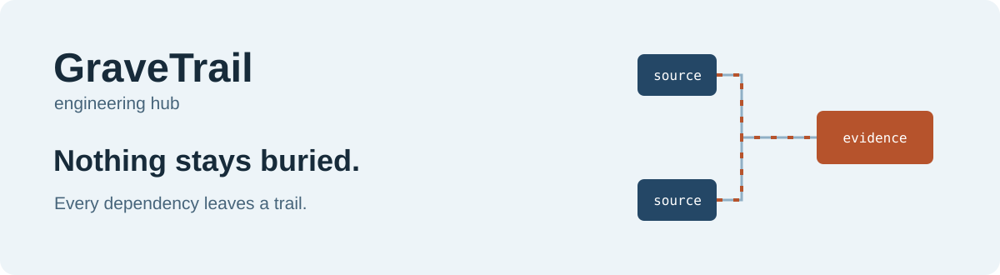

<p align="center">
  <a href="https://sahasilak.github.io/GraveTrail/"><strong>🚀 Explore the live GraveTrail documentation →</strong></a>
</p>

<p align="center">
  
</p>

<p align="center">
  <a href="https://www.python.org/downloads/"></a>
  <a href="LICENSE"></a>
  <a href="https://github.com/SahasilAK/GraveTrail/actions/workflows/tests.yml"></a>
  <a href="https://github.com/SahasilAK/GraveTrail/actions/workflows/docs.yml"></a>
</p>

<p align="center">
  <a href="https://sahasilak.github.io/GraveTrail/"><strong>Documentation hub</strong></a> ·
  <a href="docs/getting-started/quick-start.md">Quick start</a> ·
  <a href="docs/CLI_GUIDE.md">CLI</a> ·
  <a href="docs/MCP_INTEGRATION.md">MCP</a> ·
  <a href="CONTRIBUTING.md">Contribute</a>
</p>

# Your scripts have a story. Follow it.

**GraveTrail engineering hub** is a local-first workspace for understanding SQL and SAS
projects. Import a folder or ZIP, build table lineage, and follow every relationship back
to the exact source statement. Find direct column references, investigate downstream
impact, and share an interactive graph that works offline.

Built for data engineers, analysts, architects, and developers working through unfamiliar
pipelines, migrations, and change reviews. Deterministic analysis needs **no LLM, cloud
account, or paid service**. Imported code is never executed.

## From scattered scripts to source evidence

| Investigate | What you get |
| --- | --- |
| [Build lineage](docs/USER_GUIDE.md) | SQL AST parsing, dedicated SAS rules, CSV source metadata, and a persistent file inventory. |
| [Explore dependencies](docs/user-guide/index.md) | Upstream/downstream trees, focused interactive graphs, cycle detection, and temporary-step collapse with provenance. |
| [Inspect direct column usage](docs/USER_GUIDE.md) | References scoped to the selected source, including usage type, file, and exact lines. Unknown wildcards stay unknown. |
| [Keep the evidence](docs/DATA_MODEL.md) | Original file bytes, statement ranges, extraction methods, and versioned analysis history. |
| [Connect tools and agents](docs/integrations/index.md) | CLI and MCP queries over stored analysis, bounded responses, explicit permissions, and managed exports. |
| [Add optional AI assistance](docs/LLM_INTEGRATION.md) | Configurable provider profiles and task routing; grounded output validation and explicit inferred-result merges. |
| [Operate locally](docs/DATA_MANAGEMENT.md) | Independent workspaces, previewed cleanup, mandatory backups for general cleanup, and restore into a new data home. |


*A workflow illustration, not an application screenshot. Actual results come from your imported files.*

<details>
<summary><strong>See the application with the included SQL project</strong></summary>


Captured from an isolated local workspace using the supplied SQL fixture. See the
[user guide](docs/user-guide/index.md) for the dashboard and source-evidence viewer.

</details>

## Start in minutes

Install [Git](https://git-scm.com/downloads), Python 3.11+, and
[uv](https://docs.astral.sh/uv/getting-started/installation/), then run:

```sh
git clone https://github.com/SahasilAK/GraveTrail.git
cd GraveTrail
uv sync --locked --extra dev
uv run gravetrail-ui
```

Open [http://127.0.0.1:8501](http://127.0.0.1:8501). From the checkout, data is stored
in ignored `.dataforge/`. Choose a location with `uv run gravetrail-ui --home PATH`.
Use the same explicit `--home` when switching between UI, CLI, and MCP; **one process
owns each DuckDB home**. Installed launchers use the platform user-data directory.

Prefer pip? In a Python virtual environment, run `python -m pip install -e ".[dev]"`,
then `gravetrail-ui`. See the [installation guide](docs/SETUP_AND_DEPLOYMENT.md) for
Windows, Linux, macOS, credentials, and troubleshooting.

<details>
<summary><strong>Docker or a standalone build</strong></summary>

Build the container from this repository and retain data in a named volume:

```sh
docker build -t gravetrail:local .
docker run --rm -p 127.0.0.1:8501:8501 -v dataforge-data:/data gravetrail:local
```

Standalone directory bundles can be built for the host OS:

```sh
uv run gravetrail-build --target executable
```

No public binary or registry image is assumed. Native builds require target-platform
verification; see [builds and release limits](docs/BUILD_AND_RELEASE.md).

</details>

GraveTrail replaces the DataForge product name. Existing commands, environment
variables, and data homes remain supported; see
[rebrand compatibility](docs/BUILD_AND_RELEASE.md#gravetrail-rebrand-compatibility).

## Try a real project

1. Open **Sources** and upload either project ZIP from [`tests/sample_data/`](tests/sample_data/).
2. Select **only `.sql`** for the SQL ZIP or **only `.sas`** for the SAS ZIP, then import.
3. Open **Analysis → Run** and select **Analyze all files**. No provider configuration is needed.
4. In **Lineage**, search `pub.all_kpis`, select the exact asset, and explore
   upstream with **Traversal options → Traversal depth** set to **30**. Trace seven ETL layers back to all **16 source tables**.
5. Select a graph edge to inspect source evidence. Explore **Columns** or download
   a CSV/JSON report, original source bundle, or offline interactive HTML graph.

The fixture expectations are 85 persistent tables and 128 logical lineage edges; SAS
also includes 16 temporary WORK datasets. See the [walkthrough](docs/getting-started/quick-start.md)
and [fixture verification limits](docs/TESTING.md).

## Find your guide

| Start here | Go deeper |
| --- | --- |
| [Getting started](docs/getting-started/index.md) | [Installation & deployment](docs/SETUP_AND_DEPLOYMENT.md) · [Configuration](docs/getting-started/configuration.md) |
| [User guide](docs/user-guide/index.md) | [UI reference](docs/USER_GUIDE.md) · [Cleanup & recovery](docs/DATA_MANAGEMENT.md) |
| [Integrations](docs/integrations/index.md) | [CLI](docs/CLI_GUIDE.md) · [MCP](docs/MCP_INTEGRATION.md) · [Capability matrix](docs/CLI_MCP_CAPABILITIES.md) · [LLM providers](docs/LLM_INTEGRATION.md) |
| [Architecture](docs/architecture/overview.md) | [Lineage engine](docs/LINEAGE_ENGINE.md) · [SQL](docs/SQL_PARSING.md) · [SAS](docs/SAS_PARSING.md) · [Security](docs/SECURITY.md) |
| [Development](docs/development/index.md) | [Contributing](CONTRIBUTING.md) · [Testing](docs/TESTING.md) · [Build verification](docs/BUILD_AND_RELEASE.md) |
| [Troubleshooting](docs/troubleshooting/help.md) | [Publish GitHub Pages](docs/deployment/github-pages.md) · [Maintain documentation](docs/development/documentation.md) |

Explore the [live documentation website](https://sahasilak.github.io/GraveTrail/)
with search and light/dark mode. See the [Pages deployment guide](docs/deployment/github-pages.md)
for publishing details. GitHub Pages hosts the documentation;
run the Streamlit application locally or on your own host.

## Know the boundaries

This is **static analysis**, not a database or SAS runtime. Dynamic SQL, runtime macros,
ambiguous names, and unsupported syntax produce diagnostics rather than guessed edges.
Direct column usage is separate from transitive column lineage. See the parser coverage guides.

The UI is intended for one trusted local user and has no multi-user authentication layer.
Remote AI requests require privacy permission. Supply secrets through masked session
credentials or named read-only launch variables; never commit them. Exports and backups
can contain source code. [Read the security guide](docs/SECURITY.md).

## Build with us

Start with [CONTRIBUTING.md](CONTRIBUTING.md), then pick a focused improvement or
[report a reproducible issue](https://github.com/SahasilAK/GraveTrail/issues/new/choose).
For security concerns, use [SECURITY.md](SECURITY.md). Development checks:

```sh
uv run pytest -q
uv run ruff check .
```

GraveTrail uses [Streamlit](https://streamlit.io/), [SQLGlot](https://github.com/tobymao/sqlglot),
[NetworkX](https://networkx.org/), and [DuckDB](https://duckdb.org/). Documentation is built
with [Material for MkDocs](https://squidfunk.github.io/mkdocs-material/).

Distributed under the [Apache License 2.0](LICENSE). Dependencies retain their own licenses.
