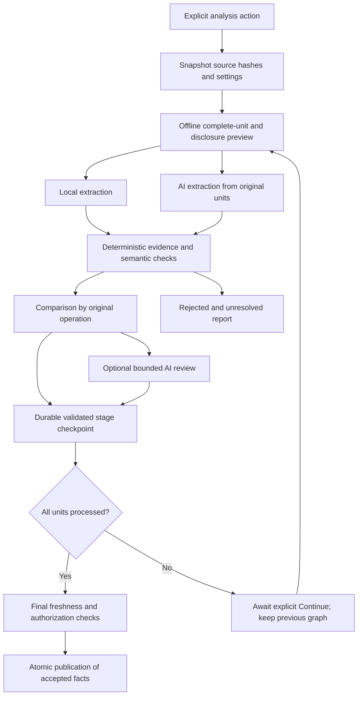

# AI project analysis

AI project analysis adds table lineage, direct column usage and column transformations to the main **Analysis** workflow. Local parser analysis remains the default and needs no provider. Use hybrid analysis first; AI-generated analysis is experimental and has no qualified live precision claim.

## Choose a build

| Analysis controls | Mode | Published SQL/SAS facts |
| --- | --- | --- |
| **Use AI for analysis** off | `parser` | Existing local parsing and still-valid saved inferred support; no new AI requests |
| AI on, **Compare with parser** on | `hybrid` | Parser facts plus independently extracted, deterministically validated AI facts |
| AI on, comparison off | `ai` | Validated AI facts; unmatched parser facts are shown as omissions rather than silently published |

CSV continues to supply local schema metadata. **Additional AI review** is optional. Review can withhold a candidate, but cannot make an unsupported claim publishable. AI additions remain **inferred**, with the compatibility confidence ceiling of 0.8. That number is display metadata, not a measured probability.

Review receives compact candidates and the original unit once. Preview reserves 2,000 characters for candidates. Candidates beyond that bound stay unresolved with `additional_ai_review_context_limit`; they never receive implied approval. This keeps the optional review within the previewed request and call budget.

1. Import SQL/SAS source files and configure a provider under **Connections & AI**.
2. Open **Analysis**, select files, and enable **Use AI for analysis**. Keep **Compare with parser** selected for a hybrid build.
3. Inspect the offline preview: selected files, complete units, disclosure, configured routes, context failures, retry/fallback call ceiling and output-token reservations. Preview does not test connections or send source.
4. Start the explicit AI analysis action. Inspect the completed comparison/report and original evidence; unresolved and rejected candidates do not become accepted dependencies.
5. Use the job cancellation control when needed. Cancellation, stale source/settings, exhausted budgets and failed required units retain the previously committed graph.

The five existing manual assistance tasks remain available in Diagnostics, including their separate explicit inferred merge workflow. Project extraction/review tasks require host-issued units and candidates and do not appear as manual range tasks.

## What happens to the source

Units retain original character offsets and lines, including multiple statements on one line. SQL statements and SAS DATA/PROC/macro blocks stay whole. Relevant declarations are retrieved by exact symbol names; project coverage does not depend on a top-k search. An oversized indivisible unit blocks the run instead of being truncated. Project planning can exceed 50 units; the existing manual selection limit remains 50 chunks.

Each request receives its original unit, relevant selected-source declarations and safe configured context. Extraction does not receive parser relationship or transformation answers. The declaration catalog includes provenance and marks conflicts unknown. Unselected source is not implicitly sent as extra context. Static schemas and structural parsing are shared inputs, so independent extraction is not independent proof.

A remote project run can transmit a complete selected file across several chunks. It requires both **external requests** and **complete source** permission. A loopback gateway such as OmniRoute may forward data to another provider. Source, comments and embedded instructions are untrusted data and are never executed. Session credentials remain in memory; credentials and provider echoes are redacted through the existing connection boundary.

## Context and run budgets

Connection discovery retains allowlisted model limits when the endpoint reports them. The selected model's metadata is bound to its endpoint, model, authentication, API version and credential reference. **Inspect selected model limits** refreshes it explicitly; Ollama also checks its currently loaded allocation. Discovery and offline preview submit no project source. Unknown/stale metadata uses configured caps. Gateway aliases such as OmniRoute `auto/...` may change upstream: advertised maxima are advisory, and upstream errors remain possible.

New profiles start with **Automatic** context/output values. Existing saved numeric limits remain **Custom**, including values equal to old defaults. Editing a number makes it Custom; **Reset profile limits to automatic** explicitly enables recommendations. Automatic output allocation scales with the complete unit, bounded by the profile/output capacity. Automatic calculation does not widen existing source permissions or the workspace Privacy allowance.

The complete request includes system instructions, JSON encoding, original unit, relevant catalog and wire schema. It must fit both profile/workspace character caps and current reported token limits. The offline estimator uses UTF-8 bytes plus framing, with capacity headroom. This is a conservative estimate for an unknown tokenizer, not an exact provider count. Combined windows reserve output inside context; separate windows are used only when explicitly reported. A smaller optional fallback is excluded with a reason; primary-route, credential and source-permission failures still block.

If the complete envelope exceeds a character allowance, preview shows an **Apply calculated context allowance** action when it fits the application's 100,000-character privacy maximum. That explicit action updates only the required context allowances. It does not enable external requests, complete-source permission or history. Oversized indivisible blocks remain explicit failures; the project planner no longer uses the manual assistance chunk-size control.

| Execution control | Automatic calculation | Allowed range |
| --- | --- | --- |
| Physical provider attempts | Required extraction, possible review, retries and eligible fallback attempts | 1–2000 |
| Reserved output tokens | Sum of every possible attempt's output allocation | 1000–2000000 |
| Cooperative seconds | Routed per-attempt timeouts, bounded by the application ceiling | 30–14400 |

Values in the existing **AI request budget** menu recalculate with source/model/review selection. Edit an individual value to preserve a Custom ceiling; **Reset AI budgets to automatic** clears those overrides. CLI/MCP omitted or null limits request Automatic; explicit numbers remain Custom. Preview reports total work separately from the largest complete-unit prefix fitting this execution.

Large projects return **awaiting_continuation** at the execution limit. Completed extraction/validation and review stages are durable, including partial semantic outcomes. **Continue AI analysis** rechecks the pinned sources, configuration, original publication, prompts, routes, permissions and budgets. It makes no calls for completed stages. The current graph remains visible until all required units finish and a single final publication succeeds. Process restart never sends requests automatically. A lost in-flight response needs the explicit retry choice, which identifies the possibility of a duplicate charge. Cumulative reservations and unknown usage remain visible across executions.

Every extraction/review/retry/fallback attempt reserves its configured maximum output allocation before dispatch and rechecks current authorization, source identity, cancellation and remaining budget. Unknown usage keeps that conservative reservation. Reported token counts remain provider metadata; absent usage is unknown. No monetary estimate is invented.

The deadline starts when work enters execution, excluding queue time. HTTP timeouts are limited by remaining time; checks also run between received chunks, stages and immediately before publication. A blocked socket/parser cannot always be preempted exactly, so cancellation or deadline reporting may return later. An already sent request may have incurred usage.

## Validation, comparison and reuse

Every candidate must pass strict bounded contracts and cite the complete immutable original unit with exact hash, offsets, lines and quote. Protocol v2 returns only the exact host-issued unit reference in each citation. The host restores the complete immutable citation before canonical and semantic validation. Unknown IDs, additional citation keys and truncated output are rejected. Columns also require exact expression spans, scope, branch/version and dependency roles. The host can locate omitted expression offsets only when the exact expression occurs once in the unit; ambiguous, missing or explicitly wrong spans are rejected. SQL projections include their original aliases; assignment expressions follow the task protocol. A real fragment that omits a JOIN does not establish ownership. Names in comments, literals, unused CTEs, unknown runtime macros and unknown wildcard outputs cannot manufacture dependencies.

Supported parser structure verifies ordinary claims. Separately bounded static SQL UPDATE/MERGE assignment verifiers cover a small tested gap subset. Unsupported branches, ownership or semantics remain unresolved. Join, filter, partition, order and rowset effects remain distinct from output value inputs. Additional AI agreement cannot override this boundary.

Hybrid comparison preserves parser-only facts and reports omissions. AI-only candidates publish only after deterministic checks. Corroboration of one original operation remains one writer. Conflicting/uncertain support stays inspectable; confident traversal stops at unresolved boundaries and unknown writer order.

Accepted project facts and minimal provenance are durable and can be reused by offline parser rebuilds. Selected-file runs preserve compatible unselected contributions. AI cache reuse requires the same source/context, job/settings, route/model, prompt/schema and validation identity; current source and authorization are checked again. Cache hits make zero new requests and do not turn historical usage into zero. **Refresh AI** explicitly bypasses AI extraction reuse; forcing local parser work alone does not authorize AI requests.

Preserved contributions carry their original declaration dependencies into later selected-file snapshots. Changing a declaration invalidates dependent offline reuse even if the most recent run analyzed another file.

Extraction, validation and comparison stage before publication. Final source/settings/revision checks and fact/support materialization commit together. Failed, cancelled or stale runs do not replace the existing graph. Failed billable work does not restart automatically after a process restart.

## Evidence and current limits

Synthetic SQL/SAS holdout labels and mock HTTP tests exercise exact evidence, deceptive negatives, roles, abstention, transport and orchestration. They do not measure a live model's precision. There is no claim of universal SQL/SAS coverage, inferred runtime execution order or a complete database schema.

A bounded development smoke on 2026-10-20 used loopback OmniRoute `auto/best-reasoning` on two synthetic SQL units. Both committed with known token usage: seven accepted claims, no rejected/unresolved candidates and one AI-only UPDATE derivation. Earlier development attempts exposed offset/protocol errors and informed prompt changes. This is a functionality check after tuning, not an independent precision evaluation or SAS qualification.

The live qualification targets remain unestablished: at least 99% accepted table-edge precision and 98% accepted value-column dependency precision, reported separately by language with coverage and sample sizes. The intended minimum is 100 accepted table predictions and 200 accepted value-dependency predictions across at least 20 scripts per language. No provider calls or private-project transmission are part of normal CI or documentation builds. See [testing](TESTING.md), [provider integration](LLM_INTEGRATION.md), [CLI](CLI_GUIDE.md) and [MCP](MCP_INTEGRATION.md).

## Design evidence

The design follows [context engineering guidance](https://www.anthropic.com/engineering/effective-context-engineering-for-ai-agents): keep complete, relevant source and retrieve context when needed. Long-window support alone does not establish effective task performance ([RULER](https://arxiv.org/abs/2404.06654)). Provider metadata can expose distinct limits ([Google model resource](https://ai.google.dev/api/models), [OpenRouter model properties](https://openrouter.ai/docs/api/api-reference/models/list-all-models-and-their-properties)); unknown window semantics are handled conservatively. Prompt caching can reduce repeated-input cost but does not remove context or output reservations.

Automatic-budget qualification processed 1,000 synthetic units across ten explicit
executions with exactly 1,000 unique requests and one final publication. A separate
browser fixture processed three units in three executions, accepting nine locally
validated claims. The real MCP HTTP SDK and a clean installed wheel also exercised
continuation. These mock-transport checks do not establish live-model accuracy.
A fresh OmniRoute attempt for this extension could not complete (provider error);
no new live precision result is claimed. See [performance measurements](PERFORMANCE.md#automatic-ai-continuation-qualification-2026-10-20).
