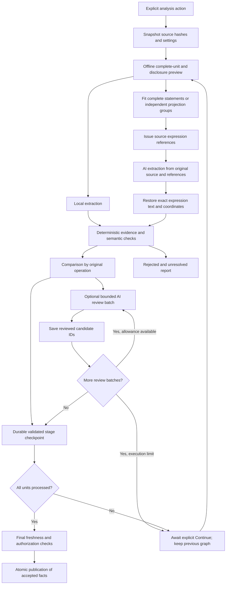

# AI project analysis

dbt projects use parser analysis. Selected dbt sources are rejected before AI context
disclosure, including manual diagnostic assistance. Select ordinary SQL/SAS files separately
to use this workflow in a mixed workspace; existing dbt facts are preserved.

**Local parser analysis is the primary, default workflow.** It builds table lineage,
column usage and supported transformations without sending source to an AI provider.
No model connection, API key or AI token usage is required. In **Analysis → Run**,
leave **Use AI for analysis** unchecked. Saving an AI connection alone does not
start AI extraction.

**Optional AI analysis adds a second capability in the same app.** For large,
complex systems where you want additional coverage beyond supported parser
patterns, enable AI and keep **Compare with parser** selected for hybrid analysis.
It compares local facts with independently extracted AI proposals, validates their
original evidence and semantics, and reports omissions and unresolved coverage.
Selected source and relevant context are sent to the configured provider, subject
to your privacy controls; a local gateway may forward them upstream.

Large projects can still use the local parser alone. AI can help investigate
coverage gaps but cannot guarantee that every dependency is discovered or correct.
AI-generated mode is experimental and has no qualified live precision claim.

## Choose a build

| Analysis controls | Mode | Published SQL/SAS facts |
| --- | --- | --- |
| **Use AI for analysis** off | `parser` | Existing local parsing and still-valid saved inferred support; no new AI requests |
| AI on, **Compare with parser** on | `hybrid` | Parser facts plus independently extracted, deterministically validated AI facts |
| AI on, comparison off | `ai` | Validated AI facts; unmatched parser facts are shown as omissions rather than silently published |

CSV continues to supply local schema metadata. **Additional AI review** is optional. Review can withhold a candidate, but cannot make an unsupported claim publishable. AI additions remain **inferred**, with the compatibility confidence ceiling of 0.8. That number is display metadata, not a measured probability.

Review receives every eligible compact candidate in deterministic batches, targeting 2,000 candidate characters and at most 100 decisions per request. A larger single candidate gets its own full-envelope fit check; it is never silently dropped. Preview labels review sizing provisional until extraction produces candidates. Continue uses the actual remaining batches and saves progress after every completed batch. Reviewer approval cannot override local validation.

1. Import SQL/SAS source files and configure a provider under **Connections & AI**.
2. Open **Analysis**, select files, and enable **Use AI for analysis**. Keep **Compare with parser** selected for a hybrid build.
3. Inspect the offline preview: selected files, complete units, disclosure, configured routes, context failures, retry/fallback call ceiling and output-token reservations. Preview does not test connections or send source.
4. Start the explicit AI analysis action. Inspect the completed comparison/report and original evidence; unresolved and rejected candidates do not become accepted dependencies.
5. Use the job cancellation control when needed. Cancellation, stale source/settings, exhausted budgets and failed required units retain the previously committed graph.

Enabling AI immediately shows an expandable preparation status below the AI options.
A live elapsed-time spinner stays visible while the local calculation runs. Expand the
panel to see actual file/task counts for source reads, statement splitting, shared
context, task sizing and prompt/credential checks. The panel finishes as **Ready** or
**Needs attention**, with its duration frozen; blockers and preparation failures expand
the details. This stage is offline: model requests begin only after you choose Analyze.
Automatic budgets reuse the same preview rather than calculating it twice; custom
budget changes are checked again before the analysis action becomes available.

The five existing manual assistance tasks remain available in Diagnostics, including their separate explicit inferred merge workflow. Project extraction/review tasks require host-issued units and candidates and do not appear as manual range tasks.

## What happens to the source

Units retain original character offsets and lines, including multiple statements on one line. Complete SQL statements and SAS blocks are preferred. When the complete request cannot fit, eligible independent SQL projections or static PROC SQL statements become smaller source tasks as described below. Relevant declarations are retrieved by exact symbol names; project coverage does not depend on a top-k search. An unsupported indivisible unit still blocks rather than being truncated. Project planning can exceed 50 tasks; the manual selection limit remains 50 chunks.

Each request receives its original unit, relevant selected-source declarations and safe configured context. Extraction does not receive parser relationship or transformation answers. The declaration catalog includes provenance and marks conflicts unknown. Unselected source is not implicitly sent as extra context. Static schemas and structural parsing are shared inputs, so independent extraction is not independent proof.

A remote project run can transmit a complete selected file across several chunks. It requires both **external requests** and **complete source** permission. A loopback gateway such as OmniRoute may forward data to another provider. Source, comments and embedded instructions are untrusted data and are never executed. Session credentials remain in memory; credentials and provider echoes are redacted through the existing connection boundary.

## Context and run budgets

Parser cache 14 and validator 3 pin semantic versions into AI cache and continuation
identities. An upgrade makes an older paused run stale before another request; start a
new run to use the new semantics. The previous published graph remains available.

Connection discovery retains allowlisted model limits when the endpoint reports them. The selected model's metadata is bound to its endpoint, model, authentication, API version and credential reference. **Inspect selected model limits** refreshes it explicitly; Ollama also checks its currently loaded allocation. Discovery and offline preview submit no project source. Unknown/stale metadata uses configured caps. Gateway aliases such as OmniRoute `auto/...` may change upstream: advertised maxima are advisory, and upstream errors remain possible.

New profiles start with **Automatic** context/output values. Existing saved numeric limits remain **Custom**, including values equal to old defaults. Editing a number makes it Custom; **Reset profile limits to automatic** explicitly enables recommendations. Automatic output allocation scales with the complete unit, bounded by the profile/output capacity. Automatic calculation does not widen existing source permissions or the workspace Privacy allowance.

The complete request includes system instructions, JSON encoding, original unit, relevant catalog and wire schema. It must fit both profile/workspace character caps and current reported token limits. The offline estimator uses UTF-8 bytes plus framing, with capacity headroom. This is a conservative estimate for an unknown tokenizer, not an exact provider count. Combined windows reserve output inside context; separate windows are used only when explicitly reported. A smaller optional fallback is excluded with a reason; primary-route, credential and source-permission failures still block.

If the complete envelope exceeds a character allowance, preview shows an **Apply calculated context allowance** action when it fits the application's 100,000-character privacy maximum. That explicit action updates only the required context allowances. It does not enable external requests, complete-source permission or history. Oversized indivisible blocks remain explicit failures; the project planner no longer uses the manual assistance chunk-size control.

| Execution control | Automatic calculation | Allowed range |
| --- | --- | --- |
| Physical provider attempts | Required extraction, possible review, retries and eligible fallback attempts | 1–2000 |
| Reserved output tokens | Sum of every possible attempt's output allocation | 1000–2000000 |
| Cooperative seconds | Routed per-attempt timeouts, bounded by the application ceiling | 30–14400 |

Values in the existing **AI request budget** menu recalculate with source/model/review selection. Edit an individual value to preserve a Custom ceiling; **Reset AI budgets to automatic** clears those overrides. CLI/MCP omitted or null limits request Automatic; explicit numbers remain Custom. Preview reports total work separately from the largest prefix of extraction/review stages fitting this execution. A unit may pause after extraction or between review batches without losing completed work.

Large projects return **awaiting_continuation** at the execution limit. Completed extraction/validation and individual review batches are durable, including partial semantic outcomes. Original source partitions and reviewed candidate IDs are saved so capacity metadata aging cannot silently repartition a continuation. **Continue AI analysis** rechecks the pinned sources, configuration, original publication, prompts, routes, permissions and budgets. It makes no calls for completed stages. The current graph remains visible until all required units finish and a single final publication succeeds. Process restart never sends requests automatically. A lost in-flight response needs the explicit retry choice, which identifies the possibility of a duplicate charge. Cumulative reservations and unknown usage remain visible across executions.

Every extraction/review/retry/fallback attempt reserves its configured maximum output allocation before dispatch and rechecks current authorization, source identity, cancellation and remaining budget. Unknown usage keeps that conservative reservation. Reported token counts remain provider metadata; absent usage is unknown. No monetary estimate is invented.

Provider profiles allow a request timeout of 1–3,600 seconds (one hour); existing saved/default values remain unchanged. Set it under Connections & AI → Advanced request options and save the profile. The progress panel refreshes every two seconds with total elapsed time and current extraction/review waiting time; completion freezes the timer. These timers indicate a pending request, not upstream model progress.

The deadline starts when work enters execution, excluding queue time. HTTP timeouts are limited by remaining time; checks also run between received chunks, stages and immediately before publication. A blocked socket/parser cannot always be preempted exactly, so cancellation or deadline reporting may return later. An already sent request may have incurred usage.

## Oversized operations and large review sets

For an independent outer SELECT, the planner can recursively divide the projection list until each complete request fits. Eligible requests with more than 100 projections are also divided to respect the response schema ceiling. This applies to a standalone SELECT, CREATE-AS or INSERT-SELECT without positional target column lists. Each task sends exact original header, assigned projection text and shared FROM/JOIN/WHERE suffix, with absolute source coordinates and original projection ordinals. Omitted text consists only of sibling projections. The host validates against the complete immutable original and restricts accepted output claims to the assigned projections. Shared table and contextual usage facts belong to the first task. Publication combines all tasks into one original writer.

Splitting requires unique named outputs and excludes stars, sibling-alias references, nested SELECTs/CTEs, set operations, DISTINCT, aggregates/windows, grouping, HAVING, QUALIFY, ordering, TOP/LIMIT/OFFSET, SELECT AS STRUCT, and a WHERE clause without FROM. Unqualified clause references to output aliases also prevent splitting. Only the SELECT projection, FROM/JOIN and WHERE argument forms are allowlisted; additional dialect clauses or modifiers remain indivisible. Each computed projection span is also parsed and compared with its original AST projection, so a keyword inside a qualified column cannot masquerade as a clause boundary. These restrictions prevent projection meaning from depending on omitted sections. A single large projection or shared context can still exceed capacity. The canonical original-unit limit remains 200,000 characters. Source privacy allowances remain binding.

An option-free static `PROC SQL; ... QUIT;` block can be paged at complete SELECT/CREATE/INSERT/UPDATE/DELETE statement boundaries. Macro references, connection/pass-through/session controls and stateful DATA/macro blocks remain indivisible. SQL/SAS runtime behavior and execution order are never inferred from paging.

Review batches account for every eligible candidate. A singleton that exceeds route capacity blocks explicitly. Contradicted or insufficiently evidenced candidates remain unresolved; a failed, cancelled or incomplete batch never counts as approval. Continue skips completed extraction and reviewed candidate IDs, rechecks sources and authorization, and preserves the prior graph until every required task finishes. Unknown in-flight review responses use the same explicit potentially duplicate retry rule as extraction.

## Validation, comparison and reuse

Every candidate must pass strict bounded contracts and cite the complete immutable original unit. Model evidence contains only the exact host-issued `unit_id`; the host restores its hash, offsets, lines and quote before canonical and semantic validation. Unknown IDs, additional citation keys and truncated output are rejected.

### Source expression references

Extraction protocol **v3 / prompt 4** supplies `expression_references`: source-only SQL projections, UPDATE/MERGE right-hand sides and SAS assignments, plus a whole-unit reference for SAS final projections. The model copies an issued `reference_id` into `expression_reference` and omits expression text and offsets. The app resolves the exact original text and absolute character coordinates, including repeated expressions, comments and Unicode. The catalog contains syntax locations, never parser dependency answers. Relevant dialect settings are used consistently for issuance and decoding.

References bind the immutable unit, file/hash, job, dialect, original span, kind and expression text. Focused tasks receive references only for visible source segments; an omitted sibling cannot be cited. A reference proves location only: target ownership, scope, branch/version, ordinal and every value/join/filter/rowset dependency still require independent host checks. Identical text in another UNION branch or SAS assignment version cannot substitute for the correct occurrence. Unknown, stale, foreign or conflicting references quarantine the response, with a source-free reason in default history.

Strict legacy expression responses remain supported. Without a reference, omitted offsets resolve only for a unique exact substring; ambiguous, missing or explicitly wrong spans fail. SQL projections include original aliases; SQL assignments cite their right-hand sides and SAS assignments retain the complete original statement. Unsupported syntax may have no expression reference and must use exact legacy evidence or remain unresolved. Comments, literals, unused CTEs, runtime macros and unknown wildcard outputs cannot manufacture dependencies.

The catalog and generated wire schema count toward the actual request envelope, so existing planning, privacy and model limits remain binding. Review stays protocol **v2 / prompt 3**. Canonical accepted facts and compact v2 durable payloads remain readable; expression references are resolved before storage, with no database migration. Older paused runs become stale after the semantic/prompt upgrade and require a new run.

Supported parser structure verifies ordinary claims. Separately bounded static SQL UPDATE/MERGE assignment verifiers cover a small tested gap subset. Unsupported branches, ownership or semantics remain unresolved. Join, filter, partition, order and rowset effects remain distinct from output value inputs. Additional AI agreement cannot override this boundary.

Hybrid comparison preserves parser-only facts and reports omissions. AI-only candidates publish only after deterministic checks. Corroboration of one original operation remains one writer. Conflicting/uncertain support stays inspectable; confident traversal stops at unresolved boundaries and unknown writer order.

Accepted project facts and minimal provenance are durable and can be reused by offline parser rebuilds. Selected-file runs preserve compatible unselected contributions. AI cache reuse requires the same source/context, job/settings, route/model, prompt/schema and validation identity; current source and authorization are checked again. Cache hits make zero new requests and do not turn historical usage into zero. **Refresh AI** explicitly bypasses AI extraction reuse; forcing local parser work alone does not authorize AI requests.

Preserved contributions carry their original declaration dependencies into later selected-file snapshots. Changing a declaration invalidates dependent offline reuse even if the most recent run analyzed another file.

Extraction, validation and comparison stage before publication. Final source/settings/revision checks and fact/support materialization commit together. Failed, cancelled or stale runs do not replace the existing graph. Failed billable work does not restart automatically after a process restart.

## Evidence and current limits

Synthetic SQL/SAS holdout labels and mock HTTP tests exercise exact evidence, deceptive negatives, roles, abstention, transport and orchestration. They do not measure a live model's precision. There is no claim of universal SQL/SAS coverage, inferred runtime execution order or a complete database schema.

A bounded development smoke on 2026-10-20 used loopback OmniRoute `auto/best-reasoning` on two synthetic SQL units. Both committed with known token usage: seven accepted claims, no rejected/unresolved candidates and one AI-only UPDATE derivation. Earlier development attempts exposed offset/protocol errors and informed prompt changes. This is a functionality check after tuning, not an independent precision evaluation or SAS qualification.

The [banking archive evaluation](TESTING.md#supplied-banking-archive-evaluation-2026-10-21)
on 2026-10-21 checks all 4,315 source scripts offline and records bounded real-provider
samples. Low contract-valid coverage and missing independent column gold leave the live
gate open. The later host-expression-reference enhancement removes model offset arithmetic, but its two development provider attempts timed out; no new live accuracy result is claimed. Those results support keeping the local parser primary and AI-only experimental;
they do not establish that hybrid improves coverage for this corpus.

The live qualification targets remain unestablished: at least 99% accepted table-edge precision and 98% accepted value-column dependency precision, reported separately by language with coverage and sample sizes. The intended minimum is 100 accepted table predictions and 200 accepted value-dependency predictions across at least 20 scripts per language. No provider calls or private-project transmission are part of normal CI or documentation builds. See [testing](TESTING.md), [provider integration](LLM_INTEGRATION.md), [CLI](CLI_GUIDE.md) and [MCP](MCP_INTEGRATION.md).

## Design evidence

The design follows [context engineering guidance](https://www.anthropic.com/engineering/effective-context-engineering-for-ai-agents): keep complete, relevant source and retrieve context when needed. Long-window support alone does not establish effective task performance ([RULER](https://arxiv.org/abs/2404.06654)). Provider metadata can expose distinct limits ([Google model resource](https://ai.google.dev/api/models), [OpenRouter model properties](https://openrouter.ai/docs/api/api-reference/models/list-all-models-and-their-properties)); unknown window semantics are handled conservatively. Prompt caching can reduce repeated-input cost but does not remove context or output reservations.

Automatic-budget qualification processed 1,000 synthetic units across ten explicit
executions with exactly 1,000 unique requests and one final publication. A separate
browser fixture processed three units in three executions, accepting nine locally
validated claims. The real MCP HTTP SDK and a clean installed wheel also exercised
continuation. These mock-transport checks do not establish live-model accuracy.
A fresh OmniRoute attempt for this extension could not complete (provider error);
no new live precision result is claimed. See [performance measurements](PERFORMANCE.md#automatic-ai-continuation-qualification-2026-10-20).
