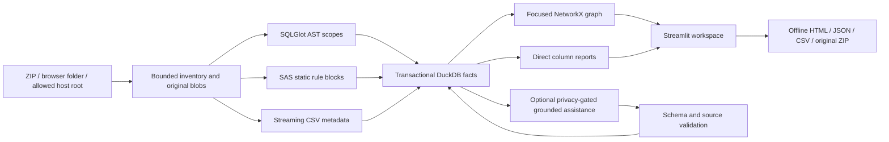

# Architecture

DataForge is a single local Streamlit application with Python feature services. Presentation
never parses source or executes imported statements. DuckDB persists facts; NetworkX derives
bounded graphs; a local SVG/JavaScript component links graph interactions to source evidence.

`models.py` defines parser contracts. `ingestion.py` validates inputs and persists inventory.
`parsers/` returns facts and diagnostics without DB/UI access. `services.py` snapshots input,
uses hash/config/path caches, parses with 1–8 workers, and atomically materializes facts.
`store.py` serializes connection access and applies versioned transactional schema migrations.
`maintenance.py` previews bounded unreferenced history, archives with a transactional recovery
journal plus local JSON copy, and restores missing records without changing materialized facts.
`graph.py` derives traversal, SCC cycles, path views and temporary contraction.
`llm.py` implements HTTP adapters, privacy, strict grounding, quarantine and inferred merges.
`assistance_queue.py` derives bounded current diagnostics and statement/context suggestions;
explicit review requests pin the preview hash through task routing before network transmission.
The queue has no separate persisted job state or automatic worker. AI results use existing
retained records, and UI session state holds result IDs rather than copied source claims.
`exports.py` serves UI components and offline exports from the same renderer.

Original bytes are immutable SHA-256-addressed blobs. Statements pin their source hash, so
reimporting the same path cannot substitute new code for old evidence. Newer files stay pending
if imported during analysis. Only one analysis runs at a time per Store, while immutable input
snapshots allow import activity without cache poisoning. Graph cache revisions use completed runs.

No graph database, message broker or external service is required. The intended deployment is a
single local user/process. Multi-user/authenticated hosting requires additional deployment work.
