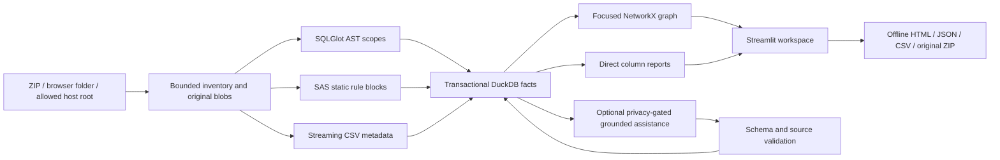

# Architecture

DataForge is a single local Streamlit application with Python feature services. Presentation
never parses source or executes imported statements. DuckDB persists facts; NetworkX derives
bounded graphs; a local SVG/JavaScript component links graph interactions to source evidence.

`models.py` defines parser contracts. `ingestion.py` validates inputs and persists inventory.
`parsers/` returns facts and diagnostics without DB/UI access. `services.py` snapshots input,
uses hash/config/path caches, parses with 1–8 workers, and atomically materializes facts.
`store.py` serializes connection access and applies versioned transactional schema migrations.
`maintenance.py` previews bounded unreferenced history, archives with a transactional recovery
journal plus local JSON copy, and restores missing records without changing materialized facts.
`cleanup.py` owns broader dependency-aware category plans and guarded apply; the specialized
history/staging recovery services remain separate. `database_maintenance.py` owns integrity
inspection, checkpointed whole-home snapshots and validated restore into a new home.
`graph.py` derives traversal, SCC cycles, path views and temporary contraction.
`llm.py` implements HTTP adapters, privacy, strict grounding, quarantine and inferred merges.
`connections.py` supplies session-scoped `RuntimeConnections` via a context variable. Adapters
resolve a credential from that scope, then the explicitly named read-only launch variable.
No per-session credential is placed in the process environment or persisted profile.
`assistance_queue.py` derives bounded current diagnostics and statement/context suggestions;
explicit review requests pin the preview hash through task routing before network transmission.
The queue has no separate persisted job state or automatic worker. AI results use existing
retained records, and UI session state holds result IDs rather than copied source claims.
`exports.py` serves UI components and offline exports from the same renderer.

Original bytes are immutable SHA-256-addressed blobs. Statements pin their source hash, so
reimporting the same path cannot substitute new code for old evidence. Newer files stay pending
if imported during analysis. Only one analysis runs at a time per Store, while immutable input
snapshots allow import activity without cache poisoning. Graph cache revisions use completed runs.

No graph database, message broker or external service is required. The intended deployment is a
single local user/process. Multi-user/authenticated hosting requires additional deployment work.

## Agent and automation interfaces

`dataforge.cli` (Typer) and `dataforge.agent.mcp_server` (official MCP SDK) call
`AgentService`, which applies permissions/output policy and delegates to the existing
Importer, analyze, Store, LineageGraph, column_report and export helpers. Streamlit
remains the primary UI; Settings adds setup/control/test presentation only. No parser,
source execution or LLM logic is added to adapters. Managed jobs/results/audit/revocation
snapshots live beneath the runtime home's `agent/` directory; no database migration is
needed. See [MCP_INTEGRATION.md](MCP_INTEGRATION.md) and [CLI_GUIDE.md](CLI_GUIDE.md).

## Maintenance boundary

Category plans list actual rows/files, logical JSON row size estimates and a revision token.
Apply recomputes the plan under the maintenance guard, verifies typed scope confirmation and
rejects active jobs, analysis and provider requests. Database mutations are transactional;
managed filesystem deletion is checked within the home. A failed filesystem action can leave
an incomplete cleanup; the result must be reviewed rather than assuming cross-resource atomicity.
General destructive cleanup is not recoverable without a backup.

Source and AI cleanup remove the complete dependent workspace graph and analysis history,
avoiding stale inferred edges or missing statement references. Lineage reset preserves imported
inventory and configuration; workspace reset also removes generated AI/history. Parser cache is
shared and has its own operation. Immutable originals remain until unreferenced blob collection;
retained snapshots protect content, and recovery archives conservatively prevent collection.
Application reset targets a fixed managed allowlist and preserves backups, unrecognized files,
installed code and maintained documentation. No schema tables are dropped.

Whole-home backups use DuckDB `COPY FROM DATABASE` to a checkpointed snapshot, then archive
managed runtime files with a SHA-256 manifest. Restore validates bounded archive contents and
schema, opens the staged database read-only and renames staging into a new destination. This
is distinct from the bounded history/staging recovery journals. Schema versions remain 1–4;
maintenance adds no destructive upgrade. See [setup and deployment](SETUP_AND_DEPLOYMENT.md).

## Distribution boundary

`launcher.py` finds the source app or packaged `_app` directory and launches the same
Streamlit pages. Wheels include UI/component assets, prompt resources and default Streamlit
configuration. Frozen bundles use the same launcher and expose CLI/MCP via `--cli`.
Installed/frozen launchers default to platform user-data locations; source launchers default
to `.dataforge/` relative to the working directory unless explicitly configured. CLI/MCP
uses the same home resolver. Installed theme configuration
is copied once into the writable home instead of changing packaged assets.

`build.py` provides Python, Docker and host executable targets, reading the project version,
launching build tools with an allowlisted environment and recording artifact hashes/metadata.
Checksums prove file integrity, not publisher authenticity or runtime correctness. Native
artifacts need native runner smoke tests. Docker runs the installed wheel as a non-root user
with persistent `/data`. UI and MCP are alternative owners of a home, not concurrent services
against one DuckDB file. See [build verification](BUILD_AND_RELEASE.md).
