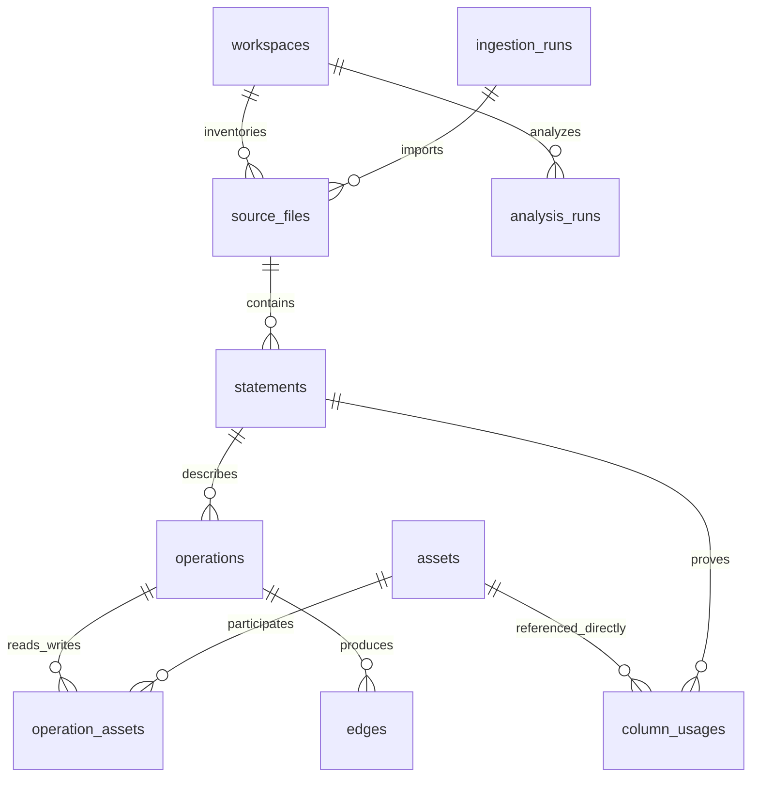

# Data model

DuckDB lives at `DATAFORGE_HOME/dataforge.duckdb`. Schema migrations are additive and execute
inside a transaction. Version 1 creates tables; version 2 adds statement source content hashes;
version 3 adds the compressed history recovery journal.
Do not edit schema destructively or delete runtime data to resolve a migration error.

| Table | Responsibility |
|---|---|
| workspaces, settings | Independent named contexts and JSON settings |
| ingestion_runs | Source/import diagnostics, accepted/skipped/duplicate counters |
| source_files | Stable path IDs, full decoded text, byte hash, blob reference, encoding, status, metadata |
| parse_cache | Parser version + hash + path + config results; safely disposable |
| analysis_runs | Status, duration, counts, config and comparison snapshots |
| history_archives | Workspace-bound compressed recovery bodies, original byte size and creation time; committed atomically with history removal |
| assets, asset_aliases | Stable canonical identities, display names, kind, temporary flags and resolution notes |
| statements | Exact statement snippet, original line range, file ID and source version hash |
| operations, operation_assets | Explicit transformation nodes with many-to-many input/output memberships |
| edges | Derived input/output relationships with method, confidence, status and evidence keys |
| column_usages | Scope-local direct column references and expression context |
| diagnostics | Parse failures, ambiguity and unresolved symbols with file/line |
| llm_profiles | Provider config and environment variable names, never credentials |
| llm_records, prompt_versions | AI provenance, validation outcomes, usage, prompt hashes and durable merged claims |

IDs derive from workspace/path, normalized asset identity or operation identity. UI services
filter by workspace. Original blobs may be shared by hash; workspace deletion leaves blobs
intact to avoid deleting content referenced elsewhere. There are no destructive FK cascades;
the materialization service owns cross-table transaction integrity.

History maintenance archives only unreferenced analysis/import records, preserving the latest
completed analysis, current edge/inventory references and running analyses. Recovery JSON has
a canonical SHA-256 integrity check; a compressed copy is journaled in the same DuckDB transaction
as removal. Local JSON files provide an additional recovery copy. Restore inserts missing IDs
transactionally without replacing current facts or existing history. Both copies are retained.

Migration4 adds temporary_recovery (workspace, file name, compressed bytes, original size,
SHA256 and created/restored timestamps). Bytes commit before stale staging-file removal.
Recovery journals are not metadata-transfer payloads and are deleted only with explicit
workspace deletion. This table never authorizes cleanup outside its application namespace.
