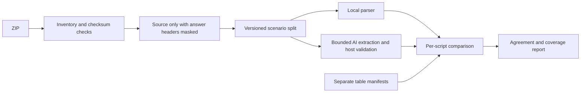

# Testing

<span id="current-acceptance-summary-2026-10-20"></span>

## Current acceptance summary — 2026-10-21

dbt extension validation: **910 tests passed, 2 skipped** on Windows/Python 3.11.16.
`tests/test_dbt_*.py` covers safe imports, static templates/resources, manifest v12,
catalog v1/run-results v6, identities, columns, settings, access, maintenance and UI.
The reproducible 1,000-model workload and exact scope limits are in [dbt support](DBT_SUPPORT.md).
This extends the historical SQL/SAS acceptance evidence below.

AI preparation status verification: **915 passed, 2 existing Windows skips** in
178.66 seconds. `tests/test_ai_preparation.py` covers offline file/task progress,
status-before-calculation ordering, automatic preview reuse and ready/blocked/error
presentation. Existing custom/reset/context allowance controls pass. A real browser
with a disposable 12-file fixture and deliberately slowed source reads verified
the live native elapsed timer, expansion during work, frozen completion duration,
expanded missing-credential/failure details and disabled analysis actions. No live
provider requests were made. Ruff, lock validation and the strict documentation
build pass; packaged applications were not rebuilt for this UI change.

This table distinguishes delivered behavior, dated environment evidence and still-open gates.
Earlier numerical results below are historical; a later source change does not refresh a
previously tested distribution artifact. Optional local `plans/` records are not shipped or
published; this tracked summary is the public acceptance reference.

| Area | Latest evidence | Remaining gate |
| --- | --- | --- |
| Source application | Parser cache13/validator2 add bounded SAS constants and reachable DML scopes; semantic-version continuation pins; 830 tests pass with 2 existing Windows skips | No claim of universal SQL/SAS coverage or qualified live-model precision |
| SQL/SAS sample ZIPs | Each has 85 persistent tables, 128 logical edges, seven layers/all 16 roots; SAS adds 16 WORK assets/144 physical edges | Real client projects and large dense graphs need separate accuracy/performance acceptance |
| CLI/MCP | Complete documented interfaces and actual SDK transport/permission regressions; fixture parity includes original bytes, evidence and warm caches | One DuckDB process owns each home |
| OmniRoute | 2026-10-20 project smoke: two synthetic SQL units committed, two requests with known usage, seven accepted claims including one AI-only UPDATE derivation; earlier manual SQL/SAS gate remains historical | Development smoke after prompt tuning is not an independent precision evaluation or SAS project qualification |
| Windows wheel/executable | 2026-10-20 clean installed wheel outside checkout passed packaged prompts/schemas, real adapter with mock HTTP, accepted lineage/column publication and support; 2026-10-18 executable smoke remains historical | Current native executable/container and target-native release acceptance remain open |
| Linux Docker | 2026-10-17 GraveTrail image passed non-root CLI/import/lineage/UI/MCP and volume persistence | 2026-10-18 fresh Docker checks were blocked by daemon availability; no parser-9 container result claimed |
| Native Linux/macOS and hosted release | Build/publish workflow implemented | Target-native downloaded-artifact and current hosted release acceptance remain unrecorded here |
| Standalone HTML | Self-contained assets, escaping, JavaScript checks and real UI download passed; 2026-10-18 source-generated `file://` graph with 501 nodes/500 edges passed fullscreen, keyboard copy and evidence checks without external requests | Current packaged artifacts were not rebuilt for the QOL changes |

Whole-home backup/restore and guarded blob cleanup are delivered features. Scheduled retention,
SVG/PNG export and multi-user collaboration remain optional. Bounded column transformations
are now implemented for the [documented SQL/SAS subset](TRANSFORMATION_LINEAGE.md).

Review follow-up verification on 2026-10-18: **568 passed, 2 existing Windows symlink
permission skips** in 97.58 seconds. Parser cache 11 fixes equivalent quoted column
identities, including escaped/special names; classifies downstream row-selection effects
before trimming displayed inputs; and maps plain INSERT wildcards to declared destination
positions. Unknown/mismatched/mixed wildcard layouts remain unresolved. Regressions verify
that older caches request reanalysis and are replaced on the next analysis. The full suite
includes existing UI, CLI, actual MCP transport, direct-usage and storage compatibility checks.
Ruff, the lock check and strict documentation validation pass (37 public pages, 8 assets).

Initial column transformation verification on 2026-10-18: **545 passed, 2 existing Windows
symlink permission skips** in 111.01 seconds; Ruff and the lock check pass. Strict Pages
validation passes all **37 public pages**, 8 assets, rendered local links/anchors and search.
New fixtures cover projection/role separation, constants, CTE/INSERT/UNION and unsupported
SQL boundaries; ordered SAS variables and function/option boundaries; job isolation;
schema-based inference; revision/settings changes; converging cycles and all output limits;
failed reanalysis; migration-4 restore/upgrade, cleanup and integrity. AppTest and a real
Chromium session verify the dedicated page, readable inspector, original expressions/lines,
coverage and export controls without browser errors. CLI, shared MCP handlers and the real
SDK stdio transport return matching scoped transformations and enforce source permissions.
Independent review findings have regression tests and no confirmed blockers remain.

An earlier run concurrent with the benchmark/docs build reached the existing 10-second
MCP startup deadline (544 passed, 1 timeout, 2 skips). Both transport checks passed alone,
then the complete suite passed with no concurrent benchmark/build. The
[synthetic column benchmark](PERFORMANCE.md#column-transformation-measurement-2026-10-18)
records measured time, Python allocation scope and explicit traversal limits. These checks
do not establish live SQL/SAS execution compatibility or refresh native release artifacts.

Initial parser-9 source verification on 2026-10-18: **402 passed, 1 existing Windows symlink
privilege skip** in 68.31 seconds. Ruff and the lock check pass. Fresh isolated SQL/SAS ZIP
acceptance through CLI/service/actual MCP preserves exact originals, expected logical/physical
edges, all seven layers/16 roots and 86 warm cache hits per project. The running isolated UI
rebuilt all three new fixtures, validated zero invalid evidence records, and displayed the
procedure upstream chain and original source on graph selection. No imported code or external
provider was executed. Release artifacts were not rebuilt for this source change.

The subsequent CodeQL ReDoS follow-up passes **411 tests, 1 existing skip** in 63.74 seconds.
Routine-header whitespace/comments now scan forward without an ambiguous repeated regex,
honoring each dialect's nested-comment rules. A subprocess regression with 100,000 spaces
after a comment exceeded its 10-second bound before the fix and passes afterward; ordinary
SQL evidence and CREATE/ALTER procedure guards are preserved. Fresh SQL/SAS ZIP parity and
the running isolated UI pass, including zero invalid evidence records for the padded SQL.
Parser cache version 9 is unchanged because the fix preserves intended parsing behavior.

Lineage/Columns QOL source verification on 2026-10-18: **441 passed, 2 Windows symlink
permission skips** in 72.42 seconds; Ruff passes. AppTest covers disconnected All beyond
focused caps, direction-specific evidence, exact focus beyond search limits, shared selection,
Back/Forward branching and Tree-tab/control restoration. Column tests preserve unknown schema
and wildcard coverage, distinguish unused from filtered-out names and accept comma terms.
An isolated real Chromium session passed All, fullscreen enter/exit, exact node copy,
double-click focus, Back/Forward, directional source files, individual/list/unused column
copy and comma filtering with no browser errors. A separate source-generated standalone graph
passed 501-node rendering and keyboard interactions without external requests. These checks
do not establish performance for every large/dense graph or refresh packaged-release evidence.

## Test commands and historical evidence

`uv run pytest -q` runs unit, integration, security and Streamlit AppTest checks. `uv run ruff
check .` checks lint/imports. Node.js, when installed, adds a JavaScript syntax check; the app
itself requires no Node runtime. Tests construct isolated temporary DuckDB homes and use real
source fixtures, not a hardcoded graph.

Required scenarios are covered: explicit CSV→SAS WORK→staging→SQL mart flow, ambiguous orders
names, CTE resolution, direct versus transitive columns, unresolved macros, cycles, no provider,
and malformed/hallucinated provider output. Tests also cover original bytes, restart, extension
filters, path traversal, ZIP symlinks/ratios, CSV width/header failure, rollback, concurrent import,
source-hash evidence, quoted names, unused CTEs, SAS inline data and retention of merged claims.

AppTest renders every page and exercises ambiguous choices, profile forms and settings sections.
Actual browser checks are separate because Python AppTest cannot execute custom graph JavaScript.
Browser testing found and fixed a JS string-escaping defect; a syntax regression now covers it.
Node also checks mounting an empty graph through a DocumentFragment-shaped container without
an element style property. Real-browser tests verify rendering and interactions separately.
Provider tests use HTTPX MockTransport with real protocol payload validation. They do not prove
live account permissions/model availability. Do not call them a live integration test.

The CI matrix is configured for Windows/Linux and Python 3.11/3.12. Only the current local
environment results are claimed until remote CI actually executes. Docker is optional and
unverified unless a container build/run is explicitly recorded in implementation status.

Continuation checks include safe fenced JSON and malformed/deep provider envelopes, transactional
v1/v2 configuration round trips, workspace editing, closed-tree rendering/expand/collapse,
bounded ordered path exports, schema conflict/change/refresh handling and declaration evidence.
AppTest exercises schema-expanded columns, DDL source viewing and dictionary provenance.
Actual browser tests also downloaded and checked five-step path JSON/CSV with original hashes.

`scripts/verify_llm.py` is an explicit live test using synthetic SQL/SAS only. The bounded
2026-10-17 OmniRoute gate passed discovery, connection, SQL/SAS grounded claims, explicit
inferred merges, refresh and owner reopen using `auto/best-reasoning` at
`http://localhost:20128/v1` with the existing `OMNIROUTE_API_KEY` reference. Earlier runs
recorded invalid output and gateway failures. A dated pass is not an availability guarantee;
model-list membership does not establish callability. See the current implementation status.

History tests cover archive/restore protection, v3 migration, bounded payloads, rollback and
database recovery after filename loss/restart. Visualization checks cover strict preferences,
safe configuration round trips, graph export parity, source expansion and workspace selection
resets. Actual browser verification saved preferences, restarted the server, checked hidden
labels with accessible full names, neutral fills and edge width, selected node evidence and
downloaded matching graph JSON. Both normal and clean Python 3.11 environments pass 120 tests.

Diagnostic review regressions cover SQL statement focus, bounded queue and SAS nearby context,
informational/CSV/pending exclusion, isolation, privacy, invalid-output quarantine, explicit
inferred merge and source changes after queue lookup. AppTest also presses a stale request
button after reimport/reanalysis and proves zero network calls; a fresh request then validates
and merges via synthetic HTTP transport. UI state holds a record ID. Actual browser uploaded
synthetic unresolved SQL, analyzed it and adjusted the focused line preview without provider use.
Latest complete result: 127 tests pass in both normal and clean Python 3.11 environments;
Ruff, lock checks and wheel/source builds pass.


Local completion records, when supplied, live in the ignored plans directory.
Regression tests cover task-specific advisory grounding, AI
admission/chunks, settings/cache preservation, recoverable staging cleanup, supplied job scope,
seven labeled vendor/SAS cases in LF and CRLF, storage isolation, inventory refresh and exact
SAS evidence. Historical test counts above describe earlier stages. A Windows wheel and Linux
Docker build/run passed in earlier local verification; artifacts have not been rebuilt for
every subsequent source change. Hosted release CI and native Linux/macOS executable acceptance
remain separate gates. Standalone offline HTML interaction through a file-browser URL remains
unexecuted. See [build verification](BUILD_AND_RELEASE.md) and current dated acceptance.


## Agent integration acceptance

Run the four `tests/test_agent_*.py` modules for standalone CLI/MCP parity, actual SDK
stdio/HTTP, permissions/budgets, persisted/background jobs, source boundaries and Settings
AppTest. Run `scripts/verify_agents.py` with an isolated --home and --output for both supplied
SQL/SAS ZIPs and representative token estimates. It executes no imported source and records
exact SAS FORMAT-modifier evidence and the remaining static-analysis diagnostics. Retain the generated report locally for review.

## CLI/MCP UI parity verification

Run `uv run pytest tests/test_parity_*.py` and the full `uv run pytest`. The keyed 48-ID fixture is checked against actual CLI help and MCP schemas; new network/mutation tools must reject a read-only launch. Provider mocks are repeatable and require no keys. `uv run python scripts/verify_parity.py --home NEW_ISOLATED_HOME --output NEW_REPORT.json` exercises both supplied ZIPs through CLI/service/actual MCP and owner reopen, including every original byte/hash, exact logical edges, seven layers/all16 roots and warm cache reuse. Never point destructive tests at an existing user home. Record running UI/live/transport evidence and unexecuted gates in the local report.

## AI project analysis qualification — 2026-10-20

New contract/context/transport/validator/reconciliation/orchestration tests use synthetic originals and HTTPX MockTransport. Strict evidence and negative fixtures cover fragments/splices, ambiguous ownership, unused CTEs, scope/role/version mapping, static UPDATE/MERGE gaps, retry/fallback budgeting, truncation, unknown usage and cooperative deadline/cancellation. Fourteen versioned SQL/SAS holdout scripts label expected facts and abstentions separately from prompt examples.

These checks prove bounded application behavior, not live-model accuracy. No live project-analysis precision gate, current native binary smoke or private ZIP disclosure is claimed here. Historical manual OmniRoute evidence above does not qualify the new project workflow. AI-generated mode is experimental; hybrid comparison is the initial choice. The [AI project analysis guide](AI_ANALYSIS.md#evidence-and-current-limits) records the still-open language-specific live precision, coverage and sample-size targets.

Earlier source verification on 2026-10-20: **738 passed, 2 existing Windows symlink skips** in 178.66 seconds. The actual browser confirmed unchecked defaults, hybrid opt-in/preview, background publication and accepted table/column claims in the report using synthetic mocked extraction. Follow-up AppTest/browser checks cover automatic terminal report refresh and selection. A clean wheel installed in a separate environment ran outside the checkout, loading packaged project prompts/schemas and publishing one table edge/column derivation with durable support through mock HTTP. Ruff, lock and strict Pages validation are recorded with the PR. The bounded two-case live OmniRoute smoke described above verifies requests/usage and AI gap publication, but its sample is too small and was used in prompt development; do not infer a precision percentage.

The offline scorer can be reproduced with:

```bash
uv run --locked python scripts/benchmark_ai_analysis.py --project-gold --output metrics.json
```

It scores the parser baseline against separate `evaluation_gold.json` operation/scope/version/role labels and optionally both synthetic archive manifests. `--predictions saved.json` scores explicit saved predictions; this remains unqualified saved evidence. Live evaluation requires `--live`, explicit `--cases`, `DATAFORGE_AI_BENCHMARK_LIVE=1`, an existing named credential reference and bounded attempt/time options. The synthetic live route is fixed to loopback OmniRoute `auto/best-reasoning`. No live qualification follows from offline or mock scores. Gold/expected files are scorer inputs and never model context.

## Supplied banking archive evaluation — 2026-10-21

The new `scripts/benchmark_lineage_archives.py` checks all source checksums before
evaluation and scores per-script table pairs against the separately supplied manifest.
It reads ZIP members without executing their bundled Python, SQL or SAS. SQL fixture
answer comments are masked before model input while preserving character/line positions;
reports retain original and evaluation-source hashes. Gold files never enter the source
inventory or declaration catalog. This masking is an evaluation precaution, not a change
to the application's original-source workflow.



| Corpus | Scripts | Manifest edges | Baseline matched | Parser 13 matched | Remaining omissions | Additional reported pairs |
| --- | ---: | ---: | ---: | ---: | ---: | ---: |
| Banking SQL | 2,114 | 4,992 | 4,936 | 4,948 | 44 | 5 |
| Banking SAS | 2,201 | 5,912 | 5,287 | 5,712 | 200 | 0 |

The SQL extra pairs preserve explicit unqualified `accounts` references in adversarial
scripts whose manifests expect abstention; they need identity adjudication, not a claim
that model agreement establishes truth. Remaining SQL omissions include unsupported DB2
and conditional T-SQL procedure forms. Remaining SAS omissions include runtime macros,
external paths without macro bindings and HASH lookup datasets. No runtime is executed
to invent these dependencies. These are table-manifest agreement counts, not measured
column precision or proof that the fixture executes successfully.

Reproduce the complete offline comparison with the supplied archives in a local folder:

```bash
uv run --locked python scripts/benchmark_lineage_archives.py --archive /samples/banking_legacy_sql_2114_lineage_stress_test.zip --language sql --split all --output sql-metrics.json
uv run --locked python scripts/benchmark_lineage_archives.py --archive /samples/banking_legacy_sas_2201_lineage_stress_test.zip --language sas --split all --output sas-metrics.json
```

Live evaluation additionally requires `DATAFORGE_AI_BENCHMARK_LIVE=1`, `--live`, a named
`DATAFORGE_...` credential reference, `--split development` or `--split holdout`, and an
explicit `--limit`. Use `--max-attempts` and `--max-seconds` to bound each invocation.
The route remains loopback OmniRoute `auto/best-reasoning`; the gateway may forward source
upstream. Receipts preserve requested and gateway-reported resolved model, prompt hash,
finish reason, physical attempts and known token usage, including quarantined responses.
Missing receipts or usage remain unknown. Hybrid reuses the same extraction calls.
Failed or unattempted scripts count as omissions, rather than disappearing from scores.

The versioned split hashes scenario names, keeping repeated templates together, and
sample limits round-robin scenarios. Record a frozen selection before the final live run;
development or interrupted runs never qualify the holdout. Repeated scripts remain
correlated, and gateway aliases can route different models across calls.

**Both supplied archives lack independent column, dependency-role, operation, scope and
version labels.** The archive report therefore always marks the full live release gate
`insufficient_evidence`. Existing small semantic gold fixtures remain a separate check;
table-manifest agreement cannot qualify the documented column-precision target.

The frozen bounded rerun selected 20 scripts per language and made real OmniRoute calls:

| Language | Requests | Contract-valid scripts | Parser matched / expected pairs | AI matched pairs | Hybrid matched pairs | Reported input / output tokens |
| --- | ---: | ---: | ---: | ---: | ---: | ---: |
| SQL | 20 | 4 / 20 | 41 / 41 | 5 | 7 | 42,780 / 44,557 |
| SAS | 26 | 9 / 20 | 30 / 34 | 0 | 9 | 55,315 / 30,159 |

The gateway reported `gemini-3-flash` for these final calls; that is gateway metadata,
not independent confirmation of the upstream deployment. Contract-invalid responses
were quarantined. A separate development diagnostic localized a failure to canonical
derivation evidence validation. No evidence checks were relaxed to improve the score.
Failed required scripts have no usable AI/hybrid prediction in this benchmark; in the
application a failed required unit retains the previous published graph. The sample
does not demonstrate reliable AI-only extraction or improved project coverage.

These 46 final requests have complete reported metering, including quarantines. Development
calls and an interrupted exploratory run are separate; any lost in-flight usage from the
interruption remains unknown. The first exploratory selection was stopped for code-review
fixes and excluded from qualification. The final rerun is recorded evidence, not a claim
of an independent blind qualification. The live gate remains open: resolve model citation
failures, independently label columns/roles/operation identities, then test a fresh holdout
with sufficient accepted predictions. No new provider calls occur in ordinary CI.

Source verification: **830 passed, 2 existing Windows skips** in 218.05 seconds.
Ruff, the lock check, strict Pages validation (38 public pages, 8 assets) and wheel/sdist
builds pass. A fresh wheel installed outside the checkout verifies exact typed usage,
outer DML alias ownership and the shared validator version without provider calls.
Original archive imports retain all 2,114 SQL and 2,201 SAS scripts/hashes; cold analysis
and warm rebuilds complete with 2,114 and 2,201 cache hits respectively in isolated homes.

## Automatic capacity and continuation qualification

Focused tests cover allowlisted/unknown model metadata, combined/separate context, UTF-8 estimates, full-envelope limits, legacy Custom origins, UI edit/reset, compact evidence references, 16 MB canonical expansion, per-file aggregate snapshots, staged partial outcomes, reopen/resume, changed configuration and unknown in-flight retry. A deadline between extraction and review must repeat no extraction. Run `uv run --locked python scripts/benchmark_ai_analysis.py --scale-units 1000 --output /path/to/report.json` for synthetic mock-transport execution, durable reopen, exact request coverage, atomic publication, peak Python memory and maximum unit-record size. It never uses a live provider. These are lifecycle/storage checks, not live-model precision measurements.

Budget UI regressions also cover page navigation retaining a nondefault Custom value,
and Continue retaining a saved API/CLI Custom ceiling until an explicit reset.
A constrained fallback is excluded in offline planning and receives no source even
when the primary has a transient failure.

## Semantic paging and review batch regressions

`tests/test_ai_analysis_scaling.py` exercises exact original source segments, projection ordinals, retained JOIN/WHERE dependency roles, rejected cross-focus claims, conservative indivisible constructs, static PROC SQL boundaries, oversized singleton review candidates and clean reopen between review batches. A real adapter/mock HTTP round trip processes every projection of a wide query once across explicit executions, publishing one original writer. These checks qualify host orchestration and validation, not live-model accuracy. Native crash durability and live precision remain separate release gates.

Latest source verification after semantic paging/review batches: **801 passed, 2 existing Windows skips** in 439.67 seconds. The final scaling regressions separately passed **28 tests**, including real extraction/review adapter paths with mock HTTP. A fresh installed wheel outside the checkout loads the conditional focus prompt and passes both the 36-output/one-writer and 24-candidate/no-repeat continuation checks. The repeated 1,000-unit lifecycle qualification is recorded in [performance](PERFORMANCE.md#automatic-ai-continuation-qualification-2026-10-20). No live provider precision claim follows from these results.

## Host expression citation enhancement (2026-10-21)

Extraction wire v3 / prompt 4 lets the model select an app-issued source expression reference instead of reproducing expression text and calculating offsets. Parser 14 / validator 3 check the exact original occurrence so identical UNION expressions and SAS assignment versions cannot swap locations. References hydrate before strict canonical/semantic validation. Review stays wire v2 / prompt 3, legacy expression responses remain supported and compact canonical v2 storage needs no migration.

`tests/test_ai_citations.py` covers repeated SQL/UNION and SAS expressions, forged/stale/cross-unit references, conflicting supplied text/positions, dialect and absolute offsets, Unicode/comments, focused sibling visibility, UPDATE RHS, paged static PROC SQL, SAS format syntax and malformed SQL. Real-adapter mock HTTP tests verify source-free quarantine reasons, reference-only accepted publication, reopen and offline cache reuse. Generated wire schemas have runtime parity tests. The existing eight-assignment extraction/review test passes within the unchanged 8,000-character allowance. A fresh wheel built from sdist and installed outside the checkout verifies packaged prompts/schema, reference resolution, semantic acceptance, strict legacy roundtrip and parser/validator versions without network calls.

A bounded development check attempted two production-adapter requests through loopback OmniRoute `auto/best-reasoning`: one answer-masked BigQuery archive development script and one synthetic repeated SAS assignment. **Both timed out without a model response.** No expression-reference adoption or live acceptance result could be measured. Reported token usage and any upstream charges remain unknown; no automatic retries or additional qualification calls were made. This does not replace the historical banking sample above or establish a precision result.

Independent column/role/scope/version labels are explicitly deferred. The full live accuracy gate remains open; implementing safer citations alone does not establish complete or correct lineage for complex projects. Local parser analysis remains the default and sends no source to AI.

Verification for this enhancement: **848 passed, 2 existing Windows skips** in 157.44 seconds; documentation regressions **6 passed**. Ruff and the dependency lock check pass. Strict Pages validation passes for **38 public pages, 8 assets and 212 search entries**, including all rendered local links/anchors. The wheel and sdist build successfully. Native executables and containers were not rebuilt; no UI interaction changed.

Historical status before the Pillow remediation below: post-push CI exposed dependency advisories in the preexisting lock. Updating only Certifi from `2026.7.22` to `2026.10.19` removes `PYSEC-2026-4320`; **62 transport/connection/capability tests pass** after this update. The current all-groups dependency audit still reports **eight Pillow 12.3.0 advisories**, fixed in Pillow 13.0.0. Streamlit 1.66.0 requires `pillow>=9.2.0,<13`, so the supported resolver cannot select that fix. No version override, ignored advisory or disabled audit is added. Dependency CI remains a release blocker pending a compatible upstream dependency resolution. This is separate from citation validation. See [Pillow release notes](https://pillow.readthedocs.io/en/stable/releasenotes/13.0.0.html) and [Streamlit package metadata](https://pypi.org/pypi/streamlit/1.66.0/json).

## One-hour timeout and visible waits (2026-10-21)

Profile validation and the provider UI accept request timeouts through 3,600 seconds, reject 3,601, and preserve saved/default values. Regression tests cover save/reopen, remaining-execution deadline clamping, job start/stage/finish timestamps, elapsed timer advancement/freeze, legacy polling and waiting/validation stages for extraction and review. Native manual-request spinners use elapsed timing; no provider heartbeat is inferred.

A disposable browser fixture used the real project-analysis worker/adapter with OmniRoute `auto/best-coding`, a 3,600-second request limit and one synthetic SQL unit. The waiting display visibly advanced from initial elapsed zero to elapsed four seconds / waiting three seconds. The request completed in **9.76 seconds**, before cancellation, with one request, three accepted claims and no rejected/unresolved claims. Provider-reported usage was **1,772 input / 514 output tokens**. The isolated test app was stopped immediately after verification; no further live calls or user-workspace builds were made. This is functionality evidence, not a precision qualification.

Verification for timeout/progress: **851 passed, 2 existing Windows skips** in154.04seconds; documentation regressions **6 passed**, Ruff/lock clean. Strict Pages validates38publicpages/8assets/214searchentries. Wheel/sdist build and fresh installed-wheel cap/UI asset checks pass. Review reports no actionable findings. At this timeout-feature revision, the Pillow audit blocker was still open; see the subsequent remediation below.

## Pillow security compatibility remediation (2026-10-21)

An isolated exact Streamlit 1.66.0 / Pillow 13.0.0 environment passed the existing **851 tests with 2 existing Windows skips** in 154.64 seconds. Additional compatibility checks verify RGB/JPEG, RGBA/L/palette PNG resizing and encoding through Streamlit's real image path, plus public icon/array rendering. Project/runtime/installer pins match, and the only unsatisfied upstream metadata declaration is Streamlit's known Pillow<13 bound. This is a tested local exception, not upstream support or a universal compatibility claim.

The project pins patched Pillow and the tested Streamlit version; uv uses one explicit Pillow override. Python builds emit a checksummed companion override file, embed it in wheel resources and include only its root source copy in sdist. Tests detected and fixed an initially unanchored include leaking ignored build outputs. Docker COPY and context allowlist include the required file. Clean wheel installation uses the explicit companion outside the checkout; ordinary dependency resolution rejects the metadata conflict and cannot silently select vulnerable Pillow. Native/Docker locked builds retain the same dependency policy.

Both the all-groups/extras locked audit and the actual installed-wheel third-party audit report **no known vulnerabilities**. The latter reports only the local GraveTrail distribution unavailable on PyPI, rather than excluding an external dependency or suppressing an advisory. Windows/Linux Python 3.11/3.12 security jobs now repeat both audits. Independent code review identified the Docker input omission; a failing regression was added and the copy/allowlist fixed.

The initial installed UI smoke hit the harness's 1 MB WebSocket frame ceiling on a legitimate 2.5 MB startup frame; the smoke client now permits a bounded 8 MB frame. Imported SQL/SAS is never executed. No live model calls or user-data migrations were required. A Docker runtime build could not run locally because the Docker daemon is unavailable; container source/input regressions pass, and the release build gate remains enabled.

Final remediation source verification: **859 passed, 2 existing Windows symlink-privilege skips** in 151.39 seconds. Ruff/lock and six documentation regressions pass. The fresh installed-wheel smoke passes CLI import/lineage, actual SVG/PNG export, real stdio MCP query, UI health and a rendered session outside the checkout. No provider requests were made.


## Resumable AI analysis

Resumable pipeline tests cover project/window separation, automatic rollover, request-level recovery, batch item isolation, owner-thread database access, mixed SQL/SAS/dbt table/column publication, scoped stored-fact linking and bounded resolution. `test_ai_pipeline_qualification.py` reproduces the screenshot task shape. Mock HTTP and synthetic scale evidence establish behavior only; live model precision and native release acceptance remain separate gates.

Final local qualification for this pipeline: **940 passed, 2 existing Windows skips** (`python -m pytest -q`, 183.72 seconds, Python 3.11.16). `ruff check .` and the strict docs build pass (42 public pages). A fresh wheel installed to a separate target and exercised outside the checkout passed mixed SQL/SAS/dbt table+column publication, packaged dbt/resolution prompts and schema9 integrity with zero live calls. Native executable/container and live-provider accuracy were not rerun.


## Adaptive AI context and expression components (2026-10-22)

The final source suite passes **963 tests with 2 existing Windows skips** in
248.62 seconds on Python 3.11.16. Ruff, lock validation and the strict Pages build
pass. A fresh wheel built from sdist and installed to a separate target exercises
the packaged extraction/review prompts, 301-dependency expression composition,
additional component review and zero-network saved-result reuse.

Regressions cover the actual 625-character banking statement under the default
8,000-source-character allowance; SQL UNION, stateful SAS and large dbt context;
nested source/projection identities; irreducible minimum capacity; response slot
limits; quoted names; hidden-source attribution; checkpoint/reopen; and newly
enabled review rejecting a previously composed expression. The host reconciles
the original parent once. A real **17 MiB expression** remains below the existing
JSON record limit through checked source-offset persistence. Support refresh
preserves its provenance, and 100 same-source report claims require one blob read.

`scripts/qualify_ai_context.py` imports the actual 2,114-script SQL banking archive
and 86-script SQL project in an isolated temporary home. An offline full preview
of all **2,200 files** fits the default 8,000-character source allowance and a
16,384-token combined model window. One qualification snapshot planned 14,507
tasks, with a maximum 6,811 disclosed source/context characters and 13,260 total
request characters. Task counts depend on model limits, review settings and
planning versions. The optional `--execute` mode uses mock HTTP and checks every
physical envelope, unique task extraction and one publication.

These are source fitting, composition, recovery and persistence checks. Mock
responses supply known components or explicit partial outcomes; they do not
establish live-model precision or complete semantic coverage. The user's Test
workspace and providers are untouched. Static parser algorithms are unchanged;
native executable and container release checks were not rerun.
