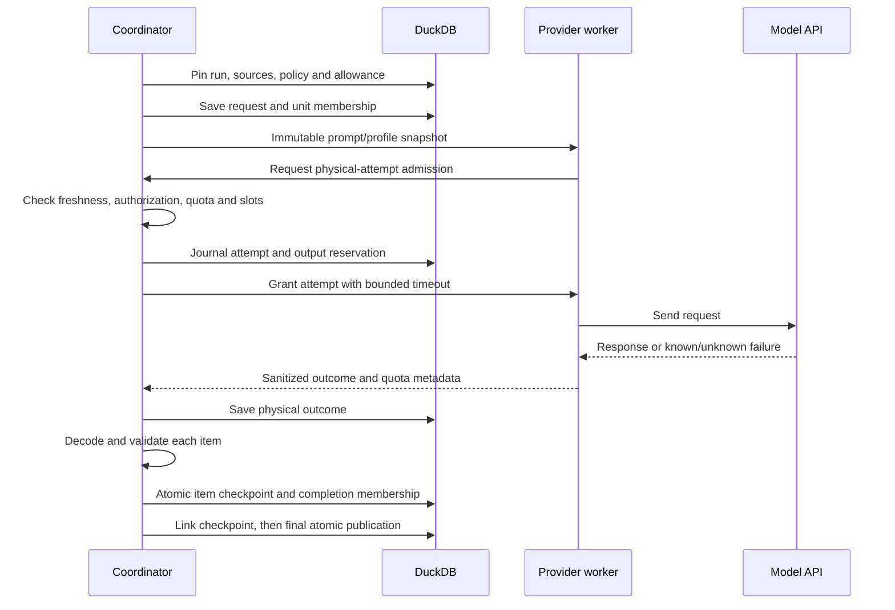

# Resumable AI pipeline architecture

The shared `analysis_service` coordinates the UI, CLI and MCP. It extends the
existing DuckDB evidence store and graph materialization; it introduces no agent
framework, graph database or vector index. Static SQL/SAS/dbt algorithms remain
unchanged. Read the [user flow](../user-guide/ai-analysis-flow.md) first.

## Ownership and dispatch

Workers have no Store, transaction, Streamlit state or mutable shared execution
ledger. A message/event bridge returns admission to the owning thread. The owner
keeps servicing admissions while other responses are outstanding, avoiding a
worker-waits-for-owner deadlock. Request slots retain the existing workspace
range 1–4 and process cap 8; background analysis jobs retain their separate cap 2.

Provider work runs outside database transactions. Final publication rechecks the
complete inventory/configuration pin, original bytes and prior publication before
committing normalized facts, accepted snapshots, support and dbt project rows.

## Durable state

Schema migration 9 adds four tables, alongside existing run/unit/claim/support
and source-referenced accepted snapshots:

| Table | Purpose |
| --- | --- |
| `ai_analysis_requests` | Batch identity, unit membership, planned/partial/completed state. |
| `ai_analysis_attempts` | Independent physical dispatch identity, output reservation, received/known-failure/unknown outcome and sanitized quota feedback. |
| `ai_context_dependencies` | Original and relevant context resource hashes/scopes for each planned unit. |
| `ai_link_checkpoints` | Accepted-input fingerprint and bounded deterministic linking report. |

Records contain bounded JSON and immutable source references rather than copied
source bodies per attempt. Full provider history remains privacy opt-in. Cleanup,
integrity inspection and backup/restore include the new tables; older supported
backup schemas remain readable. Rollback uses a pre-upgrade backup/new home rather
than a destructive down-migration.

A received response with no completed item checkpoint remains an uncertain recovery
boundary. Explicit retry acknowledges that it may already have been billed. Unit
completion is idempotent within its run; this does not imply provider billing is.

## Context, batching and reuse

SQL and SAS prefer complete lexical/semantic boundaries. Oversized source or context
falls back to host-issued source/context views with exact ranges and bounded original
anchors. These views are partial evidence, never reconstructed executable statements;
every interval/context record remains assigned to a saved task. dbt context uses safe
existing project/resource/artifact readers, preserving root, package, version and
source/artifact origin. Prompts contain source declarations and supplied artifacts,
never computed static lineage answers. Python/Jinja/hooks are inspected as data.

Full system instructions, schema, visible source, expression references, context and
reserved output count toward model capacity. The source-character allowance measures
source and disclosed project/settings context separately; protocol overhead cannot
consume this allowance. `AnalysisRequest.max_context_chars` optionally replaces saved
workspace/profile character allowances for one build; it cannot override model token
limits or disclosure permissions. A versioned batch envelope wraps existing
single-unit contracts, with at most eight items. Each item must use its own host ID
and evidence. Good items survive missing/malformed siblings; truncated unparseable
responses establish no partial success. Smaller fallbacks replan pending work.

Per-unit reuse keys include source identity, relevant context, settings, prompt,
validator and parser compatibility. The separate complete publication pin still
rejects any stale inventory/configuration. Context lookup indexes avoid scanning
the entire catalog for every unit. Dispatch checks use a compact inventory revision;
final publication verifies immutable source bytes again.

Planning also bounds expected expression slots and visible dependency names;
repeated UNION branches cannot evade response limits merely by sharing names.
Only source work is subdivided for output pressure. Context is divided when it
contributes to a request-capacity failure, avoiding needless source/context
combinations. An irreducible minimum-envelope probe stops before per-character
expansion when the chosen model or explicit allowance cannot fit the protocol.

Extraction wire4/prompt6 supports `fragment` derivations and partial expression
references. Validated components retain identity, inputs and exact covered ranges
in the existing unit checkpoint. Canonical local facts can exceed the wire's
100-input/20,000-expression-character bounds; individual model responses retain
those bounds. `ai_composition.py` requires complete range coverage, unions inputs
and validates the full result against the original parent. This is host work;
the prompt never receives the parser's calculated dependencies. Both normal and
component validation use the same supported UPDATE/MERGE verifier.

Review wire2/prompt4 addresses exact source references and one-input dependency
components. Completed component decisions persist independently. Composed facts
are rebuilt after review and never re-reviewed as a single oversized candidate.
One original-parent reconciliation avoids repeatedly comparing the full parser
result for every source view. Large exact expressions use immutable source spans
in checkpoints, final reports and accepted snapshots, with bounds checked on
rehydration. Existing stored inline expressions remain readable.

## Quotas and allowances

Model capacity and provider quotas are separate. A process-wide quota registry
coordinates explicit non-secret groups or conservative endpoint scopes. It admits
request and input/output-token buckets independently; response limits/reset hints
and Retry-After are advisory and sanitized. Saved feedback is restored on Resume.
Unknown gateway upstream/account quotas are not inferred from the advertised model.

Every physical attempt, retry and fallback reserves output and increments the
lifetime ledger. Window rollover does not reset that ledger. Bounded repair and
targeted resolution draw from the same finite project allowance. Cooperative
provider waits are separated from active execution time. Source or permission
changes during a wait are checked again before disclosure.

## Stored-fact linking and publication

Linking indexes validated operations, assets and fields by scope and explicit dbt
identity. It preserves value/filter/join/order/partition/rowset roles, reports
multiple writers without proven order, deduplicates links and finds strongly
connected components. It does not enumerate all transitive pairs or infer order
from filenames. The table and column views share the same published snapshot.

Uncertain extraction can receive at most two targeted follow-up rounds, stopping
when no new validated fact appears. Previously accepted facts cannot be promoted
by model confidence or reviewer agreement. AI-only publication omits unmatched
static data-flow edges while retaining structural dbt inventory and typed resource
context. Supplied compiled-expression mappings and dynamic/Python semantics without
supported original evidence remain explicitly partial.

Qualification uses deterministic mock providers and independent semantic gold.
Mock scale results prove accounting/recovery behavior, not live model precision.
See [Testing](../TESTING.md) and [Performance](../PERFORMANCE.md).
