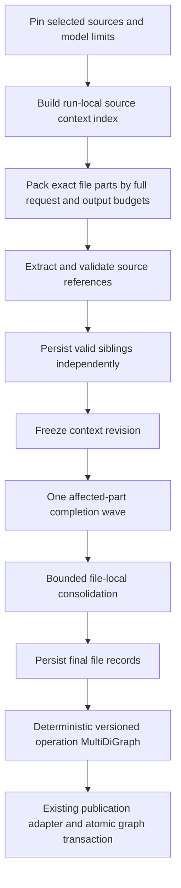

# File extraction pipeline

Protocol 5 supersedes the resumable window/adaptive focus designs. The application
owns request fitting, source integrity, persistence, linking and publication; AI
owns semantic extraction. Static analysis remains independent.

`analysis_service.run_analysis` is the UI/CLI/MCP coordinator. Singleton, batch,
completion and consolidation work share its request/attempt journal and spending
ceiling. No database transaction spans network I/O. No static parser results are
used to approve new AI extraction.

`ai_analysis_models` defines versioned source/part/file/operation/context records.
`ai_context` pins snapshots and plans exact ranges. `ai_context_index` supplies
scoped, authorized definition evidence and freezes bounded completion work.
`ai_budget` checks the actual serialized provider payload. `ai_batching` prepares
one stable instructions/schema prefix and an items envelope. `ai_validation`
checks source integrity independently of legacy semantic validation.

Existing DuckDB run/unit/request/attempt tables store part and file results.
Original part details survive refinement and failure. Historical snapshots and
migration-9 tables remain registered for maintenance/backup.

`ai_linking.build_operation_graph` rebuilds a NetworkX MultiDiGraph from saved
records. Resource versions and operations are explicit nodes; role/evidence edges
remain distinct. `upstream_operations` returns the selected target's dependencies,
external inputs, uncertainty and cycles. Ambiguous order is never advertised as
an executable plan. `to_publication_results` adapts these resolved identities to
the existing publication shape. No provider access or generation occurs in linking.

See [AI analysis](../AI_ANALYSIS.md) for capacity, disclosure, recovery and accuracy
boundaries. Mock transport results are separate from pending live-model evaluation.
