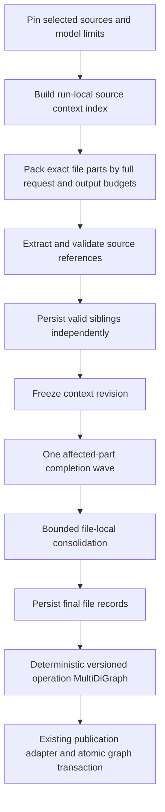

# File extraction pipeline

Protocol 5 supersedes the resumable window/adaptive focus designs. The application
owns request fitting, source integrity, persistence, linking and publication; AI
owns semantic extraction. Static analysis remains independent.

`analysis_service.run_analysis` is the UI/CLI/MCP coordinator. Singleton, batch,
completion and consolidation work share its request/attempt journal and spending
ceiling. No database transaction spans network I/O. No static parser results are
used to approve new AI extraction.

`ai_analysis_models` defines versioned source/part/file/operation/context records.
`ai_context` pins snapshots and plans exact ranges. `ai_context_index` supplies
scoped, authorized definition evidence and freezes bounded completion work.
`ai_budget` derives deterministic model-aware allowances from the run's pinned
output share/exact overrides and checks the actual serialized provider payload.
Shared context reserves safety/applicable reasoning once, while separate windows
keep input independent. Legacy checkpoints retain their original policy; dynamic
routes need manually confirmed safe capacities. `ai_batching` prepares
one stable instructions/schema prefix and an items envelope. `ai_validation`
checks source integrity independently of legacy semantic validation.

`ai_extraction_recovery` supplies safe failure metadata, bounded source subdivision
and cancellable waits. Pending item state, feedback, delays and split ancestry live
in the existing run summary; per-request diagnostics live in the existing journal.
Passes have finite HTTP/transport attempts, rotate failed items behind other work,
and retain every unknown outcome/reservation. After three unsuccessful item passes,
required work is saved with `unresolved` status and a host-owned partial extraction;
available validated details publish with explicit incomplete coverage. Initial fitting
also checks a bounded corrective-feedback envelope through the same request builder.
Resume rehydrates exact pinned definition IDs/evidence/fingerprints, independent of
any newly calculated source-part boundaries. Consolidation groups across files share
one pending set, so a failing file does not block later file work.
Consolidation membership is frozen before dispatch as hashes referencing saved
operations. Existing checkpoints recreate their original group fitting once before
freezing it, so completed groups and explicit supersessions are not repeated.

Initial required failures defer freezing the single completion wave; initial or
completion failures defer consolidation until repair. Partial views can retain
unconsolidated details rather than freeze incomplete inputs. An explicit retry of
a committed partial run renews only unresolved items' bounded pass allowance and
reuses successful checkpoints. Attempts/spending remain cumulative. Its freshness
pin accepts its own partial publication, while any other publication/source/config
change still blocks continuation. Reports persist unresolved item and unprocessed
initial-file counts separately from semantic coverage gaps.

Each initial wire request is built fresh from stable instructions/schema, current
source parts and relevant definitions. No preceding response/history/continuation ID
or growing summary is included. The same builder supplies planning and dispatch;
safe packing diagnostics record counts, estimates, allowances and stopping reasons.
The existing conservative output estimate and unknown-tokenizer counter remain.

Existing DuckDB run/unit/request/attempt tables store part and file results.
Original part details survive refinement and failure. Historical snapshots and
migration-9 tables remain registered for maintenance/backup.

`ai_linking.build_operation_graph` rebuilds a NetworkX MultiDiGraph from saved
records. Resource versions and operations are explicit nodes; role/evidence edges
remain distinct. `upstream_operations` returns the selected target's dependencies,
external inputs, uncertainty and cycles. Ambiguous order is never advertised as
an executable plan. `to_publication_results` adapts these resolved identities to
the existing publication shape. No provider access or generation occurs in linking.

See [AI analysis](../AI_ANALYSIS.md) for capacity, disclosure, recovery and accuracy
boundaries. Mock transport results are separate from pending live-model evaluation.
