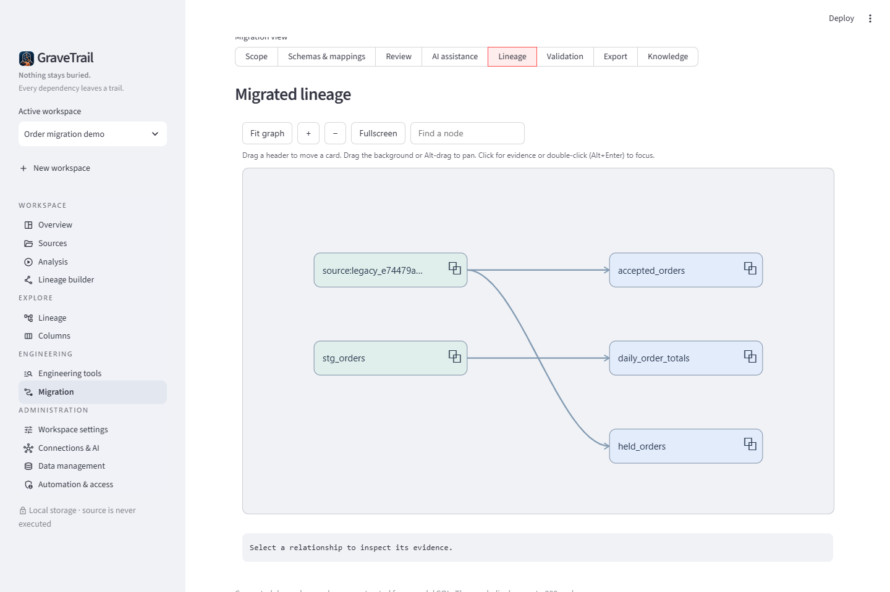

# Migration architecture

The Migration page uses the existing workspace Store, job journal, provider connections and
request budgeting. The migration service has no warehouse client or dbt runtime dependency.
The CLI and MCP adapters call the same services through the workspace agent policy. Artifact
downloads recheck source access. Provider dispatch additionally requires launch authorization and
the exact disclosure pin. Setup, edits, validation and export remain revision-bound.

The guided AI run inventories source regions and dependency bindings without emitting static drafts.
Each provider conversion covers one retained file and its mapped dbt models. Source comparison
requires an assessment for each included nontrivial region and saves separate static check results.
The project checkpoints conversion, comparison and optimization before an engineer applies the
combined diff. A static draft can be generated as request evidence when the engineer includes it.

`dataforge.migration.engine` plans outputs and source obligations before writing candidates.
Source-specific rules live in `sources.py`. SQLGlot parses and generates SQL with explicit dialects.
The emitter replaces recognized AST table references with literal dbt references. Independent
inspection uses inert table tokens and checks dependencies, output accounting, schema provenance,
cycles and generated graph edges. Unsupported semantics stay review findings. Unsupported or
unavailable sources stay visible in the inventory and coverage. A small registry and warehouse
adapter own the compatibility profile, dialect, materializations and type mapping.

<figure class="gt-product" markdown>

<figcaption>The Lineage view renders the dependencies extracted from dbt drafts. The pinned analyzed lineage is shown separately below the migrated evidence.</figcaption>
</figure>

See the [recorded migration walkthrough](../user-guide/migration.md#watch-the-workflow) for the
source scope, review findings and pilot that produced this graph.

T-SQL temporary writes stay scoped to the pinned source script. Only an earlier, single local
`SELECT INTO` with a clear lifetime can supply an ephemeral model dependency. Materializing SQL
statements resolve against preceding local writes, with earlier relation versions requiring a
confirmed source mapping. SAS `WORK` writers resolve in their pinned script and use the same names
as analyzed lineage. SAS ordered steps record their input binding and source requirements during
inventory. The engineer supplies the tie-breaking order through a revision-checked SQL proposal.

Schema version 11 adds four workspace-owned tables. Project rows point at immutable revisions.
Source rows retain compressed decoded evidence and the snapshot retains original byte hashes,
encoding and admission metadata. Revision rows hold the plan, candidate files, schema decisions
and review bindings. Activity rows hold bounded request attempts, scoped responses, job references
and approved lesson versions. Workspace cleanup removes the migration rows. Source cleanup leaves
migration evidence intact, and the existing database backup includes all four tables.

Publication checks the expected revision inside one DuckDB transaction. Provider calls take place
outside transactions. Each explicitly dispatched physical attempt reserves capacity before sending.
An unknown outcome keeps its reservation across restarts. The current release uses one attempt per
explicit dispatch and allows retry of a prepared request within the cumulative project budget.
No response can publish code directly.

Static conversion checkpoints completed model lowering in bounded batches. Retrying the same
revision rebuilds inventory from the pinned snapshot and reuses completed model SQL and bindings
from the same converter version. Successful publication removes the temporary checkpoint records.
Reconversion uses the same job and checkpoint flow from an already converted revision. The new
static draft uses the embedded source snapshot and pinned target profile. Earlier plans, edits,
settings and reviews remain in revision history and can be restored as a new revision.

New handoffs pin [dbt Core 1.12.5](https://pypi.org/project/dbt-core/1.12.5/) and
[dbt-databricks 1.12.8](https://pypi.org/project/dbt-databricks/1.12.8/). Existing 1.10.13
profiles remain resolvable on their original projects. These versions identify the external
installation target and static output format.

The Validation view stores confirmed dbt tests and reconciliation plans in a revision. Uploaded
dbt artifacts are checked against the revision environment marker, invocation, model text,
target and source bindings. Activity rows keep bounded summaries and artifact digests. Compile,
build and model-test observations are distinct from engineer acceptance and legacy equivalence.
Reconciliation uploads bind aggregate and keyed metrics to the revision, plan fingerprint, and run
stage. Incremental comparisons record initial-load and repeat-run results. Activity rows store
bounded numeric evidence and computed outcomes. A partial upload leaves coverage incomplete.
Pilot exports take dependency closure from the fully validated project graph. Source comparisons
follow the packaged model scope. Full source text is an opt-in artifact stored outside the model tree.
