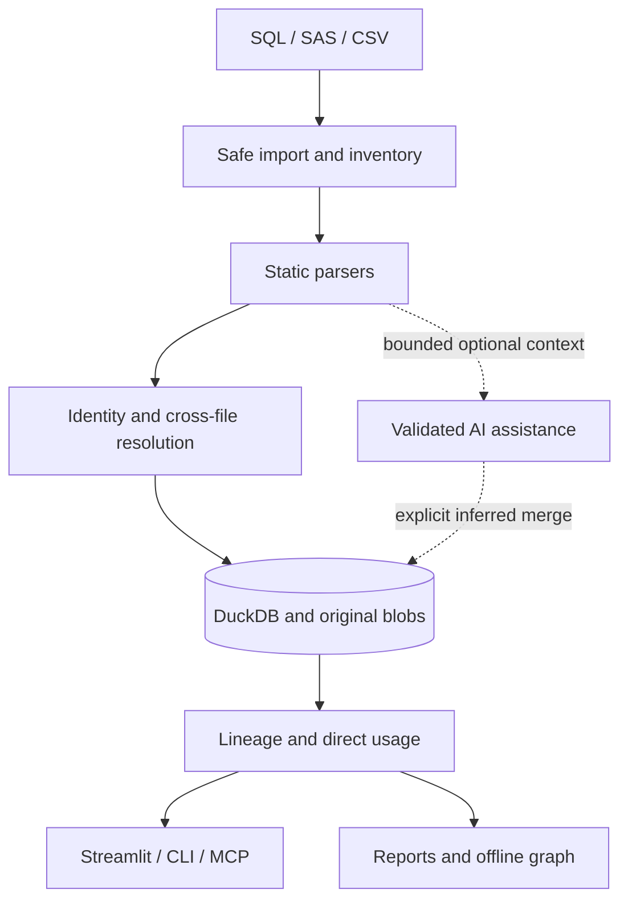

# How GraveTrail works

GraveTrail keeps presentation separate from parsing, storage and investigation. The UI,
CLI and MCP adapters call shared services. No imported SQL, SAS or CSV content is executed.

| Question | Reference |
| --- | --- |
| Where do services, UI and persistence belong? | [System architecture](../ARCHITECTURE.md) |
| How are originals, operations and evidence versioned? | [Data model](../DATA_MODEL.md) |
| How are assets resolved and temporary steps collapsed? | [Lineage engine](../LINEAGE_ENGINE.md) |
| Which SQL constructs are supported? | [SQL coverage](../SQL_PARSING.md) |
| What do SAS rules resolve, and what stays uncertain? | [SAS coverage](../SAS_PARSING.md) |
| How are prompts and grounded claims validated? | [Prompt engineering](../PROMPT_ENGINEERING.md) and [LLM integration](../LLM_INTEGRATION.md) |
| What protects imports, secrets and destructive operations? | [Security model](../SECURITY.md) |
| What has actually been measured? | [Performance evidence](../PERFORMANCE.md) |

## Keep the distinction between facts and inference

Asset identity uses stable IDs and namespace/job context, not a global table-name merge.
Ambiguous names stay unresolved. Evidence pins original source hashes and exact line
ranges, so a later import cannot silently replace the statement behind an earlier edge.
Temporary contraction keeps its underlying logical steps and provenance.

Direct column usage reports references to the selected source. The separate
[transformation service](../TRANSFORMATION_LINEAGE.md) follows output/value derivations
with bounded traversal and coverage markers. Wildcards expand only with trustworthy schema evidence.
Logical dependency order does not establish runtime execution order.

For implementation conventions and adding parsers, continue to
[development](../development/index.md).
