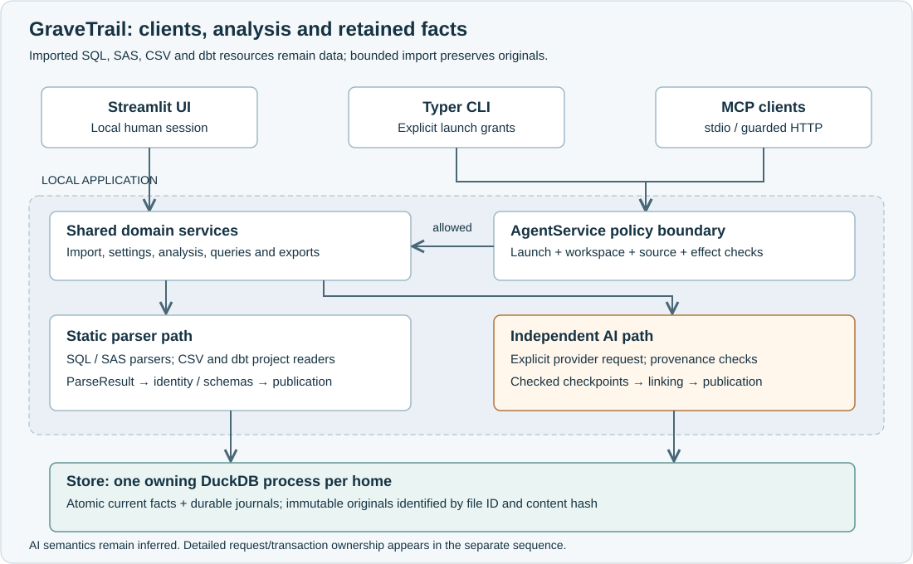
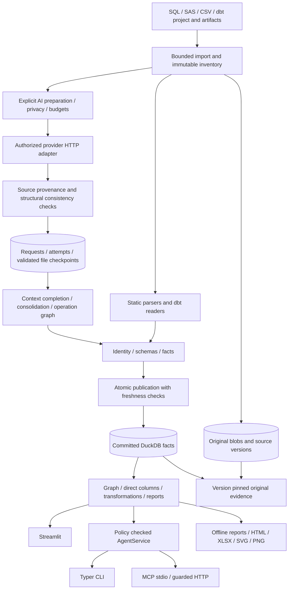
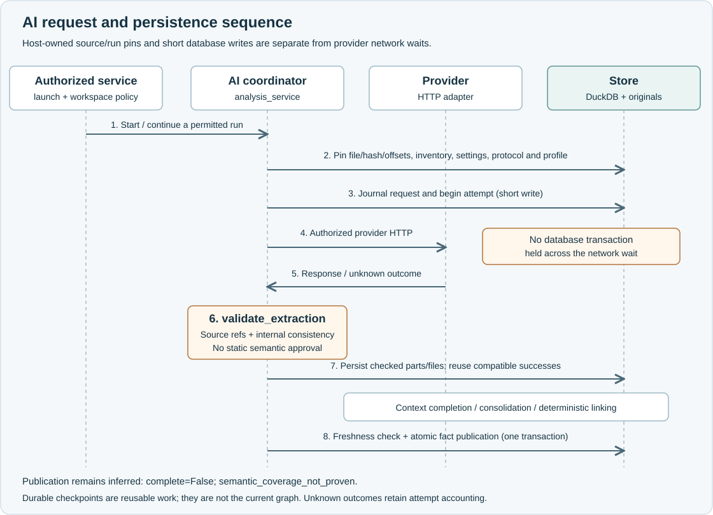

# How GraveTrail works

<!-- Compatibility anchors for sections now linked from this page. -->

GraveTrail imports source text into a local workspace, extracts static or explicitly requested
AI facts, and publishes an evidence-backed graph for investigation. Streamlit, CLI and MCP
reuse services. DuckDB stores inventory, current facts and durable journals; immutable blobs
retain originals. Imported SQL, SAS, dbt Python and Jinja are never executed.

The source baseline for this guide is
[`1864dc8`](https://github.com/SahasilAK/GraveTrail/tree/1864dc8887ac8342a8ef8b369cc8a2e8b5d2e414).
Read the [newcomer walkthrough](../development/getting-started.md) for a runnable local example
and the [subsystem code map](../development/code-map.md) for implementation ownership.

## Components and trust boundaries

The [editable system diagram](../assets/diagrams/system-boundaries.svg) renders offline.
UI presentation calls local services; CLI and MCP pass the shared automation policy first.
Both analysis paths publish through the same Store and retain source versions.

| Boundary | Owner | What crosses it |
| --- | --- | --- |
| Untrusted bytes → retained inventory | [Importer](https://github.com/SahasilAK/GraveTrail/blob/1864dc8887ac8342a8ef8b369cc8a2e8b5d2e414/src/dataforge/ingestion.py), [dbt admission](https://github.com/SahasilAK/GraveTrail/blob/1864dc8887ac8342a8ef8b369cc8a2e8b5d2e414/src/dataforge/dbt/imports.py) | validated relative paths, decoded text, content hashes and import diagnostics |
| Text → parser-neutral operations | [parsers](https://github.com/SahasilAK/GraveTrail/blob/1864dc8887ac8342a8ef8b369cc8a2e8b5d2e414/src/dataforge/parsers/sql.py), [models](https://github.com/SahasilAK/GraveTrail/blob/1864dc8887ac8342a8ef8b369cc8a2e8b5d2e414/src/dataforge/models.py), [dbt](https://github.com/SahasilAK/GraveTrail/blob/1864dc8887ac8342a8ef8b369cc8a2e8b5d2e414/src/dataforge/dbt/service.py) | exact statements, asset references, usages/derivations and coverage |
| Provider content → accepted extraction | [coordinator](https://github.com/SahasilAK/GraveTrail/blob/1864dc8887ac8342a8ef8b369cc8a2e8b5d2e414/src/dataforge/analysis_service.py), [validation](https://github.com/SahasilAK/GraveTrail/blob/1864dc8887ac8342a8ef8b369cc8a2e8b5d2e414/src/dataforge/ai_validation.py) | source-reference bounds/hash checks and internal consistency; no deterministic semantic approval |
| Prepared results → current workspace | [services](https://github.com/SahasilAK/GraveTrail/blob/1864dc8887ac8342a8ef8b369cc8a2e8b5d2e414/src/dataforge/services.py), [Store](https://github.com/SahasilAK/GraveTrail/blob/1864dc8887ac8342a8ef8b369cc8a2e8b5d2e414/src/dataforge/store.py) | one coherent revision of tables, columns, diagnostics and snapshots |
| Stored facts → investigation | [graph](https://github.com/SahasilAK/GraveTrail/blob/1864dc8887ac8342a8ef8b369cc8a2e8b5d2e414/src/dataforge/graph.py), [transformations](https://github.com/SahasilAK/GraveTrail/blob/1864dc8887ac8342a8ef8b369cc8a2e8b5d2e414/src/dataforge/transformations.py), [reporting](https://github.com/SahasilAK/GraveTrail/blob/1864dc8887ac8342a8ef8b369cc8a2e8b5d2e414/src/dataforge/reporting.py) | bounded reads with unresolved/limit/coverage markers |
| External client → permitted operation | [AgentService](https://github.com/SahasilAK/GraveTrail/blob/1864dc8887ac8342a8ef8b369cc8a2e8b5d2e414/src/dataforge/agent/service.py), [policy contracts](https://github.com/SahasilAK/GraveTrail/blob/1864dc8887ac8342a8ef8b369cc8a2e8b5d2e414/src/dataforge/agent/contracts.py) | workspace-scoped validated requests and bounded JSON responses |
| Facts → downloadable artifact | [exports](https://github.com/SahasilAK/GraveTrail/blob/1864dc8887ac8342a8ef8b369cc8a2e8b5d2e414/src/dataforge/exports.py), [artifact service](https://github.com/SahasilAK/GraveTrail/blob/1864dc8887ac8342a8ef8b369cc8a2e8b5d2e414/src/dataforge/artifacts.py) | escaped text/bytes, source disclosure choice, revision and completeness metadata |

## One parser analysis

1. `Importer` validates ZIP entries, directory roots or uploaded relative paths, records source
   inventory and preserves original bytes by content hash. Re-import may update the current
   source record while older originals remain available to prior evidence.
2. `services.analyze` snapshots parsing configuration and uses a cache keyed by parser
   version, content hash, relative path and configuration. Parser workers return `ParseResult`;
   they do not write facts directly. dbt project discovery and resource analysis join the same
   publication path.
3. Asset resolution combines workspace, persistent/temporary lifetime, job/session and supplied
   logical identity. Schema reconciliation expands wildcards only from trustworthy compatible
   declarations. A global table-name match is insufficient.
4. Materialization writes statement/operation/asset/edge/direct-column/derivation/diagnostic
   rows and run snapshots inside one transaction. Failure preserves the preceding graph.
5. Readers construct graphs and reports from committed rows. They do not execute source,
   infer runtime order from logical dependency order or silently analyze new imports.

See [workflow tests](https://github.com/SahasilAK/GraveTrail/blob/1864dc8887ac8342a8ef8b369cc8a2e8b5d2e414/tests/test_workflow.py), [schema tests](https://github.com/SahasilAK/GraveTrail/blob/1864dc8887ac8342a8ef8b369cc8a2e8b5d2e414/tests/test_schemas.py),
[job identity tests](https://github.com/SahasilAK/GraveTrail/blob/1864dc8887ac8342a8ef8b369cc8a2e8b5d2e414/tests/test_job_identity.py) and [boundary contracts](contracts.md).

## One AI analysis

The [editable request and persistence sequence](../assets/diagrams/analysis-sequence.svg)
separates provider HTTP from database transactions. Source and run pins belong to the host;
checked checkpoints and current fact publication have different lifetimes.

Project AI is an explicit parser/AI choice in the current protocol. Preview prepares source
units, context and a model-bound token budget without sending a provider request. Execution
records attempts and durable checked file checkpoints. `validate_extraction` checks strict
shape, pinned source hash, permitted source-reference ranges, operation ownership and internal
identity/conflict consistency. It does not ask the static parser to approve the model's
semantics. Context completion, per-file consolidation and the deterministic operation graph
produce a publication candidate. Freshness and prior
publication checks gate atomic commit. A valid partial publication identifies unresolved
coverage and can retry unresolved work while reusing successful checkpoints. AI publication
remains inferred: the report keeps
`complete=False` and `semantic_coverage_not_proven`, even when the model reports complete coverage.

Cancellation, interrupted transport and unknown upstream response outcomes are distinct
states. Saved checkpoints do not automatically authorize another billable request after an
owner restart. Runtime reasoning is transient; retained request/response inspection is separately
bounded and privacy-controlled. The [AI pipeline architecture](ai-analysis-pipeline.md)
describes the current protocol 5 sequence, recovery and persistence in detail.

Manual focused assistance is a separate workflow: select source lines, preview the exact
redacted request, request a saved validated result, then explicitly merge eligible inferred
claims. Advisory explanations and direct-column advice are not mergeable lineage.

## Evidence and query meaning

An edge retains original file/version, exact statement and coordinates, operation, method,
status and confidence. Re-import must not substitute a newer statement behind an old edge.
Temporary contraction preserves the underlying steps and their evidence. Missing endpoints,
ambiguous assets and traversal budgets produce visible incompleteness.

Direct column usage answers where a source column appears. Transformation tracing answers
how output values/roles derive across operations, with its own bounded coverage. Neither is
a proof of runtime execution order. dbt logical resource identity and generated SQL evidence
also remain distinct from physical table names and original-template evidence.

| More detail | Guide |
| --- | --- |
| Data tables, immutable versions and snapshots | [Data model](../DATA_MODEL.md) |
| Table traversal and temporary contraction | [Lineage engine](../LINEAGE_ENGINE.md) |
| Direct versus derivation columns | [Transformation lineage](../TRANSFORMATION_LINEAGE.md) |
| SQL/SAS coverage | [SQL parsing](../SQL_PARSING.md), [SAS parsing](../SAS_PARSING.md) |
| dbt project/resource/artifact semantics | [dbt support](../DBT_SUPPORT.md) |
| Host validation, credentials and network boundaries | [Contracts](contracts.md), [security](../SECURITY.md), [LLM integration](../LLM_INTEGRATION.md) |
| Older detailed architectural reference | [System architecture](../ARCHITECTURE.md) |
| Verification scope and measured workloads | [Testing](../TESTING.md), [performance](../PERFORMANCE.md) |
