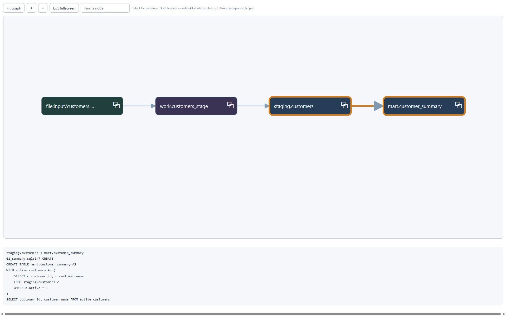

# Interactive lineage example

Follow a customer-summary pipeline through imported CSV, a SAS WORK dataset,
staging and a SQL mart. This application-generated static graph uses tracked
`tests/fixtures/scenario` sources: four assets and three evidence-backed relationships.

*A focused dependency/evidence example, separate from the large SQL tutorial.*

<iframe class="gt-lineage-demo" src="../../assets/examples/lineage.html" title="Interactive customer-summary lineage with source evidence" sandbox="allow-scripts" allow="fullscreen" loading="lazy"></iframe>

[Open standalone graph](../assets/examples/lineage.html){ .md-button }
[Download HTML](../assets/examples/lineage.html){ .md-button download="gravetrail-lineage-example.html" }

## Try the controls

- **Fit graph**, **+** and **−** fit or zoom. Drag the background to pan.
- **Find a node** highlights matching labels; clear search to reset it.
- Select a node or relationship to read details and original evidence below the graph.
- Use a node’s copy icon to copy its full name; double-click inspects its upstream context.
- Use Tab to reach controls, nodes and edges; Enter selects them.
- **Fullscreen** expands the graph when the browser permits it; Escape exits.

Standalone exports have no application navigation callback: double-click/Alt+Enter
cannot change the application asset. They cannot refresh analysis, restore a workspace
or execute source code. Reopen your data home in the app to continue investigating.

## Safe snapshot and offline scope

The supplied desktop export was inspected as a renderer/interaction reference and
left intact. This snapshot was recreated from repository fixtures. It contains safe
relative fixture paths and snippets, no credentials/personal absolute paths, and no
external script/style/image resources. Its content policy blocks network connections;
the iframe isolates its script from the documentation page.

Download HTML before disconnecting. The served example was browser-tested with its
network-blocking content policy and no external resource references. A true browser
offline-switch/local-file check remains unverified: the verification browser does not
expose an offline switch and rejects file URLs. This is separate from local static
analysis and the website, whose Mermaid integration may use external assets.
See [local operation](../concepts/local-and-ai.md).

Update through the [asset workflow](../development/documentation.md). Embedded evidence
and the exact publication digest require review whenever it changes; arbitrary HTML
remains rejected.
