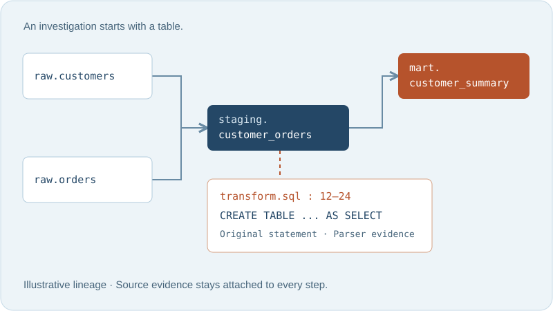

---
hide:
  - navigation
  - toc
---

<div class="df-hero" markdown>
<div class="df-hero-copy" markdown>

# Trace the path.<br>Keep the proof.

Understand the SQL and SAS pipelines in front of you. GraveTrail connects table
dependencies to the original statements, so every investigation has somewhere to start
and evidence to come back to.

[Build your first lineage](getting-started/quick-start.md){ .md-button .md-button--primary }
[Explore the guides](user-guide/index.md){ .md-button }

Local-first. No LLM required. Imported code is never executed.
{ .df-caption }

</div>
<div class="df-hero-visual" markdown>



</div>
</div>

## Start with the question you need to answer

<div class="df-questions" markdown>
<div markdown>

### Where did this table come from?

Import SQL/SAS scripts, analyze the project, and follow upstream dependencies through
persistent and temporary stages. Inspect the statement behind each edge.

[Lineage builder and explorer](user-guide/index.md)

</div>
<div markdown>

### What changes if I edit it?

Trace downstream impact, inspect direct column references, and search related source.
Share your findings as reports or a standalone interactive graph.

[Investigation and exports](USER_GUIDE.md)

</div>
<div markdown>

### How can my tools query it?

Use the CLI or MCP to query stored analysis with explicit permissions, freshness
metadata, pagination, and bounded responses. Retrieve original source only when needed.

[CLI, MCP, and provider integrations](integrations/index.md)

</div>
</div>

## One project, one useful first run

```sh
git clone https://github.com/SahasilAK/GraveTrail.git
cd GraveTrail
uv sync --locked --extra dev
uv run gravetrail-ui
```

Requires Python 3.11+ and [uv](https://docs.astral.sh/uv/getting-started/installation/).
Open [127.0.0.1:8501](http://127.0.0.1:8501). Try one of the supplied SQL/SAS project ZIPs:
the [first-lineage walkthrough](getting-started/quick-start.md) traces `pub.all_kpis`
through seven layers to sixteen source tables.

Using pip, a container, or a native bundle? The [installation and operations reference](SETUP_AND_DEPLOYMENT.md)
explains each option and its verification limits. There is no assumed public binary release.

## Choose your next step

| Your goal | Read this |
| --- | --- |
| Set up a workspace and get results | [Getting started](getting-started/index.md) and [configuration](getting-started/configuration.md) |
| Explore evidence, direct columns, and exports | [User guide](user-guide/index.md) |
| Configure automation or optional AI | [Integrations](integrations/index.md) |
| Understand resolution rules and data structures | [Architecture](architecture/overview.md) |
| Install, build, back up, or publish these docs | [Deployment](deployment/index.md) |
| Add a parser, fix a bug, or improve a guide | [Development](development/index.md) |
| Recover from an error | [Troubleshooting](troubleshooting/help.md) |

!!! info "Evidence includes uncertainty"
    GraveTrail performs static analysis. Unsupported syntax, dynamic macros, and ambiguous
    identities remain diagnostic boundaries. AI-assisted claims remain inferred after
    explicit validation and merge. Start with [SQL](SQL_PARSING.md) and [SAS](SAS_PARSING.md)
    coverage before drawing conclusions from missing edges.
