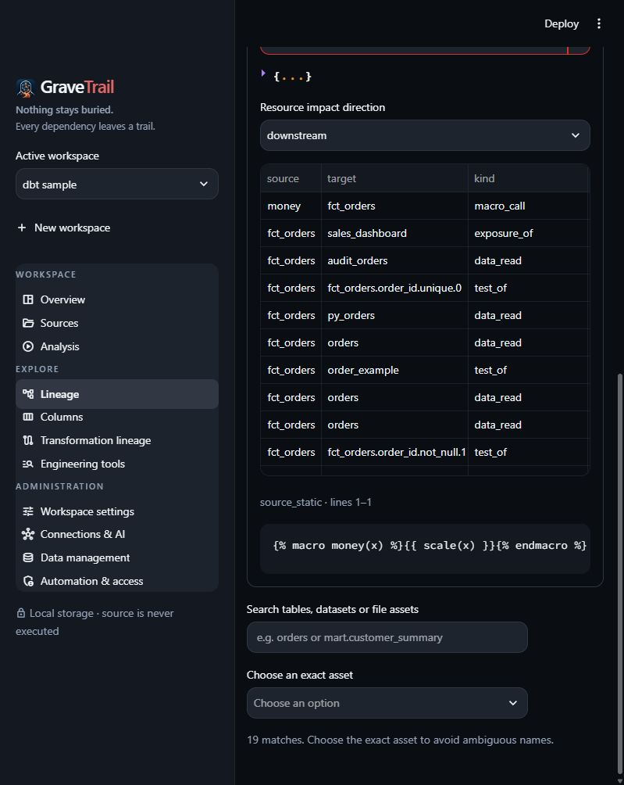

# Analyze a dbt project

GraveTrail reads dbt source files and supplied artifacts to build evidence-backed lineage.
It does not need a warehouse connection, run `dbt`, evaluate imported Jinja/Python or fetch
packages. This workflow describes source checkout **`1864dc8`**; dbt support is newer than
the published **v0.0.1** release. See [installation](../SETUP_AND_DEPLOYMENT.md#4-python-installation).

Use the [retail example](../examples/dbt.md) to try this with synthetic files. The
[dbt support reference](../DBT_SUPPORT.md) defines exact coverage and artifact contracts.

## Prepare the input

Keep `dbt_project.yml` beside the resource directories it configures. Import a project
directory, a ZIP preserving paths, or a browser-selected folder. A ZIP may contain an
enclosing folder or several independent dbt roots. Root/package/version identity prevents
same-named models from merging.

Check these before importing:

- Include SQL models and their property/source YAML, macros, seeds, snapshots, tests and
  docs from configured paths. Custom `model-paths`, `macro-paths` and other resource paths
  must be literal relative paths.
- If qualified package references matter, include already-installed package code and enable
  **Include supplied package sources**. `packages.yml` alone cannot resolve package models.
- Keep credentials out of the input. Profiles, dotfiles and logs are excluded. GraveTrail
  never reads credentials from dbt profiles to compile or query the warehouse.
- If using artifacts, obtain a matching manifest outside GraveTrail. Identify its exact
  import-relative path, such as `retail/target/manifest.json` inside a ZIP.

## Import and choose evidence

In **Sources**, choose project type **dbt project**, then select the input method.
For host-directory import, configure an allowed root containing the directory. Review the
import result and diagnostics before moving to Analysis.

| dbt mode | Use it when | Expect |
| --- | --- | --- |
| **source** | You have project files and want offline static inspection | Literal refs/sources, resource inventory, parseable model columns; partial macro/dynamic SQL coverage |
| **enriched** | You have source plus a matching generated manifest | Declared artifact DAG and available compiled model expressions; known raw-model mismatch blocks publication |
| **artifact** | You have a manifest without original project files | Resource/DAG evidence from exact JSON slices; original repository source is unavailable |

Generated target files are excluded unless selected. Choose the manifest path explicitly;
do not assume a retained artifact has become the selected analysis context. Catalog v1 and
run-results v6 can enrich a selected manifest v12 if their context matches. Freshness and
semantic artifacts are retained evidence only. See [artifact compatibility](../DBT_SUPPORT.md#artifacts-and-evidence).

## Build and inspect

Open **Analysis → Run**, leave **Use AI for analysis** unchecked and choose **Analyze all files**
(or **Analyze selected** for a selection). Selecting any dbt member includes its project
closure, so YAML/macro changes invalidate dependent results even when model SQL is
unchanged. Reimport external edits before rebuilding. Unchanged projects reuse committed
results; clearing parse cache alone does not delete the normalized dbt result.

Open **dbt projects and coverage** to inspect the evidence mode and completeness. Partial
dependencies or columns are expected when the project contains runtime Jinja, macro-built
SQL or Python models. A completed build means the analysis operation finished; it does
not certify warehouse execution or full semantic coverage.

Then inspect the result from several views:

1. In **Lineage**, select a logical model such as `fct_orders`. Follow upstream/downstream
   data assets. Ephemeral models remain visible logical nodes.
2. Expand **dbt resources and macro impact**. Select the root and resource, then choose
   downstream or upstream impact. A macro's downstream consumers are typed relationships,
   separate from table-to-table lineage. Test, exposure and semantic attachments also live
   here. The resource list has paging; large dependency previews require CLI/MCP paging.
3. Read the selected resource's metadata and evidence. Source facts use original source
   slices. Artifact facts show origin and JSON Pointer; compiled expressions retain
   `compiled_sql` origin rather than claiming original Jinja text.
4. In **Columns** and **Transformations**, inspect parseable model projections and expression
   evidence. YAML descriptions are documentation, not a complete physical schema. Python
   models provide literal dependencies without DataFrame column derivations.

Use exact IDs when several roots/packages or versions share a name. `ref('orders')` can
resolve to YAML `latest_version`; `ref('orders', v=1)` pins a version. Inspect resource
version and asset ID instead of interpreting the display name alone.

## Optional project AI

Static parsing works without AI. To use AI, configure a provider in Settings, choose the
project AI build and review the disclosed files and token estimate first. Selecting a dbt
member includes its project context, including YAML and macro/context-only files.
Project requests send exact original parts/definitions; the manual range-assistance
redaction step does not sanitize them. Review [source disclosure](../SECURE_CONFIGURATION.md#project-ai-disclosure-and-revocation)
before authorizing provider access.

AI extraction publishes its validated inferred facts independently. Parser results do not
fill omitted AI edges. Partial AI coverage, dynamic Jinja and unsupported Python semantics
remain visible limits. Hybrid comparison is unavailable in this checkout; a later explicit
parser build is a separate operation. Manual range assistance does not accept dbt files.
Follow the [AI analysis workflow](../user-guide/ai-analysis-flow.md) for authorization,
saved progress and retry behavior.

## CLI and MCP

Use one process owner per home. Stop the UI/MCP owner before an independent CLI accesses
that home, or use a dedicated home. The following PowerShell example runs from the source
checkout after installation; replace the paths and use the returned workspace ID.

```powershell
$gtHome = 'D:\GraveTrail\dbt-review-home'
$inputRoot = 'D:\Projects'
$project = 'D:\Projects\retail'
$created = gravetrail --home $gtHome --json --allow-write workspace create 'dbt review' | ConvertFrom-Json
$workspaceId = $created.workspace_id

gravetrail --home $gtHome --json --allow-write --allowed-root $inputRoot ingest $project --workspace $workspaceId --source-kind dbt
gravetrail --home $gtHome --json --allow-write lineage build --workspace $workspaceId
gravetrail --home $gtHome --json dbt projects --workspace $workspaceId
gravetrail --home $gtHome --json dbt resources --workspace $workspaceId --resource-type macro
gravetrail --home $gtHome --json lineage validate --workspace $workspaceId
```

From the returned resource IDs:

```powershell
gravetrail --home $gtHome --json --detail detailed dbt resource RESOURCE_ID --workspace $workspaceId
gravetrail --home $gtHome --json dbt dependencies RESOURCE_ID --workspace $workspaceId --direction downstream --kind macro_call
```

For source plus artifacts, add `--dbt-mode enriched --artifact-path target/manifest.json`
to ingest. For a standalone manifest use `--dbt-mode artifact` and its exact relative path.
Use `--include-packages` only for supplied package code. The dbt importer uses configured
resource paths rather than the ordinary SQL/SAS/CSV extension selection.

MCP exposes the same reports through `list_dbt_projects`, `list_dbt_resources`,
`get_dbt_resource` and `trace_dbt_dependencies`. Import with `ingest_sources`,
`source_kind="dbt"` and `dbt_options` such as
`{"mode":"enriched","artifact_paths":["target/manifest.json"],"include_packages":false}`.
Mutation requires launch and workspace write access, and imports require an allowed root.
Detailed evidence requires source access. Observe `analysis_current`, `complete`,
`depth_boundary` and `next_cursor`; fetch every needed page.
See [CLI integration](../CLI_GUIDE.md) and [MCP integration](../MCP_INTEGRATION.md).

## Export and recover

The normal graph, path and source exports work for dbt logical assets. For example:

```powershell
gravetrail --home $gtHome --json --allow-write export graph fct_orders --workspace $workspaceId --format html --output .\dbt-lineage.html
gravetrail --home $gtHome --json --allow-write export lineage fct_orders --workspace $workspaceId --format json
```

Use a new output filename; exports do not overwrite existing files. The HTML command
downloads the artifact, while the JSON lineage command returns a stored result ID.
Inspect graph boundaries and coverage before sharing an export. Evidence integrity
validation confirms retained source ranges, not runtime correctness.

Failed/cancelled parser publication retains the prior graph and catalog. A raw-source
mismatch calls for a matching supplied manifest or source mode. Missing resources usually
require checking import paths, enabled config or package inclusion. Consult
[dbt troubleshooting](../DBT_SUPPORT.md#troubleshooting) and
[upgrade/recovery](../DBT_SUPPORT.md#upgrade-and-recovery) for the remaining cases.



*Source-mode retail sample: macro consumers are typed resource relationships; code is never executed.*
