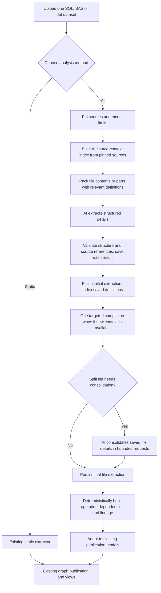

# Optional AI lineage: branch review and refactoring plan

> Approved implementation guide: use `superpowers:executing-plans` to execute tasks in order against the combined working state. The user's confirmed 2026-10-24 context-management design supersedes earlier budgeting and recovery guidance below.

**Goal:** Let a user upload one SQL, SAS, or dbt dataset, choose static or AI lineage, and obtain the existing lineage views from persisted file extraction results, with explicit incomplete coverage when bounded recovery cannot finish required work.

**Architecture:** Batch actual file contents with bounded relevant context, extract structured operations and facts, and persist each result. An AI-only source-context index supplies definitions and supports bounded completion of extractions missing context; split files may also require consolidation. Deterministic code combines the saved results into an evidence-backed operation graph and existing lineage views. There is no project-wide model call.

**Tech stack:** Reuse Python, Pydantic, DuckDB, NetworkX, SQLGlot, HTTPX and Streamlit. Add optional `tiktoken` support for known matching models; add Hugging Face `tokenizers` only when a supported configured model requires its matching tokenizer. No agent framework, vector database, distributed queue, or second graph store.

**Revision:** Updated 2026-10-24 for deterministic model-aware input/output allocation, independent requests and bounded recovery with retryable partial publication. Refactor the combined committed and uncommitted working state of this branch; do not reset the checkout to the review HEAD. Historical review findings remain below; implementation evidence belongs in the companion results document.

**Spec:** The user’s instructions in this conversation, recorded in section 2, supersede the older resumable-pipeline design wherever they disagree. The user explicitly approved a file-level AI pass over saved details when a file requires multiple requests.

## 1. Review scope and confidence

- Reviewed branch: `codex/resumable-ai-lineage`, HEAD `18c7013561618ab8fcc8e148b0626aea394ec47d`.
- Comparison: merge base with local `origin/main`, `a669b9ab326bd82d36d86e89ae7d5fb7f7cf2166`. No remote fetch was needed for this local review.
- Considered both committed changes and the current uncommitted AI-context changes, as requested. Existing edits must be preserved until their replacement is deliberately implemented.
- Source inspection was restricted to branch-changed files, plus the uncommitted changed test `tests/test_ai_analysis_context.py`. Referenced unchanged modules were not opened. The plan identifies integration checks that require inspecting them during implementation; it does not claim those contracts have already been verified.
- This is a static architecture/code review, not a test-run report. No provider requests, imports into a user workspace, application code changes, or database mutations were made.
- Findings below cite functions as stable navigation anchors; line numbers would change as the uncommitted work evolves.

## 2. Required behavior and deliberate simplifications

### Confirmed requirements

1. AI is optional. Static analysis remains available without a model connection.
2. Selecting AI means AI builds the lineage details, rather than the static parser deciding which AI findings are allowed.
3. One upload/build contains one analysis family: SQL, SAS, or dbt. A dbt project naturally includes SQL, YAML, macros, Python, seeds, and supplied artifacts; those are still one dbt dataset.
4. Admin model setup captures usable context size, input/output limits, and relevant provider information. The application calculates request sizes.
5. Handle 1,000+ files without sending the entire project in one request.
6. Send one or several files when they fit; split a file when it does not fit. Never truncate source to an arbitrary character prefix.
7. Persist extracted details as work completes. Capture table inputs/outputs, columns, transformations, references, source locations, and uncertainty needed to build lineage.
8. After extraction, logically combine saved details to generate the same kinds of lineage views as the static path.
9. **User-approved clarification:** an oversized file may receive an AI consolidation pass over its saved extracted details before deterministic cross-file linking.
10. Keep the implementation and user controls simple.
11. Token efficiency and semantic accuracy must be evaluated together; merely fitting all content into the context window is insufficient.
12. Preserve reusable transformation details for a later feature that generates SQL for a selected final table and may simplify intermediate steps. **Do not implement SQL generation, migration or optimization now.**

### Proposed implementation choices

These are recommendations, not additional requirements attributed to the user:

- Two normal build choices: **Static parser** and **AI-assisted**. Remove automatic parser comparison and additional review from the new build flow.
- One provider request at a time initially, using the existing background-job mechanism. Token-based batching provides throughput without a custom parallel coordinator. Preserve application-wide request-slot controls shared with other AI operations.
- Keep resume, cancellation, source/configuration freshness checks, and atomic publication. They are useful for large uploads and do not require execution-window machinery.
- One run-wide optional output-token spending ceiling; no per-window budgets or automatic window rollover. Provider request timeouts and bounded retries remain internal settings.
- Do not introduce cross-run incremental dependency caching in the first refactor. Reuse completed work within the same compatible run. Relinking saved results requires no AI.
- After bounded recovery, publish available validated details with explicit unresolved work and incomplete coverage. Never turn failed extraction into `no_operations` or a complete result. Fatal errors, stale inputs and unaccounted missing checkpoints preserve the previous graph.
- Do not promise that sending every source byte proves every semantic relationship was discovered. Track processing coverage separately from semantic uncertainty.
- Add a small AI-only source-context index using existing source snapshots and extraction records. This is scoped identifier lookup, not GraphRAG or a second knowledge store.
- Persist versioned operation/dependency records with evidence, and use existing NetworkX tooling for graph traversal. Static analysis must not depend on the new AI index or tokenizers.
- Allow one targeted completion wave after initial extraction, only for affected records whose missing context has become available. This complements file consolidation; it does not reintroduce repeated generic resolution/reviewer loops.

## 3. Findings in the current branch

| Priority | Evidence in changed files | Why it conflicts with the objective | Planned action |
| --- | --- | --- | --- |
| High | `ai_validation.py::validate_project_response` obtains `operation_contexts`; assets, relationships, usages and derivations must match parser operations or the narrow `_bounded_dml` verifier. `ai_composition.py::validate_fragment` also matches parser-derived records. | The AI mode remains constrained by locally recognized semantics. Source-backed AI discoveries beyond those recognizers are rejected/unresolved. | Separate structural/evidence validation from semantic inference. Accept valid, traceable AI facts as **inferred**, without requiring a matching static result. |
| High | `analysis_service.py::run_analysis` calls `prepare_analysis_results` before AI extraction and uses those results to construct validation/reconciliation contexts. | AI is layered around static extraction instead of replacing the extraction step. | Split source/inventory preparation from static parsing; select the extractor once, then reuse publication. |
| High | `ai_budget.py::request_allowance` uses `min(profile.context_chars, privacy_chars)` unless overridden; call sites still supply workspace fallback `8000`. `profile_recommendations` converts capacity back into a character allowance. | A large model does not automatically make the larger request budget usable. | Make AI project sizing token-based; separate explicit source-disclosure permission from capacity calculation. Do not silently widen genuine user-configured disclosure limits. |
| High | `_prepare.fit` combines projection partitioning, source windows, context-record subdivision, output-pressure probes, and recursive fitting; `ai_source_views.py` slices large context strings into 128-character records. | Multiple overlapping partition representations and fragmented settings complicate reasoning and reassembly. | One file-part representation, token-sized contiguous source ranges, and bounded relevant context. Consolidate saved parts at file level. |
| High | `analysis_service.py` saves the result of `link_stored_facts`, but final publication consumes the separately assembled `results` list. | The new link checkpoint is not the source of final published results. There are two representations of the outcome to keep consistent. | Make persisted file results the input to one deterministic linker/publication adapter. Remove the report-only parallel link state. |
| Medium | `ai_batching.py` caps at eight items and grows width after three clean responses; `project_profile` estimates output from original source byte length. | Batching reflects fixed heuristics as well as capacity, and a focused view can be sized using its full parent source. | Pack the actual outgoing envelope by input and output budgets. Use actual selected work for output estimation and reduce batches on observed truncation. |
| Medium | `run_analysis` chooses either `run_pending_requests` or `invoke_analysis_unit`, then separately performs resolution/review/composition. | Duplicate dispatch, usage, retry and recovery behavior increases maintenance cost. | One execution loop for singleton, batch and consolidation requests. |
| Medium | `ai_resolution.py` runs up to two follow-ups over unresolved validation claims; fragment composition still requires whole-parent parser validation. | These extra calls do not implement the requested saved-details/file-consolidation workflow. | Delete this mechanism; use file consolidation and one evidence-triggered completion wave through the same execution path. |
| Medium | `ui/analysis_ai.py` enables “Compare with parser” by default and exposes file caps, parallelism, characters, window limits, project limits, refresh and extra review. CLI/MCP mirror these fields. | The user has to understand orchestration internals to choose an extractor. | Two modes, provider summary, automatic sizing, progress, cancel/resume and a small advanced section. |
| Medium | `tests/test_ai_full_build.py` and the benchmark contain mixed SQL/SAS/dbt scenarios; the older design explicitly requires mixed-family builds. | This is scope the user has now ruled out. | Replace mixed-family acceptance scenarios with separate SQL, SAS and dbt builds; enforce one family at the service boundary. |
| Medium | `scripts/qualify_ai_context.py` returns empty partial responses in mock execution; `test_ai_pipeline_qualification.py` verifies task counts. | These prove work scheduling, not meaningful lineage extraction or completeness. | Keep scale/recovery checks but add independent expected graphs and nonempty structured extraction fixtures. |

### Uncommitted changes: retain intent, replace mechanisms

- `ai_context.py` compacts repeated observed references; `ai_source_views.py` counts identifier occurrences rather than only unique names. Both address real scaling/output-pressure issues. Retain the principles: deduplicate shared context and account for repeated roles/branches in output sizing.
- The corresponding adaptive-context tests address useful cases: repeated UNION branches, wide expressions, and the same column used in value/filter/window roles. Rewrite them against the simpler file-part contract rather than discarding their cases.
- At review time, `test_source_views_share_parent_context_and_fingerprint` expects cached object identity and calls `AIPlan.context_fingerprint`, but the inspected `AIPlan` has no such method and `context_for` constructs a new result. This is a visible test/implementation mismatch, not a reported executed failure. Replace it with behavior-based reuse/invalidation assertions; do not add a cache abstraction merely to satisfy object-identity assertions.
- Existing architecture/qualification documentation describes the old pipeline and must change after the refactor, not be treated as proof that it matches this objective.

## 4. Target flow



No static lineage answers are needed to approve AI results. Lexical source boundaries, inventory classification, identifiers, explicit declarations and safe dbt resource metadata may still be reused. These are structural inputs, not a requirement that the static extractor already knows the answer.

Every selected source is processed, regardless of retrieval matches. The index supplies supporting context; it never selects a subset of files to analyze. Completion and consolidation are conditional extraction work before the final deterministic combination.

## 5. Model setup and request budgeting

### Saved model information

Extend/reuse the existing `Profile.model_capabilities` contract visible in `llm.py` and provider settings. During implementation, inspect its unchanged defining module before extending it.

Persist effective context tokens, optional separate input limit, maximum output tokens, combined/separate-window semantics, metadata source, observation time, model/endpoint identity, and whether the endpoint routes dynamically. Keep tokenizer identity/counting support where genuinely known. Record manual admin values as manual; do not present estimates as discovered metadata.

The admin screen should show discovered limits and allow explicit token overrides when discovery is absent or wrong. A successful connection test does not prove context capacity. If capacity is unknown, require an admin token limit before AI builds; do not silently restore an 8,000-character capacity assumption. Refreshing metadata must not overwrite an explicit override. Endpoint/model changes invalidate unrelated discovered metadata.

Do not infer rate limits from context size. Keep request timeout/retry settings and provider throttling handling separate. Do not assume an advertised model’s full theoretical window equals a gateway’s available request window.

### Budget calculation

For a combined-window model:

```text
C = effective context-token limit
H = max(512, ceil(0.05 * C)) safety headroom
R = applicable reasoning reserve, only when separately charged to shared context
U = C - H - R
S = selected output share, 10–50%, default 30%
O = min(floor(U * S / 100), model output limit if known)
I = min(U - O, model input limit if known)
fits = token_count(complete serialized request) <= I
```

For explicitly separate windows, apply the share to independent output capacity and subtract safety from input capacity; output does not reduce input. If output capacity is absent, require an explicit run or saved Custom output allowance and explain that the percentage cannot certify an unknown capacity. Missing shared context requires confirmation. A missing optional output limit is shown as unreported, never as a verified maximum. If the fixed protocol cannot fit, stop before creating tiny parts.

Illustration, not a provider claim: shared `C=70,000`, no separate reasoning reserve and 30% output share yield `U=66,500`, `O=19,950`, `I=46,550`, including instructions, source, definitions, metadata, schema and framing. Count the full actual body and framing once; do not subtract the same protocol overhead again.

Under **Use AI for analysis → AI budget overrides**, show **Maximum output share (%)**, effective input/output allowances, capacity/provenance and clamp explanations. Optional Advanced exact overrides take precedence over saved Custom output allowances; absent an explicit run override, saved Custom output caps the slider. Model limits always apply. Automatic profiles use the model-aware recommendation without an 8,192-token ceiling. Persist and pin the selection; compatible old checkpoints retain their original policy. Preview and dispatch use the same allocator and request builder. Dynamic routes require existing manual route-safe capacity confirmation; do not assume catalog maxima apply to every fallback or change routing.

- Prefer an exact local tokenizer only when its mapping to the selected model is known. Reuse an existing supported counter if available; do not introduce a tokenizer registry/framework for arbitrary providers.
- Otherwise retain a conservative, explicitly labelled estimate such as the existing UTF-8-byte estimate with framing and headroom. It may underuse the model, but removing the separate character cap still helps. Never advertise this estimate as exact or switch universally to `characters / 4`.
- Count the actual serialized singleton/batch/consolidation payload, including context and schema. Recheck at dispatch, after any payload transformation.
- Use the selected effective output budget. Pack multiple items only if their estimated structured results fit it. Retain the labelled deterministic estimate of 256 tokens per item plus half the actual source/saved-detail UTF-8 bytes; do not reuse the full parent's length for every part. No runtime ratio learning or arbitrary per-request allocation adjustment.
- Initial provider wire payloads contain only stable instructions/schema, current batch source parts and relevant indexed definitions/references. Never replay responses, conversation history, continuation IDs or a growing summary. Provider prefix caching remains compatible. Gateway-internal history is outside application control; verify documented settings only and do not invent headers.
- Show safe file/part counts, input estimate/allowance/counting method, expected/reserved output, utilization and packing stop reasons. Existing smaller-item fitting and fresh-work priority remain; do not starve large eligible work.
- Output estimation cannot prove completeness. Explicit provider truncation, missing items, schema overflow, and a response indicating omitted results all require smaller work or an incomplete result—not acceptance as complete.
- Remove arbitrary eight-item growth policy. The request’s input/output budget determines grouping. A high defensive response-size limit may remain, but must never silently discard results.
- Preserve existing explicit source/network grants. Legacy character settings need a deliberate migration described in section 9; changing a capacity calculation must not bypass a real disclosure restriction.

### Token efficiency without sacrificing extraction coverage

- Model capacity is a ceiling, not a fill target. Pack coherent units within the input budget **and** expected output budget; qualify batch sizes against independent semantic fixtures. Do not invent a universal percentage of context or files-per-batch threshold as an accuracy guarantee.
- At 30% output share and 5% headroom, shared windows of 70,000 / 200,000 / 1,000,000 permit output maxima of 19,950 / 57,000 / 285,000 and input allowances of 46,550 / 133,000 / 665,000, subject to lower limits and applicable reasoning. There is no derived fixed character cap or accuracy guarantee.
- Reserve provider reasoning/thinking tokens according to that provider's actual accounting. If included in the output cap, do not subtract them twice; if separately charged against shared context, reserve them explicitly. Provider/model metadata governs this distinction.
- Put shared instructions and one response schema before batch-specific data. Return facts and source references, not explanatory prose, chain-of-thought, full-source echoes or repeated long expressions. Do not compress away transformations, filters, scopes or uncertainty to reduce output tokens.
- Deduplicate repeated definitions within a request. Send the actual file/part contents; summaries and catalog entries do not replace first-pass extraction of those contents.
- Use provider prompt caching opportunistically where supported and permitted, with stable prefixes and provider-specific configuration. Cache hits are not guaranteed and cached tokens still occupy context. Never require caching for correctness or add a new cache service.
- `tiktoken` counts text accurately only for a known matching encoding; request framing may still require estimation. A model using an OpenAI-compatible HTTP protocol does not necessarily use an OpenAI tokenizer. Optional tokenizer assets must be pinned/cached for offline use; no automatic model downloads during preview. Unknown models use the labelled conservative fallback.
- Report estimated versus provider-reported usage separately, including output and reasoning usage where available. Compare cost per correctly recovered relationship and missing/false relationships, not only token savings or request count.

### Open-source dependency decisions

| Tool | Decision for this refactor | Boundary |
| --- | --- | --- |
| DuckDB | Keep existing storage and migrations. Store operation/context records using existing tables where practical. | No separate graph/vector database; index data can be rebuilt from persisted source/extraction records. |
| NetworkX | Reuse for operation graph traversal, cycle detection and upstream subgraphs. Use `MultiDiGraph` where distinct dependency roles require parallel edges. | Persist domain records in DuckDB, not opaque graph pickles or a second authoritative graph. |
| Pydantic | Reuse strict, versioned extraction models and generated schemas. | Valid shape is not proof of correct semantics. |
| SQLGlot | Retain existing SQL utilities and leave an integration boundary for future SQL generation. | Do not require SQLGlot approval for AI inference; parsing/transpilation does not prove runtime equivalence or convert arbitrary SAS. |
| tiktoken (MIT) | Add an optional dependency and small counter in `ai_budget.py` for known matching encodings. | Test installed and absent cases; keep unrelated providers/static mode working without it. |
| Hugging Face Tokenizers (Apache-2.0) | Defer installation until a configured supported model has a matching tokenizer artifact and a concrete test case. | Do not install Transformers or a general model-management framework merely to count tokens. |
| GraphRAG, Neo4j/other graph stores, vector stores, LangGraph/agent frameworks | Do not add now. | Revisit for measured retrieval/storage needs or future tool-driven generation/validation workflows, not speculative extensibility. |

Official references checked during planning: [DuckDB](https://duckdb.org/), [NetworkX MultiDiGraph](https://networkx.org/documentation/stable/reference/classes/multidigraph.html), [Pydantic](https://github.com/pydantic/pydantic), [SQLGlot and its limitations](https://sqlglot.com/), [tiktoken](https://github.com/openai/tiktoken), [Hugging Face Tokenizers](https://github.com/huggingface/tokenizers). Implementation must select compatible stable dependency versions and verify packaging rather than copying a version from latest documentation.

The design follows the general principles of [Anthropic's context engineering guidance](https://www.anthropic.com/research/effective-context-engineering-for-ai-agents), [OpenAI structured outputs](https://developers.openai.com/api/docs/guides/structured-outputs) and [prompt caching](https://developers.openai.com/api/docs/guides/prompt-caching). These sources support context selection and response contracts; they do not certify this application’s lineage accuracy.

## 6. Extraction, splitting, and persisted contracts

### One work-item model

Replace `ProjectionFocus` plus `SourceFocus` with one host-owned file-part specification for the new protocol. Retain legacy readers only for historical data.

Suggested contracts in `ai_analysis_models.py`:

| Contract | Required content |
| --- | --- |
| `FilePart` | `part_id`, `file_id`, `content_hash`, `source_kind`, `part_index`, exact core start/end offsets, optional disclosed overlap ranges, context references/hashes. Source text is hydrated from the immutable snapshot. |
| `PartExtraction` | `part_id`, operations, assets, usages, derivations, symbol definitions/references, unresolved items, explicit coverage and omission status. |
| `FileExtraction` | file identity/hash, contributing part IDs, normalized facts and source references, unresolved details, processing coverage, semantic coverage, extractor/model/prompt/schema provenance. |
| `SourceReference` | file/hash plus exact original range; a supplied artifact may instead use a validated artifact location with its origin recorded. Multiple references are allowed for a cross-part fact. |
| `OperationRecord` | stable ID, file/hash and source span, kind, read/write resource identities and versions, transformations/dependency roles, known order/scope, context references, semantic limitations and provenance. Reuse existing operation/fact fields rather than duplicating them. |
| `ContextEntry` | scoped symbol/kind, definition source references, origin (`source_declared`, `artifact_declared`, `ai_inferred`), extraction revision when applicable, ambiguity/availability status. |
| `MissingContext` | affected part/operation ID, requested symbol/kind/scope, reason, supporting source reference, resolution status and consumed context fingerprint. |

Reuse existing candidate/fact fields for operation, source/target, target column, expression, dependency role, scope, branch, version and ordinal where compatible. Avoid a second duplicate domain model. Expressions can reference original source spans instead of copying long text into every response and row. A relationship must carry its evidence and identity, not just two unqualified names.

### AI-only source-context index

Implement `ai_context_index.py` as ordinary lookup functions over pinned source inventory and persisted extraction records. Use existing DuckDB storage; keep context entries in existing versioned result records where possible and build a scoped in-memory lookup once per run. Add a normalized table only if measured lookup/storage behavior requires it, with the usual migration/backup tests.

Before dispatch, index safe explicit definitions using existing lexical/resource readers: SQL declarations, SAS macros/library settings, dbt resources and configuration. Index source references rather than copying full file bodies into the catalog. Lookup keys include workspace/run, language family, project/job scope, qualified name and applicable version. Missing or conflicting definitions remain explicit; matching a bare name is not sufficient.

For each request, attach only relevant definitions/excerpts that fit its budget. Any extra source must be in the run's authorized, pinned disclosure set. A reference to an unselected file does not itself authorize reading/transmitting that source. Record supplied entry IDs and hashes in the part checkpoint. A parser's inability to discover a declaration must not block AI extraction; AI may report it later.

Persist AI-extracted definitions with `ai_inferred` origin and their source evidence. Do not promote them to verified schemas, treat them as instructions, or let an inferred declaration establish complete wildcard expansion without an adequate source declaration. No global mutable catalog shared across workspaces.

After all initial parts finish, freeze a catalog revision including their saved definitions. Match `MissingContext` items against it. Resolve exact aliases/identities in code where possible. For the remaining affected items, schedule **at most one completion pass per original part**, grouped into bounded requests containing that part's affected source ranges, saved facts and newly available definition evidence. Use the same extraction envelope with host-owned work kind `context_completion`; no separate agent or reviewer.

Completion must have a trigger: new relevant context absent from the original request. Do not resubmit every uncertain fact. Save an updated extraction revision with explicit superseded fact IDs; contradictory replacements remain unresolved instead of coexisting as accepted facts. Pin the context fingerprint and completion status for restart. Do not feed newly discovered completion definitions into repeated completion waves; remaining gaps stay reported. File consolidation consumes the updated part revisions and cannot initiate another project-wide loop.

If an affected part's required completion context cannot fit, keep its saved extraction and record `completion_context_exceeds_budget`; do not silently clip a definition, increase the model limit or start recursive completion. Completion requests are optional semantic improvement work, so a recorded unresolved limit differs from missing initial extraction. Dispatched completion/consolidation failures use the same bounded recovery and partial-publication policy, retaining original facts and missing-context evidence.

Acceptance example: a consumer in batch 1 calls a macro whose relevant definition is recognized in a later batch. The consumer alone receives the missing definition in completion; unaffected files are not resent. Changing batch order must not silently lose the known dependency. Cyclic or dynamic definitions may remain unresolved under the bounded policy.

### File splitting

1. Try a whole file first. Pack other small files if the actual envelope and response budget allow it.
2. If it cannot fit, prefer existing lexical SQL statement or SAS DATA/PROC/macro boundaries. Do not require the static lineage parser to succeed.
3. When a logical block itself is oversized, use contiguous exact ranges near line/token boundaries. Record a small bounded overlap for surrounding context, but assign each source position to exactly one core range.
4. Keep strings/comments and source offsets intact; never relabel an arbitrary fragment as a standalone executable statement. All bytes of the canonical decoded source must be accounted for, including Unicode and CRLF handling. Record decoding metadata rather than confusing byte offsets with character offsets.
5. Each part includes file identity, position, enclosing-block hints when available, and bounded relevant project context. Context lookup must not silently select only the first N definitions.
6. Do not create the Cartesian product of every source range with every context range. Separate context-only dbt resources from executable sources, index their identities once, and include the relevant definitions. If necessary context cannot fit, record the limitation and preserve its reference for bounded file consolidation.
7. Persist the plan and completion status. On truncation, split only the failed item into smaller children, mark its parent superseded, and retain completed siblings. A singleton that cannot be reduced further becomes an explicit failed/incomplete item; never recurse indefinitely.

### Validation must mean what it says

Host validation checks schema, expected item IDs, source ownership, source hash, citation bounds/exact excerpts, allowed fields, internal references and duplicate/conflicting records. It rejects forged/out-of-file references and malformed results.

It does **not** claim that an exact quote proves semantic correctness. Accepted AI lineage remains `inferred`; the static parser’s `verified` semantics must not be assigned to it. Unknown dynamic identifiers and uncertain ownership stay unresolved. Model confidence and an extra AI reviewer do not turn inference into proof.

Use one extraction response envelope with an `items` list for both one and many items. Every item must identify a scheduled part; unknown/duplicate IDs are protocol errors. Save independently valid complete items and retry only missing/invalid siblings. An unparseable truncated JSON body is not partial success.

### File-level consolidation approved by the user

After all parts of a split file are stored, make a file-level pass only when part boundaries leave operations or references to reconcile. Its input is the saved structured details, their evidence IDs, and narrowly selected source excerpts—not the entire original file again.

The response merges duplicates, resolves cross-part aliases/definitions, preserves statement order and dependency roles, and explicitly lists unresolved relationships. Store it separately from original part extraction, so failed consolidation never destroys extracted details. Every output fact references saved evidence; new source evidence must be within explicitly supplied excerpts.

If saved details also exceed context, group by file-local operation/scope and consolidate those bounded groups. Use deterministic symbol resolution between groups where possible. For a remaining oversized group, leave the relationship unresolved and retain all original details; do not recursively summarize away facts or add an unbounded agent loop. Report this limit explicitly. This is the honest boundary of a minimal implementation: arbitrary semantics spanning more context than the model can handle cannot be guaranteed complete.

## 7. Deterministic linking and publication

- Consume persisted `FileExtraction` records only; no model call and no rerun of static extraction in this phase.
- Build an operation-level graph from their saved `OperationRecord` facts. Resource versions and operations are explicit nodes; reads, writes and dependency roles are typed edges with evidence. Existing table/column/file views are projections of these same records, not another competing extraction.
- Index table/resource identities, producers, consumers and columns. SQL names respect namespace/quoting; SAS WORK and temporary objects remain scoped to the source job; dbt identities retain project/package/resource/version.
- Link a consumer to an unambiguous producer using explicit identity and ordering information. External inputs may legitimately have no producer in the uploaded dataset.
- Keep ambiguous writers unresolved. Never infer execution order from filename sorting, and never merge unrelated same-named resources.
- Preserve value, row-filter, join, partition, order and rowset roles. Preserve constants without inventing an input column, and unknown wildcards without inventing schema.
- Derive file-to-file relationships from resolved producer/consumer facts with their supporting table/column references. Reuse the existing file view if it derives these from operations; do not create a separate file graph unless the current publication contract requires one.
- Preserve cycles as cycles; avoid enumerating every transitive path.
- Convert normalized AI facts into the existing `ParseResult`/operation/publication shape using a small adapter. Reuse graph materialization, reports and exports. “Same as static” means compatible views and contracts, not identical facts or confidence.
- Publish the linked result, not an unrelated pre-link reconstruction. Recheck pinned sources/configuration immediately before the existing publication transaction.
- Keep structural dbt inventory and distinguish data flow from tests, macro use, exposures and ordering dependencies. Never execute uploaded SQL, SAS, Python, Jinja or hooks.

### Reuse for future SAS-to-SQL generation, without implementing it now

Provide `build_operation_graph(file_extractions) -> nx.MultiDiGraph` and `upstream_operations(graph, target_resource_id) -> UpstreamSlice` in `ai_linking.py`. `UpstreamSlice` includes operation/resource IDs, supporting references, external inputs, unresolved boundaries and cycles. The target includes a version when there are multiple writers. Return dependencies in execution order only when that order is established; do not topologically sort through unknown ordering or cycles and call it a runnable plan.

Preserve exact source plus known expressions, filters, joins, grouping, ordering, macro/parameter references, temporary scope and successive writes. For SAS, preserve observed stateful constructs such as RETAIN, BY/FIRST/LAST processing, conditional OUTPUT and MERGE behavior as source-backed details or explicit limitations. No requirement to build a complete SAS interpreter, compiler or generalized intermediate-representation framework now.

These functions can later supply: selected final table → necessary upstream operations and original source → dialect-specific SQL generation → equivalence tests → proposed step reduction. The future generator must not infer semantic completeness from a connected graph. “One big SQL” is not always an equivalent or better implementation. Translation, optimization, execution sandboxes, target-engine validation and human approval UI are explicitly deferred.

Keep the representation versioned and independent of a model vendor or workflow framework. Graph edges inferred by AI remain inferred after storage and traversal. Reuse existing source retrieval functions with their access checks; do not create a second unrestricted source-access API for future agents.

## 8. One execution and recovery path

Use `analysis_service.py` to coordinate a simple loop: plan pending work → pack request → send → validate → persist → continue. Run initial extraction, the conditional frozen-catalog completion wave, and necessary file consolidation through this same loop before deterministic linking. One request is active at a time initially. Single-item requests are just batches of one.

Use the existing background job and provider adapter. No new service process or custom thread/admission-message bridge is needed. The run states can be `planning`, `extracting`, `consolidating`, `linking`, `committed`, `paused`, `failed`, `cancelled`, `stale`; a transient provider wait can be progress metadata rather than a separate state machine.

Represent context completion as an `extracting` substage in persisted progress metadata, with its frozen catalog revision and work kind. It does not need a second run state machine.

- Save each successful item before requesting more work. Database transactions must not span network calls.
- A known retryable failure uses the configured bounded retry policy and Retry-After, with cancellable waits. Credits exhaustion pauses/stops with an actionable reason.
- Journal physical dispatch/outcome sufficiently to recognize an interrupted request. Reuse the attempt records already added by this branch; do not implement a second ledger in summaries.
- Resume skips completed parts, targeted completion requests and completed consolidation groups. Pin the stage/catalog revision and superseded fact membership. Source/config/model/prompt/schema changes make a paused run incompatible before new requests are sent.
- An unknown response after dispatch may have been billed; preserve the existing explicit retry acknowledgement. Do not claim exactly-once billing.
- Preview estimates requests/tokens without calls. Continue until work completes, reaches bounded unresolved status, is cancelled or hits an explicit ceiling; there is no window rollover.
- After three unsuccessful item passes, save host-owned unresolved/partial records and continue other work. Preserve every successful sibling and original source range. HTTP/transport retry caps within each pass and unknown-outcome opt-in still apply; all attempts/reservations remain cumulative.
- Publish available validated lineage with explicit incomplete coverage after bounded recovery. Record unresolved work IDs and distinguish unresolved items, unprocessed initial files and semantic gaps. Never label failed work complete or `no_operations`.
- Explicit retry of a committed partial run grants only unresolved items another bounded cycle. Reuse successful checkpoints, frozen groups and supersessions after reopen. Advance the prior-publication pin to this run's own partial publication; other publication/source/configuration changes remain stale. Cancelled continuation does not renew bounded failure counts.
- Defer freezing completion until initial required work resolves, and defer consolidation until initial/completion work resolves. This preserves one bounded completion wave and consistent consolidation inputs on later repair; partial views can retain unconsolidated details. Do not add recursive or project-wide AI passes.
- Keep the previous graph on fatal errors, stale publication or missing checkpoints not explicitly accounted for as unresolved. Successful publication never proves semantic accuracy.

## 9. Keep/change/delete map and compatibility

| Files | Decision |
| --- | --- |
| `src/dataforge/analysis_service.py` | Simplify to one coordinator and a separate deterministic publish phase; remove eager static preparation from the AI path. |
| `src/dataforge/ai_context.py` | Keep immutable snapshot preparation; replace layered partitioning with file-first planning. Simplify execution context by removing windows, resolution/review state and parallel admissions. |
| New `src/dataforge/ai_context_index.py` | Scoped source/definition lookup, relevant-context selection and planning one completion wave. Read existing snapshots/results; no graph database, embeddings or autonomous retrieval agent. |
| `src/dataforge/ai_budget.py` | Keep model-capacity checks; replace project character sizing, window recommendations and multiplied project allowances with request token budgets plus one optional run ceiling. |
| `src/dataforge/ai_batching.py` | Keep packing/response membership responsibilities; use one envelope and token/output fit, remove growth streaks and eight-item policy. |
| `src/dataforge/ai_analysis_models.py`, `ai_wire.py`, `ai_citations.py` | Introduce the versioned part/file contract; retain useful domain/evidence fields. Do not require parser-generated expression IDs for AI to express an inference. |
| `src/dataforge/ai_validation.py` | Add independent structural/evidence validation for new AI extraction. Preserve old validation only for callers still using its legacy/manual contract. |
| `src/dataforge/ai_analysis_store.py` | Store part results, file consolidation and final file records using existing run/unit/claim/snapshot storage where practical. Preserve provenance, source-span storage and historical readers. |
| `src/dataforge/ai_linking.py` | Make this the actual deterministic resolution stage; return data consumed by publication and expose operation graph/upstream traversal. Reuse NetworkX, preserving roles, versions and uncertainty. |
| `src/dataforge/ai_composition.py` | Replace parser-backed fragment union with bounded file-result consolidation. Reuse the file rather than adding a new framework/module hierarchy. |
| `src/dataforge/ai_source_views.py` | Remove source/context matrix and 128-character context fragmentation. Move any remaining simple range/overlap helper into the planner; delete the module when no callers remain. |
| `src/dataforge/ai_resolution.py`, `prompts/project_resolution/system.md` and its `KNOWLEDGE.md` | Delete after file consolidation and evidence-triggered context completion are wired; remove generic semantic-resolution loops and their hashes/state branches. |
| `src/dataforge/ai_scheduler.py` | Delete after the single coordinator handles all new project work and its recovery tests pass. |
| `src/dataforge/ai_rate_limits.py` | Keep useful Retry-After/error normalization. Remove custom quota registry/group orchestration if no retained caller needs it; keep existing shared request-slot protection. |
| `src/dataforge/ai_pipeline_store.py` | Retain migration-9 schema compatibility and minimal attempt/request recovery helpers. Stop writing redundant context/link checkpoints; do not drop historical tables in this change. |
| `src/dataforge/ai_reconciliation.py`, `ai_semantic.py` | Remove from the new AI build dependency chain. Check remaining callers before deleting any functions; legacy/manual behavior may still need them. |
| `src/dataforge/llm.py` | Reuse transport/auth, truncation/usage handling and provider protocols; route extraction and consolidation through the same adapter. Leave manual assistance contracts intact. |
| `src/dataforge/dbt/ai_context.py`, `dbt/service.py` | Keep safe project classification/resource discovery; avoid repeating all YAML context for every model. Separate inventory from static lineage preparation. |
| `src/dataforge/services.py` | Reuse publication, explicitly select static versus saved AI extraction, and prevent old AI snapshots from silently replacing an explicitly requested static build. |
| `src/dataforge/store.py`, `database_maintenance.py` | Preserve old migrations/history/restore behavior. Add only storage changes actually required by the chosen existing-table representation. |
| `ui/analysis_ai.py`, `ui/provider_settings.py` | Two build modes; token capacity setup; concise progress/recovery. Remove orchestration tuning from the normal flow. |
| `src/dataforge/cli.py`, `agent/mcp_server.py` | Same simplified request contract and defaults as UI. Keep permissions enforced in the shared service. |
| `prompts/project_lineage/system.md`, `dbt.md`, `sas.md`, changed response schemas | Rewrite for file/part extraction with explicit inference and completeness. Add one `prompts/project_lineage/consolidate.md` instruction file. Generate schemas from the models. |
| `prompts/lineage_review/system.md`, its changed schema | Stop using for new project builds. Delete only if implementation-time caller inspection proves there are no retained consumers. |
| `pyproject.toml`, dependency lock and packaged asset configuration if needed | Add optional tiktoken support with a compatible pinned resolution and offline encoding assets. Inspect unchanged lock/build files at implementation time. No speculative framework/database dependencies or blanket upgrades. |
| Changed tests, benchmark/qualification scripts and docs | Replace old contract assertions; preserve behavioral regression cases. Do not change unrelated rebranding, release, secret-scanning or dependency edits merely because they are in the diff. |

### Migration decisions

- Introduce a new extraction/checkpoint protocol version. Do not hydrate old parser-validated checkpoints as if they were new independently inferred file results.
- Keep old published snapshots and reports readable. Old paused runs remain visible but require a new build to use the new pipeline; do not attempt a general paused-run conversion engine.
- Keep migration 9 and its tables for existing databases. Stopping writes is enough; schema cleanup is separate, optional work. Preserve backup/restore and cleanup table registrations.
- Existing saved profiles without token metadata need admin token configuration. Preserve their credential/endpoint settings.
- For legacy character limits, distinguish “this was a capacity default” from “this is an explicit disclosure limit.” Where intent is not stored, show a one-time admin choice to use token-based capacity while preserving source/network permission. Do not silently erase a custom restriction, and do not retain an obsolete 8,000-character default as the new capacity rule.
- For old API requests specifying `hybrid`, additional review or execution-window options, return a clear compatibility error for starting new builds. Historical reads remain supported. Do not silently reinterpret `hybrid` as AI or ignore a caller’s explicit spending ceiling.
- All work in this plan is for the new project-build path. Existing manual AI assistance must not be accidentally rewritten by deleting shared modules wholesale.

## 10. Implementation tasks and checks

Each task should be a small reviewable commit after its focused checks pass. Do not commit or overwrite unrelated existing edits.

### Task 1 — Lock the two-path behavior and single-family contract

**Files:** `ai_analysis_models.py`, `analysis_service.py`, `services.py`, `ui/analysis_ai.py`, `cli.py`, `agent/mcp_server.py`; tests `test_ai_full_build.py`, `test_ai_analysis_access.py`, `test_ai_build_policy_interfaces.py`, `test_ai_analysis_ui.py`, `test_dbt_ai_analysis.py`.

**Interface:** `AnalysisRequest` for new builds supports `mode='parser'|'ai'`, file selection and existing resume identity; classification produces exactly one `source_kind` from import/project metadata.

- [ ] Add tests that Static makes zero AI calls and AI selects its own extraction path. After an AI build, an explicit Static build must use static results rather than silently restoring the prior AI snapshot.
- [ ] Replace the mixed-family happy-path test with independent SQL, SAS and dbt cases. Test a mixed-family selection fails before dispatch; test dbt SQL/YAML/macros/Python remains a valid single family.
- [ ] Remove default hybrid comparison from the new UI/request contract. Retain historical readers and explicit errors for removed start options.
- [ ] Run `python -m pytest tests/test_ai_full_build.py tests/test_ai_analysis_access.py tests/test_ai_build_policy_interfaces.py tests/test_ai_analysis_ui.py tests/test_dbt_ai_analysis.py -q` after integration; require all updated cases to pass.

### Task 2 — Make admin token limits drive request sizing

**Files:** `ai_budget.py`, `llm.py`, `ui/provider_settings.py`; new `tests/test_ai_token_budget.py`; update `test_ai_analysis_transport.py`. Inspect the unchanged model-capabilities/provider-save contracts only during implementation before modifying them.

Also update `pyproject.toml` and the dependency lock for optional tiktoken support; inspect packaging hooks before adding required offline encoding assets. Hugging Face Tokenizers remains conditional, not a mandatory dependency for this task.

**Interfaces:** `effective_limits(profile) -> ModelLimits`; `request_budget(profile, serialized_request, reserved_output) -> RequestBudget`, with input count/method, effective input/output limits, headroom, fit and blocking reason. Define the small value types beside the budget functions.

- [ ] Add a combined-window test using 70,000 context and 8,000 reserved output: input allowance is 58,500 with the proposed 5% headroom. Add separate-window, output-limit, Unicode and unknown-capacity tests.
- [ ] Extend budget cases to 200,000 and 1,000,000 context windows, lower explicit input/output limits and reasoning-token accounting. Verify there is no hidden character ceiling and no double reservation of thinking tokens.
- [ ] Test matching tiktoken encoding, unknown model/compatible gateway, optional package absent and offline preview without encoding downloads. A text-token count must not be labelled an exact full-provider envelope count when framing is estimated.
- [ ] Test a source larger than 8,000 characters fits when its full request fits the configured model; test a genuinely explicit disclosure restriction is still honored.
- [ ] Save discovered/manual token limits with provenance and endpoint/model binding. Implement the explicit legacy-limit migration behavior above.
- [ ] Use the same calculation in preview, planning and dispatch. No provider call in preview.
- [ ] Run `python -m pytest tests/test_ai_token_budget.py tests/test_ai_analysis_transport.py -q`; include connection-profile round-trip coverage before integration is complete.

### Task 3 — Define extraction contracts and file-first planning

**Files:** `ai_analysis_models.py`, `ai_context.py`, `ai_batching.py`, `ai_wire.py`, `ai_citations.py`, `dbt/ai_context.py`, `prompts/project_lineage/*` changed files, changed project response schemas; tests `test_ai_adaptive_context.py`, `test_ai_batching.py`, `test_ai_source_context.py`, `test_ai_analysis_context.py`, `test_dbt_ai_context.py`.

Create `src/dataforge/ai_context_index.py` and `tests/test_ai_context_index.py`. Models for `ContextEntry`, `MissingContext` and `OperationRecord` live in the existing model module.

**Interfaces:** `plan_file_parts(source, context, limits) -> list[FilePart]`; `pack_request(pending_parts, profile, context) -> PlannedRequest`; `decode_extractions(payload, expected_parts) -> (valid_items, item_errors)`. `PlannedRequest` contains exactly the serialized payload checked by the budget function plus scheduled part IDs and reserved output.

Index interfaces: `build_context_index(prepared, saved_extractions) -> ContextIndex`; `context_for_part(index, part, budget) -> ContextSelection`. Define these small return types in `ai_context_index.py`; selection records included entry IDs/hashes, unresolved matches and budget omissions. The index is rebuildable from pinned inputs, never a second source of truth.

- [ ] Define `FilePart`, `PartExtraction`, `FileExtraction` and source-reference contracts before updating prompt/schema consumers.
- [ ] Include compact `OperationRecord`, `ContextEntry` and `MissingContext` fields and versioning. Test response serialization preserves dependency roles/order/evidence without full-source echoes or explanatory prose.
- [ ] Test exact qualified lookup, duplicate names in different scopes, conflicting definitions, inferred-versus-declared origins, unresolved macros, cross-workspace isolation and unselected-source disclosure rejection. Every selected file is planned even if no symbol matches the index.
- [ ] Test whole-file preference, multi-file packing, exact contiguous coverage of oversized files, bounded overlap, Unicode, a long single SQL statement, a large SAS block, and dbt context-only files.
- [ ] Test output pressure for more than 100 columns/inputs and repeated dependency roles. Require smaller work or an explicit incomplete result, never silent clipping to schema array limits.
- [ ] Replace focus/window/context-record products with one file-part plan and one envelope for singleton/batch requests. Persist stable IDs independent of how parts are grouped into HTTP requests.
- [ ] Test duplicate/unknown/missing response IDs and partial batch failures. Keep good siblings; do not accept unparseable truncated JSON.
- [ ] Keep instructions/schema stable and once per batch; deduplicate shared definitions. Test cached/uncached request preparation gives equivalent domain inputs and neither cache absence nor cache expiry loses results. Batch fitting uses the complete actual payload.
- [ ] Run `python -m pytest tests/test_ai_adaptive_context.py tests/test_ai_batching.py tests/test_ai_source_context.py tests/test_ai_analysis_context.py tests/test_dbt_ai_context.py -q`.
- [ ] Run `python -m pytest tests/test_ai_context_index.py -q`.

### Task 4 — Persist independent extraction, targeted completion and file consolidation

**Files:** `ai_validation.py`, `ai_analysis_store.py`, `ai_composition.py`, `llm.py`, new consolidation prompt; tests `test_ai_analysis_persistence.py`, `test_ai_citations.py`, new `tests/test_ai_file_consolidation.py` and `tests/test_ai_independent_extraction.py`.

**Interfaces:** `validate_extraction(item, part, source_snapshot) -> validated result`; `save_part_extraction(...)`; `load_file_parts(...)`; `save_file_extraction(...)` in the existing store module. `plan_file_consolidation(parts, limits)` returns zero or bounded file-local work items using the same request/execution contract.

Add `plan_context_completion(extractions, frozen_index) -> list[CompletionWork]` to `ai_context_index.py`, with host-owned IDs and fields for affected part, missing symbols, new context references/fingerprint and superseded extraction revision. `CompletionWork` uses the same response model and execution/checkpoint path; the provider cannot change the work kind or catalog revision.

- [ ] Write a test where the static extractor cannot interpret a source construct but a structurally valid, source-backed AI result is retained as inferred. Ensure rejection of forged evidence remains independently tested.
- [ ] Persist operations, assets, columns, derivations, unresolved references and provenance before further requests. Store large source expressions by exact references.
- [ ] Add `tests/test_ai_context_completion.py`: put a consumer in an early batch and its missing definition in a later batch, then reverse the order. Assert the expected resolved lineage for this supported fixture, one completion at most per original part, and no resending of unaffected files. Test missing/ambiguous/cyclic context remains explicit.
- [ ] Test new-context fingerprint triggering, source/inferred origin preservation, explicit superseded fact IDs, conflicting replacements, completed-wave restart and no recursive waves from definitions discovered during completion. Include a denied source reference in the completion path.
- [ ] Test cross-part alias/temporary-table use, same column in distinct roles, repeated expressions in different branches, duplicate facts, and conflicting assignments. Consolidation must preserve their identities.
- [ ] Test consolidation inputs exceeding context: bounded operation/scope groups, no discarded original details, unresolved overflow reported, no unbounded recursion.
- [ ] Test failure/restart after extraction but before consolidation resumes only consolidation; completed consolidation must also survive reopening.
- [ ] Run `python -m pytest tests/test_ai_analysis_persistence.py tests/test_ai_citations.py tests/test_ai_file_consolidation.py tests/test_ai_independent_extraction.py -q`.
- [ ] Run `python -m pytest tests/test_ai_context_completion.py -q`.

### Task 5 — Replace both dispatch paths with one resumable loop

**Files:** `analysis_service.py`, `ai_context.py`, `llm.py`, `ai_pipeline_store.py`, `ai_rate_limits.py`; retire `ai_scheduler.py` and `ai_resolution.py`; tests `test_ai_analysis_continuation.py`, `test_ai_pipeline_store.py`, `test_ai_pipeline_review_regressions.py`, `test_ai_rate_limits.py`, `test_ai_project_policy.py`.

**Interface:** retain `run_analysis(...)` as the shared entry point; it consumes planned requests and commits validated item results through the store functions from Task 4.

- [ ] Test the same execution path handles one file, a multi-file batch, split-file extraction, targeted completion and consolidation. All attempts count against the same optional run ceiling.
- [ ] Test cancellation, bounded 429/5xx retry, credit exhaustion, timeout with unknown outcome, crash after dispatch, and resume without repeating completed work.
- [ ] Enforce one optional run-wide ceiling across retries and resumes using the durable attempt ledger. No resetting totals on resume, and no automatic allowance multiplication for removed review/resolution stages.
- [ ] Retain freshness/authorization checks before disclosure and before publication. Test a permission/config/source change during a wait prevents the next request.
- [ ] Delete worker message bridges, adaptive width streaks, execution rollover and per-unit resolution/review branches once their replacements pass.
- [ ] Run `python -m pytest tests/test_ai_analysis_continuation.py tests/test_ai_pipeline_store.py tests/test_ai_pipeline_review_regressions.py tests/test_ai_rate_limits.py tests/test_ai_project_policy.py -q`. Replace obsolete scheduler/auto-continue/resolution tests with behavior tests; do not keep dead compatibility implementations solely for them.

### Task 6 — Publish lineage from saved file results

**Files:** `ai_linking.py`, `analysis_service.py`, `services.py`, `dbt/service.py`, `ai_analysis_store.py`; tests `test_ai_linking.py`, `test_ai_full_build.py`, `test_dbt_ai_analysis.py`, `test_ai_analysis_persistence.py`.

**Interface:** `link_file_extractions(files, settings) -> LinkedAnalysis`; `to_publication_results(linked, inventory)` produces the existing publication input shape. Define `LinkedAnalysis` in `ai_linking.py` with resolved facts, unresolved links and coverage, not a second stored graph schema.

Also expose `build_operation_graph(file_extractions) -> nx.MultiDiGraph` and `upstream_operations(graph, target_resource_id) -> UpstreamSlice` as specified in section 7. Add `tests/test_ai_operation_graph.py`; keep persistence in existing extraction records.

- [ ] Test a three-file chain with exact expected table, column and file relationships. Disable provider access during linking and rerun linking from the reopened store with identical results.
- [ ] Test duplicate writers, external tables, cycles, quoted names, scoped SAS WORK tables, and same-named dbt resources in distinct packages/projects.
- [ ] Test value/filter/join/window roles, constants and unknown wildcard columns survive publication correctly.
- [ ] Test operation-level upstream traversal for a selected final resource/version, parallel dependency roles, successive writes, ambiguous ordering and cycles. Persist/reopen/rebuild must preserve IDs/evidence; independent components must be excluded from the target's upstream slice. No provider access or SQL generation is permitted in this test.
- [ ] Include SAS RETAIN/BY/conditional OUTPUT fixtures that preserve either source-backed extracted behavior or explicit semantic limitations. Never turn an unsupported stateful operation into a supposedly equivalent ordinary join merely to make the graph complete.
- [ ] Replace the old report-only link checkpoint plus separately rebuilt result flow. Assert the linker’s resolved identities and ambiguity decisions are reflected in the published graph.
- [ ] Test atomic publication, stale sources and unaccounted missing checkpoints preserve the previous graph; bounded failures and semantic uncertainty publish explicitly incomplete results with later unresolved-only retry.
- [ ] Run `python -m pytest tests/test_ai_linking.py tests/test_ai_full_build.py tests/test_dbt_ai_analysis.py tests/test_ai_analysis_persistence.py -q`.
- [ ] Run `python -m pytest tests/test_ai_operation_graph.py -q`.

### Task 7 — Finish UI/API cleanup and historical-data compatibility

**Files:** `ui/analysis_ai.py`, `ui/provider_settings.py`, `cli.py`, `agent/mcp_server.py`, `store.py`, `database_maintenance.py`; tests `test_ai_analysis_ui.py`, `test_ai_build_policy_interfaces.py`, `test_ai_analysis_access.py`, `test_dbt_store.py`, `test_dbt_maintenance.py`.

- [ ] Show method, selected provider/model, detected family, files/parts, estimated requests/input/output and known limits. Keep automatic calculations out of required user decisions.
- [ ] Show extraction/context-completion/consolidation/linking progress, incomplete files, unresolved details, actual usage when available, and cancel/resume/retry actions. Do not expose internal index tuning as mandatory user choices.
- [ ] Remove character, window-rollover, parallel-worker and additional-review controls from the new build flow. Keep refresh/rebuild only if its semantics are clear with the new same-run reuse policy.
- [ ] Keep historical runs readable, reject old incompatible resume/start contracts clearly, preserve backup/restore and migration-9 tables. Test old and new database reopen paths.
- [ ] Check the unchanged agent dispatch/validation layer and upload-to-analysis caller during implementation; update only what is required to pass the simplified request through. Their internals were outside this review’s read scope.
- [ ] Run `python -m pytest tests/test_ai_analysis_ui.py tests/test_ai_build_policy_interfaces.py tests/test_ai_analysis_access.py tests/test_dbt_store.py tests/test_dbt_maintenance.py -q`.

### Task 8 — Prove useful scale behavior and update documentation

**Files:** `scripts/qualify_ai_context.py`, `scripts/benchmark_ai_analysis.py`, `tests/test_ai_pipeline_qualification.py`, changed AI tests; `docs/AI_ANALYSIS.md`, `docs/LLM_INTEGRATION.md`, `docs/PROMPT_ENGINEERING.md`, `docs/TESTING.md`, `docs/PERFORMANCE.md`, `docs/architecture/ai-analysis-pipeline.md`, `docs/user-guide/ai-analysis-flow.md`, `docs/user-guide/ai-analysis-controls-and-recovery.md`, affected CLI/MCP/data-model guides and changed knowledge maps.

- [ ] Replace the empty-response scale success criterion with generated single-family projects containing known lineage. Test at least 1,000 files separately for SQL, SAS and dbt; use deterministic mock responses based on fixture expectations, not outputs derived from the static parser under test.
- [ ] Include oversized files, many small files, an interruption midway, duplicate writes and a larger-context model configuration. Assert all scheduled source ranges are accounted for, completed parts are reused, expected graph edges exist, and no sent request violates its complete input/output budget.
- [ ] Report request count, estimated/actual tokens where known, elapsed time, peak memory, saved-result size, processed coverage and semantic coverage separately. Do not equate HTTP item count, unit count and file count.
- [ ] Keep local mock transport qualification distinct from live-model semantic evaluation. Live evaluation uses a small human-authored expected-lineage set per family and reports false positives/missing relationships; do not silently spend provider credits as part of ordinary tests.
- [ ] Evaluate identical semantic fixtures with singleton and larger token-bounded batches, including reversed batch order and cross-batch definitions. Record table/column/file relationship precision and recall separately, evidence validity, unresolved rate, total tokens and cost per correct relationship. Model-reported complete/partial is a signal, not the acceptance oracle.
- [ ] For deterministic golden transport fixtures, require the exact expected graph and no missing/duplicate work. For an authorized live evaluation, require zero invalid evidence accepted and no regression in precision/recall against the same-model singleton baseline before enabling a larger batch policy. Do not mark semantic qualification complete if only mock execution was run; report live evaluation as pending. Keep per-model quality measurements separate from advertised capacity.
- [ ] Add an offline fixture for each family where a relevant detail is omitted from otherwise valid JSON. Demonstrate that fixture evaluation catches the omission even if the model reports complete. Runtime checks cannot guarantee detection of every semantic omission; document that limit.
- [ ] Remove dead imports/prompts/contracts only after checking remaining callers. Mark the older resumable/adaptive design documents superseded so a later implementer does not restore removed requirements.
- [ ] Run focused tests above, then `python -m pytest -q` and `python -m ruff check src ui tests scripts`. Run the updated offline qualification script and documentation build if that project’s configured tooling is installed. Record exact commands/results; do not claim live accuracy from mock results.

## 11. Review focus and completion criteria

The implementation is complete only when all of these are demonstrated:

- [ ] **Parser independence:** valid source-backed AI inference can survive without a matching static result; static builds still work without a provider (Tasks 1, 4).
- [ ] **Real model capacity:** a 70k configuration is not secretly constrained by an automatic 8k-character rule, while the full request and output reserve still fit (Task 2).
- [ ] **Cross-batch context:** a later-discovered definition can repair only its affected extraction through the bounded completion wave; unsupported/cyclic context remains explicit (Tasks 3–5).
- [ ] **Reusable operation graph:** selected-target upstream traversal preserves operation/source evidence, scope, roles and versions without new model calls, and does not pretend ambiguous order is executable (Task 6).
- [ ] **Token efficiency with accuracy:** compact schemas/context reuse and optional matching tokenizers improve sizing without truncation; larger batch policies are evaluated against semantic fixtures, not selected simply to fill the context window (Tasks 2, 3, 8).
- [ ] **No hidden loss at boundaries:** large files, long expressions, repeated branches, and output overflow retain every original part and report unresolved semantics honestly (Tasks 3, 4).
- [ ] **Crash and stale-input behavior:** resume does not repeat completed work, uncertain dispatch is acknowledged, and source/config changes cannot publish stale results (Tasks 5–7).
- [ ] **Scoped linking:** ambiguous writers, temporary names and dbt resource identities cannot become fabricated file/table/column relationships (Task 6).
- [ ] A 1,000+ file build runs from one Start action without users calculating batches or repeatedly extending execution windows (Tasks 5, 8).
- [ ] A saved extraction can rebuild lineage without another provider request (Task 6).
- [ ] AI-generated facts remain labelled inferred, incomplete semantics remain visible, and no code treats model-reported completeness as proof (Tasks 4, 6–8).
- [ ] The normal UI asks only for the analysis choice and necessary model configuration; one shared service serves UI, CLI and MCP (Tasks 1, 7).
- [ ] No mixed-family orchestration, project-wide AI synthesis, extra reviewer pipeline, distributed scheduling, or new graph database has been added (all tasks).
- [ ] SAS-to-SQL generation, step reduction, GraphRAG, vector stores and agent orchestration remain future work; the current deliverable is the reusable extraction/context/operation foundation. Optional AI tokenizers are not required to run static analysis.

The biggest simplification is changing the responsibility boundary: AI owns extraction; the application owns request fitting, source integrity, persistence, deterministic linking, and publication. It should not rebuild a static semantic verifier around every AI finding.
