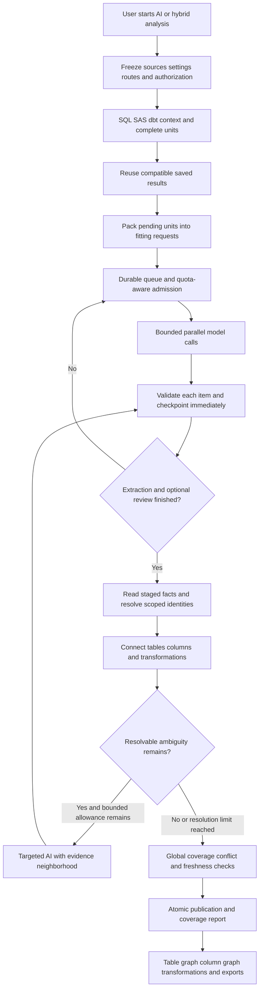

> Superseded for new AI project builds by `docs/promts/2026-10-23-simplify-ai-lineage-plan.md` and protocol 5 file extraction. Historical/manual contracts remain readable.

# Resumable AI lineage build requirements and design

Status: proposed design, not implemented. Updated: 2026-10-21, Asia/Calcutta.
Companion: [implementation plan](../plans/2026-10-21-resumable-ai-lineage.md).

## 1. Purpose and conversation decisions

Build the complete AI-driven analysis workflow for SQL, SAS, **and dbt**, from one explicit Analyze action through extraction, durable progress, cross-file linking, resolution and publication of table/column lineage. The user should not have to calculate provider-attempt budgets or manually combine results. Large workloads should normally queue and continue within a finite project allowance, taking longer where capacity is smaller.

This is an enhancement of the existing AI path, not a replacement of static parsing. No changes to SQL/SAS/dbt static parser algorithms or their default behavior are authorized by this design. Reuse existing source/project inventory, evidence and graph services. The central extraction mechanism is proper prompt context plus a strict response schema; no new dbt compiler or general agent framework is needed.

The user's later clarification makes dbt a **required part of this delivery**, not a deferred option. dbt sources must no longer be rejected merely because AI/hybrid mode was selected once their context, validation and publication path is implemented. SQL, SAS and dbt can participate in one analysis; a dbt project itself can contain SQL, YAML, macros, seeds and artifacts.

### Requirement ledger

| ID | Requirement | Implementation tasks |
| --- | --- | --- |
| R01 | Static parser algorithms/default builds remain unchanged; change only AI-driven orchestration and supporting integration. | 1, 3, 9, 10, 12 |
| R02 | One explicit AI build performs preparation through final table/column publication automatically. | 1, 7, 9, 10, 11 |
| R03 | Support required SQL, SAS and dbt handlers; classify by import metadata/project membership before extension. | 3, 4, 8, 9, 10, 12 |
| R04 | Plan complete semantic units with required context; never arbitrary truncation. | 3, 4, 5 |
| R05 | Reuse valid saved results, including units of partially processed files; invalidate relevant dependencies. | 2, 3, 7, 12 |
| R06 | Expose editable maximum files per request and maximum parallel requests immediately after enabling AI. | 1, 5, 7, 11 |
| R07 | Adapt grouping to model context/output capacity and observed quality, including less capable models. | 3, 5, 7, 12 |
| R08 | Capture structured facts, exact evidence, coverage, uncertainty and host-owned execution metadata. | 2, 3, 4, 5, 8 |
| R09 | Honor provider RPM/token limits, retry/reset instructions and shared quota scope; queue temporary throttling. | 6, 7, 11, 12 |
| R10 | Preserve completed work through request timeouts, execution windows, cancellation, failures and restart. | 2, 6, 7, 10, 12 |
| R11 | Treat unknown in-flight outcomes separately; no promise of exactly-once billing or unapproved duplicate retry. | 2, 6, 7, 11, 12 |
| R12 | Read stored validated results to link identities, producers, consumers and columns; do not reanalyze all source. | 8, 9, 10 |
| R13 | Resolve ordinary links with code and ambiguous cases with bounded, targeted AI context. | 8, 9, 10 |
| R14 | Publish one consistent snapshot with evidence, inferred status and explicit incomplete coverage. | 9, 10, 12 |
| R15 | Separate per-request, per-execution and total-project allowances from provider quotas/credits. | 1, 6, 7, 11 |
| R16 | UI, CLI and MCP use the same contracts/service and permissions. | 10, 11, 12 |
| R17 | Measure precision, coverage, calls/tokens, elapsed time, retries and saved-work reuse. | 12 |
| R18 | Finish with multiple appropriate public documentation pages and GitHub Pages flow diagrams/navigation. | 13 |

## 2. Existing behavior and evidence

Repository inspected on 2026-10-21. Current source is authoritative over older local plans/status ledgers.

- `src/dataforge/ai_budget.py`: per-execution hard limits are 2,000 physical attempts, 2,000,000 reserved output tokens and 14,400 cooperative seconds. `execution_budget` selects a bounded prefix.
- `src/dataforge/analysis_service.py`: preview reports whole-project worst-case totals, while execution processes units sequentially. A supported projection group above 100 is split even if its prompt fits. Cache context includes the full manifest. One summary `inflight` object cannot represent parallel requests.
- `src/dataforge/ai_context.py`: immutable source snapshots, SQL statement/SAS block planning, declaration context and a mutable execution ledger already exist. dbt is rejected before AI planning and non-SQL/SAS extensions are skipped.
- `src/dataforge/ai_analysis_store.py`: unit checkpoints, reviewed candidate IDs, accepted results and original evidence already persist. Reuse these semantics.
- `src/dataforge/model_capabilities.py`: allowlisted context/input/output metadata is identity-bound and expires. Unknown limits remain unknown; dynamic gateway aliases are advisory.
- `src/dataforge/llm.py`: physical-attempt accounting and protocol validation already exist. HTTP 429/5xx retries use short linear sleeps; no quota-aware pacing or Retry-After parsing exists in this path.
- `src/dataforge/llm_resources.py`: process-local concurrency admission is distinct from RPM/TPM pacing. Existing workspace concurrency is 1–4 (default 1), process admission cap 8, and background jobs have two workers.
- `src/dataforge/dbt/`: safe discovery, source/artifact readers, project/package/version identities, raw JSON evidence, normalized resources and static publication already exist. `dbt/service.py::reject_dbt_ai` is the current exclusion.
- The supplied screenshot shows 2,200 selected files, 6,238 tasks, 4,055 projection tasks and at most 12,476 attempts. This establishes confusing scope presentation, not the cause of every possible failure. Retain a synthetic reproduction without copying private source.
- Eight focused budget/continuation tests passed earlier in this conversation. They establish existing mocked behavior, not live accuracy or performance of this proposed workflow.

## 3. Full build and two different graphs

The workflow graph describes stages; the lineage graph contains datasets, fields, operations and typed dependencies. DuckDB remains authoritative storage. NetworkX and existing materializers provide derived graph views. Do not add a graph database, LangGraph or GraphRAG merely to implement nodes/edges.

The user starts one logical build. Provider-window waits and bounded execution rollover remain within that build. There is no separate user action to merge extracted results or generate the final graph. Browsing/exporting a graph does not start provider calls.

## 4. Source-specific context, shared extraction engine

### Common context envelope

Each item has a host-issued unit ID, immutable source hash, source kind, project/job identity, dialect, original spans, expression references, relevant declarations/context references, required coverage targets and the response schema. Context is source data, never instructions. Do not include parser relationship answers or fixture gold in extraction prompts.

All context counts against input capacity and existing disclosure permissions. Selecting one dbt model may require its project closure: disclose the actual closure in preview before Start. Never silently transmit unrelated/unselected source. Context dependencies can be narrower than the project freshness pin, but both must be recorded.

### SQL

Preserve complete statements, CTE/alias scope and temporary objects. Use existing lexical/AST structure only for boundaries, evidence and admissibility. Projection partitioning is allowed only under the existing proven independence rules. Replace the unconditional 100-projection planning trigger with model/output/response-cardinality fitting when qualification proves safety; retain smaller partitions whenever needed. Do not promise unsupported indivisible statements will fit every model.

### SAS

Keep complete DATA/PROC/macro blocks and stateful sequences together when required. Pass relevant library mappings, known source declarations and included macro definitions. Preserve WORK/job scope, assignment versions and branch identity. Never execute macros or assume runtime values. Unsupported dynamic semantics remain explicit.

### dbt — required

Use the existing imported project inventory, configured roots, source/enriched/artifact modes, and safe artifact readers. The AI handler prepares context and prompts; it does not alter `dbt` static parser algorithms or execute dbt/Jinja/Python/SQL.

- SQL model/snapshot/analysis units carry logical resource identity, materialization/config, dialect and relevant model code.
- YAML provides source declarations, model properties, versions, tests and documented columns, with exact source/JSON Pointer provenance. Documented columns are not proof of a complete physical schema.
- Relevant macros, `ref()`/`source()` targets, package names, variables and project configuration enter a bounded dependency closure. Include dependencies recursively to a guarded depth; unresolved cycles/dynamic references remain recorded.
- Manifest/catalog/run-results may provide supplied compiled SQL, relation bindings and declared metadata. Preserve source versus artifact-declared versus generated-SQL origin and existing artifact compatibility checks. Never label decoded compiled SQL as original JSON text or infer runtime execution from a manifest edge.
- Cross-project/package/version identity is mandatory. Resolve ephemeral logical resources without losing their role. Keep macro/test/resource-impact edges distinct from data-flow edges.
- Python models and unsupported Jinja/control flow are inventoried with partial coverage; do not advertise universal executable/column semantics. AI may propose supported evidence-backed facts, but cannot make missing runtime evidence appear.
- Distinguish extraction-bearing units from context-only YAML/config/macro files so every imported file has a disposition rather than disappearing from progress counts.
- Removing the project-analysis rejection is a late integration change after these tests pass. Manual diagnostic assistance keeps its current safety restrictions unless explicitly extended with the same dbt evidence contract; project support must not accidentally bypass its guards.

Users need not analyze one source type at a time. Prefer homogeneous batches by handler, dialect and compatible context; never combine unrelated project scopes solely to fill a request.

## 5. What is saved and how results connect

Store per-unit inputs/outputs, table dependencies, source-column usage, output derivations, expression references/restored text, value versus selection/join/filter/partition/order/rowset roles, intermediate resources, external context dependencies, coverage and unresolved reasons. Preserve exact source spans or artifact pointers for every accepted claim.

Host metadata includes run/unit/batch/attempt IDs, source and relevant context hashes, actual requested/resolved model identity where reported, prompt/wire/validator/handler versions, request outcome, known usage and checkpoint completion. Model confidence is not a measured probability; existing AI inferred status/confidence ceiling remains.

After extraction, load these records directly. Canonical identity includes source kind, namespace/database/schema, quoted identifiers, project/package/resource/version, job/temp scope, operation/branch and known writer version as applicable. Do not merge solely by lowercased table name or file order.

Connect a producer output to a compatible consumer input, then connect its column facts while retaining intermediate expressions. Table lineage is a projection of validated operations; column lineage retains direct dependencies and roles. Traversing their edges yields longer paths; do not manufacture an all-pairs transitive edge set. Unknown writer order, contradictory schemas and ambiguous ownership terminate confident paths.

Known compatible producer schemas may resolve wildcard outputs using original wildcard evidence plus schema provenance. Cycles are handled as strongly connected components with bounded fixed-point propagation, not repeated whole-project AI passes. The extraction map remains distinct from resolved/publishable facts so improvements never overwrite original decisions.

## 6. Batching, capability and rate policy

Two public controls appear immediately after enabling AI: `Maximum files per request` and `Maximum parallel requests`, each Auto/custom. Custom values are maxima, not promises of exact grouping or concurrency. One file may have many units and many calls. A request can contain several files only if the complete envelope and expected output fit.

Proposed first-release policy (implementation choices, not user-specified numbers): files custom range 1–100; parallel custom range 1–4, further constrained by existing workspace/process admission and local endpoint capacity. Auto begins with one item, can grow to 2/4/8 after three consecutive complete validated requests per handler/route, and halves on truncation/size failure. Limit a batch to 8 items initially; tune only from qualification. Unknown/dynamic metadata cannot justify larger batches by itself. A files ceiling of 1 still allows compatible units of that file to share a request; preview reports both item and distinct-file counts.

Estimate the fully serialized prompt, shared/unique context, output schema and per-item expected result. Preserve existing conservative estimation and headroom; use a provider token counter only through an explicitly supported, authorized endpoint. Native structured output/tool support is optional: retain strict JSON fallback and host validation. Do not assume context capacity establishes reasoning quality.

A batch response is a host-ID-keyed list of independent per-unit results. Validate exact membership, duplicates, evidence and coverage independently. Save good items immediately; queue missing/failed items only. A completely unparseable/truncated body cannot be claimed partly successful without independently parseable item framing. Fallback routes fit their own envelope; shrink only pending work if fallback capacity is smaller.

Rate limits govern request/token flow over time, not simply the number of files or simultaneous calls. Respect provider-specific request/input/output token buckets, burst/reset instructions and daily quotas. Read allowlisted response headers and explicitly supported account APIs; do not add privileged API-key requirements. Discovery may be unavailable or a gateway may strip metadata. Use conservative configured limits plus adaptive pacing, not invented quotas.

Scope admission across app workspaces sharing an upstream quota. Use endpoint/account quota-group references that contain no secrets; shared keys under different profiles must be groupable. Other applications can still consume that quota. A dynamic route with unknown upstream stays conservative. A process-local limiter cannot coordinate external processes; retain the one-owner-per-home constraint and document this limit.

Honor Retry-After seconds/HTTP-date and reset metadata. Without a usable hint, exponential backoff starts at 1 second and caps at 60 seconds, with jitter; a valid longer provider wait is honored through a durable scheduled retry, not truncated to 60 seconds. Retry only transient classes, within bounded physical attempts. Distinguish short throttling from quota/credit exhaustion and permanent configuration/auth failures. Never hold a database transaction while waiting or making requests.

## 7. Budgets, automatic continuation and recovery

Keep four concepts separate: per-request fit; per-execution limits; whole-project authorized allowance; provider quota/credits. An internal execution rollover is scheduling, not an analysis failure. The 12,476 versus 2,000 screenshot must become a clearly labeled project-versus-window preview.

The request resolves a finite project allowance before Start. Proposed Auto policy: calculate the conservative singleton-call upper bound for the frozen initial task plan, configured fallback/retries, optional review, at most one repair dispatch per extraction unit and at most two targeted resolution rounds per initial unit. Include the schema's bounded candidate cardinality when sizing possible review stages. Persist the resulting attempt/output-reservation/active-time ceilings and display them separately from each execution window. Custom project ceilings may be lower. Added work never silently enlarges this authorization; pause with remaining-work explanation if the finite ceiling is insufficient. No dollar estimate is a hard cost cap without reliable route prices and usage semantics.

Conservative limits must be enforced at each physical attempt, including adapter retries. Reserve output for requests in flight atomically. Release reservations for fallback/retries not sent; reconcile actual dispatched output only when usage/finish metadata is trustworthy. Never replace unknown billed usage with zero or reclaim an unknown attempt's maximum as free capacity. Keep per-execution and lifetime ledgers separate; no double counting on rollover/restart.

Auto continuation is enabled for newly started builds. During the live authorized job, extraction/review/resolution continue over fresh execution windows and temporary throttles without another click. Provider waiting does not consume active-processing allowance; track wall time, provider service time and queue time separately. Cancellation remains responsive during waits.

After process restart, reconnecting/polling must not silently authorize paid network work. Recover saved state and offer one Resume action; it then continues automatically within the original remaining project allowance and fresh runtime authorization. Session-only credentials must be supplied again if unavailable. Legacy paused runs preserve existing explicit continuation semantics and cannot be repartitioned under a changed protocol.

Persist an attempt before dispatch, then independently checkpoint each validated result. Outcomes distinguish planned, admitted, dispatched, response received, validated, retry scheduled, failed and unknown. A crash after dispatch but before durable response has an unknown outcome. Retry automatically only where a documented provider reconciliation/idempotency contract makes it safe; otherwise require explicit `retry_unknown` authorization. Completed facts from all other units remain reusable. Exactly-once application publication is feasible; exactly-once provider billing is not promised.

## 8. Reuse, freshness and final publication

Separate the full-build publication pin from a per-unit reuse key. The reuse key includes original unit hash, relevant context dependency hashes/negative lookups, job/project scope and settings, handler/prompt/schema/validator identities and compatible model/route configuration. Track definitions consulted and unresolved lookups: adding a competing definition must invalidate an earlier unique resolution. For dynamic/unknown dependencies, conservatively invalidate the affected scope rather than pretend exact dependency knowledge.

Review caches depend on the exact candidate set. Linking caches depend on accepted inputs and identity policy. Refresh AI explicitly bypasses extraction reuse; forcing parser work alone does not. Scope/dependency changes may require revalidation/relinking without forcing another extraction when source interpretation is unaffected.

AI and hybrid retain their current distinct publication semantics. SQL/SAS/dbt default parser builds are regression protected. A hybrid run may compare parser facts but extraction prompts must not receive parser dependency answers. dbt logical resources, bindings, artifact evidence and typed resource relations publish consistently with file/operation facts; an AI-only run must not silently replace its results with static dbt lineage.

All required tasks must reach a durable terminal disposition before a candidate snapshot is eligible. Partial semantic coverage can publish accepted supported facts with `complete=false` according to existing policy; missing/truncated required units are not a successful build. Failure/cancel/stale/allowance pause preserves the previously committed graph. Recheck sources, relevant configuration, permissions and prior publication revision, then publish facts/support/dbt catalog/report atomically. Linking and publication are restartable stages, with no repeat extraction for completed units.

## 9. User experience and acceptance

Preview is offline and reports source types/projects, actual context closure, extraction/context-only files, units, reuse, planned batches, provisional review/resolution work, full-project allowance and execution-window limits. Label estimated tokens as estimates and unknown quotas as unknown.

Progress reports completed/remaining units and files, cached work, active/queued requests, current stage, waiting reason/retry time, accepted/unresolved coverage and known usage. Normal waits are status, not repeated warning dialogs. Real quota exhaustion, unknown billable requests, unsplittable units and capability limitations require clear actionable explanations with saved work retained.

Acceptance includes a synthetic 2,200-file/6,238-unit workload with a 12,476-attempt conservative profile, smaller capacity models, batch sizes 1 and Auto/custom, temporary 429s and daily exhaustion, partial batch outcomes, process crashes/reopen, mixed SQL/SAS/dbt, cross-project identity collisions, wildcard resolution, schema conflicts and final publication exactly once. Benchmark mocked transport/storage separately from any opt-in live model evaluation. Never equate JSON validity or table-only gold with column accuracy.

## 10. Non-goals and remaining review choices

No static parser rewrite; no execution of imported source; no new autonomous multi-agent analysis; no mandatory graph database/vector store/framework; no unlimited retries/spending; no guaranteed accuracy on arbitrary models; no automatic paid restart merely by opening the app.

Provider asynchronous Batch APIs, prompt caching and a stronger optional resolution model are secondary optimizations after the core passes. Provider batching still represents multiple inference items and must not be miscounted as one attempt solely because submission used one HTTP call. No automatic model upgrade, new provider or broader disclosure without an already authorized route.

The user has settled dbt inclusion. Review proposed numerical batching/retry/project-allowance policies before execution; they are stated decisions in this draft, not claims that the user chose those numbers. The next step is review of this design and plan, not implementation during this planning task.

## 11. Research retained from the discussion

These sources informed the proposal; recheck provider details when implementing integrations, because limits vary by account and evolve.

- [Anthropic workflow patterns](https://www.anthropic.com/research/building-effective-agents): sectioning, routing and programmatic aggregation.
- [Microsoft GraphRAG methods](https://microsoft.github.io/graphrag/index/methods/): graph indexing cost/noise tradeoffs; generic GraphRAG is not a prerequisite for lineage.
- [Gemini rate limits](https://ai.google.dev/gemini-api/docs/rate-limits): request/token/daily constraints and project scope.
- [Claude rate limits](https://platform.claude.com/docs/en/api/rate-limits): request/input/output quotas and Retry-After.
- [OpenLineage lineage facet](https://openlineage.io/docs/spec/facets/dataset-facets/lineage/): explicit dataset/field relationships.
- [Gemini Batch API](https://ai.google.dev/gemini-api/docs/batch-api?hl=en) and [Claude prompt caching](https://platform.claude.com/docs/en/build-with-claude/prompt-caching): optional later cost/throughput optimizations.

## Implementation qualification — 2026-10-21

Execution was subsequently authorized, including a PR and removal of obsolete code.
The implementation keeps policy in AnalysisRequest and existing AIPlan/context
interfaces rather than introducing parallel policy/source-plan wrappers. Safe dbt
snapshot discovery is shared; the obsolete project-AI rejection helper is removed.
Static parser algorithms and their version remain unchanged.

Tasks 1–11 are integrated through the shared service; Task12 qualification and
Task13 public Pages/documentation updates are included. Numerical defaults use the
proposal's bounded maxima. Relevant saved validation checkpoints, including partial
semantic results, can be reused across compatible builds. Source uncertainty gets
at most two validated follow-ups; links without source-proven execution order remain
unresolved rather than buying model guesses. Generated-to-original/Python/dynamic
semantics remain explicit partial coverage, with no runtime execution.

Evidence: 940 tests passed, 2 existing Windows skips; Ruff and strict 42-page docs
build passed. An installed-wheel mixed SQL/SAS/dbt table/column and integrity smoke
passed outside the checkout, with zero live calls. A 2,001-physical-request synthetic
run crossed execution windows in one Start and published once. The screenshot's
2,200-file/6,238-unit shape has a separate planner regression.

Fresh whole-branch review found three Important issues: credentials resolved before
admission waits, partial HTTP200 stream errors losing unknown status, and stale
summary counters after a crash. Each was reproduced RED and fixed GREEN in
`tests/test_ai_pipeline_review_regressions.py`; the full suite then passed. Durable
attempt records reconcile lifetime spending independently of run-summary writes.
No Critical/Important findings remain from that review. Live-provider precision,
native executable and container release acceptance were not rerun in this task.
