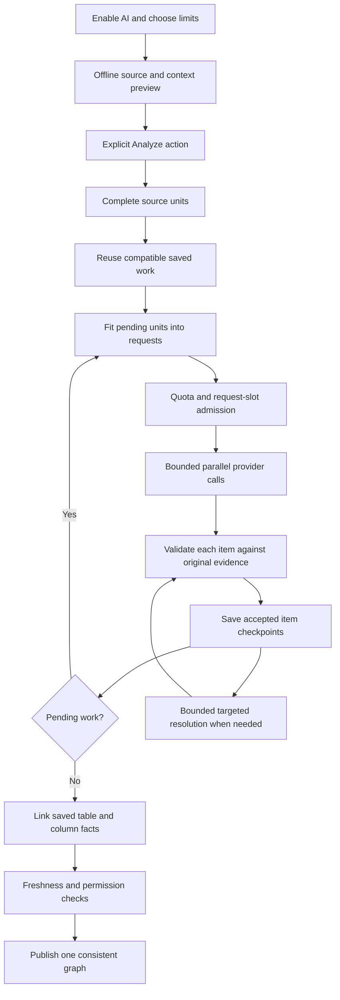

# How AI analysis builds lineage

AI analysis is one build: extraction, saved checkpoints, linking, optional targeted
resolution and publication. SQL, SAS and dbt can share a workspace. Static parser
analysis remains the default and its parsing algorithms are unchanged.

## Plan complete units

A unit is a complete SQL statement, a safe projection group retaining its parent
statement, a SAS DATA/PROC/macro block, or a dbt resource with project context.
Arbitrary character chunks would lose scope and evidence. Indivisible code that
cannot fit a model/disclosure allowance is reported before dispatch.

For dbt, project membership takes priority over the `.sql` extension. Preparation
includes resource identity, root/package/version, relevant `ref`/`source` and macro
definitions, YAML and selected source/artifact mode. Configuration and macro files
are disclosed as context rather than fake extraction tasks. Selecting a dbt member
includes its project closure; inspect that disclosure before Analyze.

Imported SQL, SAS, Jinja, Python and hooks are never executed. GraveTrail does not
run dbt compile or download packages. Dynamic templates, Python column semantics,
unknown wildcard schemas and generated-to-source mappings may remain partial.

## Gather structured facts

Each model item proposes table reads/writes, relationships, column usage,
expressions and derivation inputs with dependency roles. It also reports coverage
and unresolved symbols. Host-issued unit and expression references bind proposals
to immutable source hashes and exact coordinates. The host supplies execution
metadata; the model cannot authorize publication or certify its own accuracy.

Validation checks identities, original evidence, scope and supported semantics.
Accepted AI additions remain inferred. A model or reviewer cannot establish a
schema merely by asserting one, or turn join/filter dependencies into values.

## Save and continue

A successful item is checkpointed independently. Missing or malformed items do
not erase successful siblings. A bounded repair retries pending items; oversized
batches shrink. Within an active authorized build, execution windows roll over
automatically while the finite project allowance remains available.

After restart, choose **Continue AI analysis**. Completed checkpoints are reused,
including completed units inside a partially processed file. Opening the app,
previewing, polling or browsing a graph sends no source. An unknown dispatched
outcome needs explicit retry because the previous call may already have been billed.

## Connect the saved facts

The host reads validated checkpoints to connect scoped producers, consumers and
column dependencies. It retains intermediate operations and expressions. It does
not send the entire project to one final model request. Equal names in different
dbt roots/packages/versions remain distinct; multiple writers without proven
execution order remain unresolved. Cycles are reported with bounded graph work.

Targeted resolution revisits only an uncertain unit and its declared context,
with at most two rounds and an early stop when no new supported fact appears.
Optional review may withhold facts but cannot override validation.

Only the final atomic transaction replaces the graph, provenance, saved results
and dbt catalog together. Failures, cancellation, stale input or missing required
responses retain the previous publication. Successfully processed but unsupported
semantics may publish supported facts with incomplete coverage.

See [controls and recovery](ai-analysis-controls-and-recovery.md) and the
[pipeline architecture](../architecture/ai-analysis-pipeline.md).
