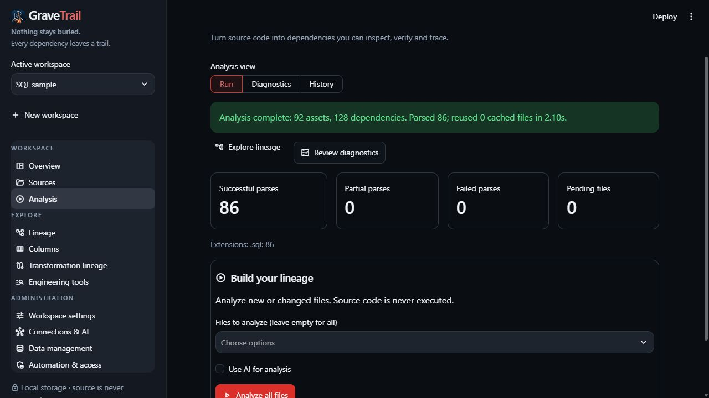

# Run analysis and review diagnostics

Open **Analysis → Run** after import. Leave **Use AI for analysis** unchecked for local
static analysis. No AI account, connection or API key is needed.

Choose **Analyze all files** initially. Compatible unchanged static parses can be reused;
**Rebuild** forces parsing. Selecting a dbt member includes its project closure because
macros, configuration and YAML can affect models together.

*Saved results and diagnostics are separate from provider setup.*

Choose **Explore lineage** or **Review diagnostics** after success. Warnings can identify
unsupported constructs, ambiguous names or partial coverage even when some edges were
found. No errors does not prove complete runtime lineage.

Pending imports can be newer than the saved graph. Check freshness. Failed/cancelled
work preserves the previous graph; do not mistake it for a successful refresh.

Optional [AI](../AI_ANALYSIS.md) independently extracts inferred facts for one selected
SQL, SAS or dbt family. Current builds have no parser-comparison, parallel-request or
execution-window controls. Read [coverage](../concepts/evidence-and-coverage.md) before
relying on either analysis workflow.
