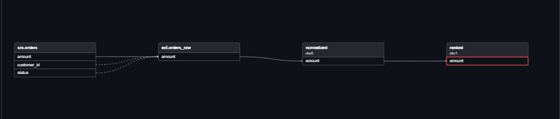

# Inspect columns and transformations

Open **Columns** and select an exact table, dataset, file, or dbt model.
**Lineage graph** opens by default. Use **Direct references** when you want a
list of places that mention a column.

## Trace where a value comes from

1. Choose a column and select **How it is produced** for inputs or **What it
   affects** for consumers.
2. Set **Transformation depth** to the number of derivation steps to follow.
   Steps can pass through CTEs, intermediate queries, or SAS variable versions.
3. Select a card header, row, or arrow to inspect the associated
   **Transformation logic**. When multiple steps apply, the picker starts
   with a step that produces the selected column if one is available.
4. Open **Analyzed source file** for the original version with line numbers,
   search, and an original-byte download.

Cards contain the rows involved in this trace. Solid lines carry values. Dashed
lines show context such as filters, joins, grouping, or order. The **Lineage**
table graph shows a simpler set of value links between expanded neighbors.

Drag a header to move its card and connected arrows. Drag the background or hold
**Alt** while dragging to pan. Use **Fit graph**, zoom, or **Find a column** to
navigate a larger trace. Manual positions stay with the current graph view.

The display may omit whole transformations to stay within its graph limit.
Open **Steps and paths** or use **Export trace** for the bounded trace, including
coverage and truncation. An unresolved boundary means the available evidence
does not establish a mapping.

## Find direct references

Switch to **Direct references** to group usages by file or context. Enter
comma-separated names to match any term. Copy controls support individual
columns and the distinct-used list.

**Unused columns** requires consistent imported declarations and known coverage.
Missing or conflicting schemas and unresolved wildcards prevent reliable non-use
claims. CSV filenames do not establish table-schema relationships.

See [transformation coverage](../TRANSFORMATION_LINEAGE.md) for tested SQL, SAS,
and dbt behavior and the limits of static evidence.
