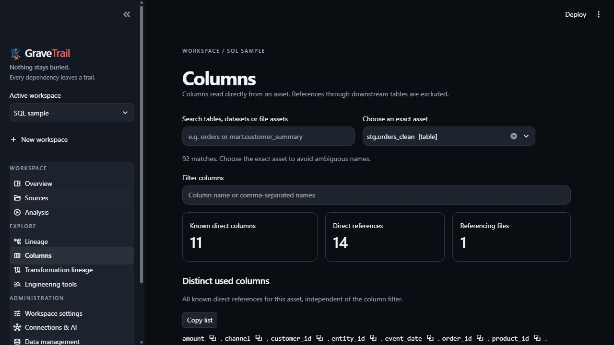

# Inspect columns and transformations

Use **Columns** to answer “where is this column referenced?” Select a source asset,
filter names and group by file/usage context. Comma-separated filter terms match
any term. Copy controls support individual names and the distinct-used list.

*Direct references and derived output values answer different questions.*

**Unused columns** needs sufficiently consistent imported declarations and known
coverage. Missing/conflicting schemas or unresolved wildcards prevent reliable
non-use claims. CSV filenames do not invent table-schema relationships.

Use **Transformation lineage** for inputs that contribute to a supported output
expression. Inspect value, selection, join/filter, rowset and window roles separately.
An unresolved boundary is not a zero-input derivation.

Exact supported SQL/PROC SQL and SAS DATA-step constructs, exclusions and upgrade
semantics live in [transformation coverage](../TRANSFORMATION_LINEAGE.md). dbt SQL can
use supported projections; Python models do not establish DataFrame derivations, and
YAML column documentation alone does not prove a physical schema.

See [lineage concepts](../concepts/lineage-and-columns.md) and [dbt limits](../DBT_SUPPORT.md).
