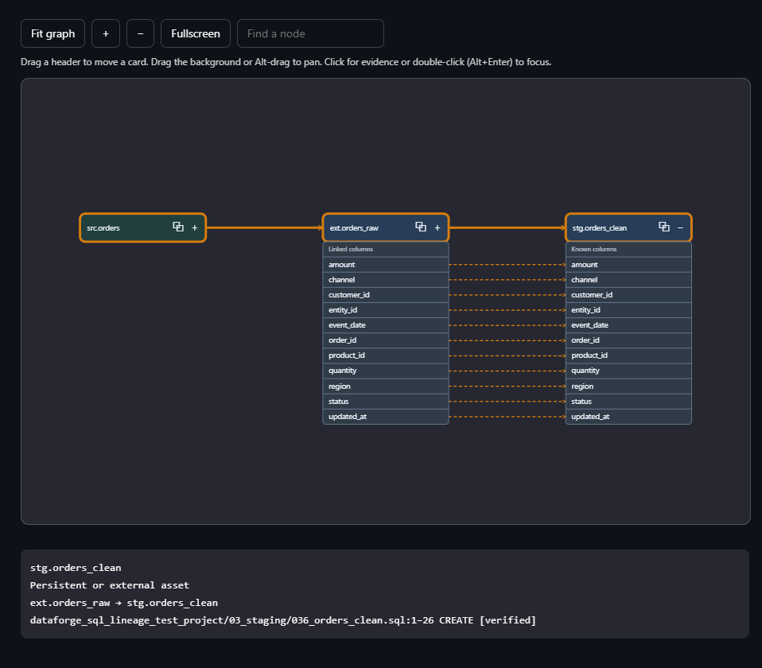

# Explore lineage and change impact

Open **Lineage**, search and select the exact qualified asset identity.

1. Choose upstream for inputs, downstream for consumers, or combined for both.
2. Open **Traversal options** to set depth and temporary-step collapsing.
3. Choose **Graph** for an overview or **Tree** to expand paths progressively.
4. Select a node/relationship to narrow source evidence.
5. For change impact, inspect downstream consumers and their original code.

## Expand a table in the graph

Select **+** on a table card to see its declared columns or the known outputs
established by analysis. Collapsed neighbors reveal only the rows that participate
in the visible column links. Dashed arrows on this canvas connect values to the
columns they feed. Join and filter context is available in the [Columns graph](columns.md).
Select a table or relationship to highlight its table and column links and narrow
the evidence below. Select **−** to collapse the card.

Drag a header to move its card and connected arrows within the current view.
Drag the background or hold **Alt** while dragging to pan. **Fit graph** includes
moved cards. Zoom, search, and **Fullscreen** are in the toolbar. Double-click a
node or focus it and press **Alt+Enter** to navigate. **Back** and **Forward**
restore asset views in the session. Tree mode requires an exact asset.

**All** includes disconnected assets and bypasses focused traversal limits; confidence
and temporary filters still apply. A truncated graph/tree is not proof of no further
dependencies. Cycles stop at repeated nodes. Check schema/job/dbt version for similar names.

For dbt, expand **dbt resources and macro impact** to inspect typed relationships
separately from the model graph. See [dbt resources](../DBT_SUPPORT.md#models-columns-and-resources).

Continue with [evidence](evidence.md), [exports](exports.md) or the [UI reference](../USER_GUIDE.md).
