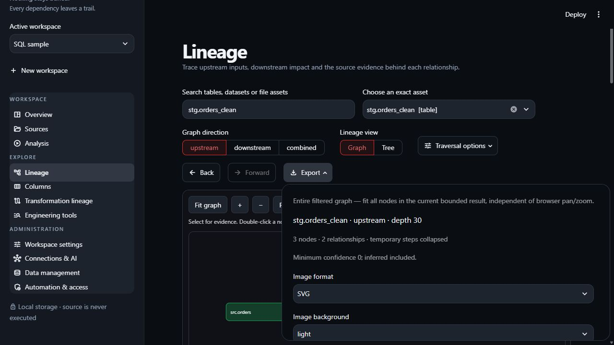

# Export and share findings

| Export | Use | Boundary |
| --- | --- | --- |
| Interactive HTML | Explore a fixed snapshot in a browser | Embeds graph/evidence; no refresh or workspace restore |
| SVG / PNG | Include a graph in a document | Business labels included; raw source excluded from images |
| CSV / JSON reports | Inspect paths/evidence in another tool | Respect completeness/truncation/unresolved markers |
| XLSX paths | Share ordered dependency/path sheets | Logical ordering is not runtime order |
| Original source ZIP | Share analyzed originals | Can contain private code |
| Backup/configuration | Recovery or supported config transfer | Different formats and ownership rules |
| Editable builder JSON | Continue an authored lineage design in another GraveTrail workspace | Includes builder schemas and diagram state; separate from a full runtime backup |

In **Lineage**, **Export** prepares graph images for the entire current filtered/bounded
graph, independent of pan/zoom. Choose format, background, scale, title and legend, then
prepare/download. Other graph/report downloads appear with the analysis/evidence views.

*Check totals and filters before sharing.*

## Reopen an interactive snapshot

Download interactive HTML and open the saved file in a browser. Try Fit, zoom, pan,
search and relationship selection. The [safe example](../examples/interactive-lineage.md)
documents supported interactions; standalone exports do not provide every application action.

HTML cannot import analysis back into GraveTrail. Reopen the same data home/workspace,
or use supported [backup/restore](../DATA_MANAGEMENT.md), to continue live queries.

The [CLI reference](../CLI_GUIDE.md) covers artifact downloads/checksums. For format
ownership see the [developer module guide](../development/code-map.md).

## Share an authored canvas

In **Lineage builder → Build lineage**, use **Export ▾** for SVG, PNG, or
**Editable canvas (JSON)**. Image exports include all placed boxes regardless of
pan/zoom and retain selection/trace styling. Expand comments before exporting an
image when you need their full visible text.

The **Export & restore builder** expander also prepares JSON, offline interactive
HTML, Excel, and CSV. Builder HTML supports presentation and exploration; use
editable JSON to continue authoring in the app. JSON includes workspace schemas
outside the current canvas catalog, full comments, relationships, folders,
positions, sizes, and assigned colors.

The recipient uploads JSON in **Lineage builder → Saved work → Import another
user's work**, supplies a name, and chooses **Import as saved work**. They then
select that copy, confirm replacement, and **Load saved work** before continuing
in **Build lineage**. Import alone leaves their active canvas unchanged.

For definitions alone, **Export schemas** offers all tables, searched selections,
or source/intermediate/target roles in JSON, YAML, SQL DDL, CSV, or Excel. These
exports omit canvas layout and relationships. See the
[builder guide](lineage-builder.md#export-a-diagram-schemas-or-editable-work) for
the complete export and transfer workflow.
