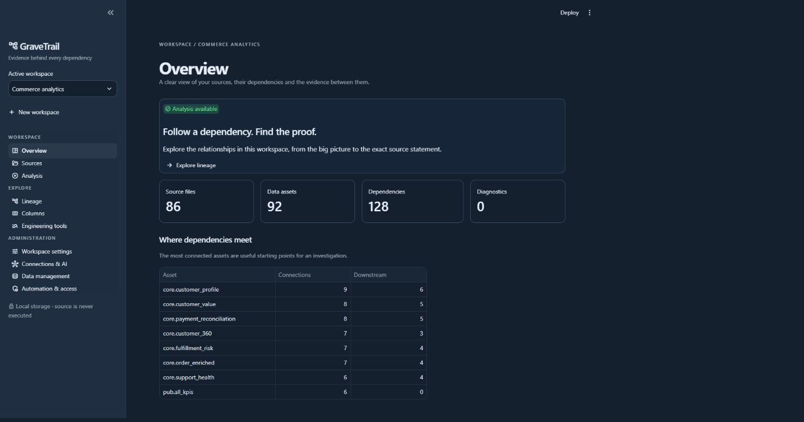

# User guide

*Actual local application, captured with the included SQL project in an isolated home.*

Start with a focused question: which sources feed this table, which reports depend on
it, or where is this column used? GraveTrail connects the answer to original source
evidence and keeps unresolved cases visible. The [detailed user reference](../USER_GUIDE.md)
documents individual controls and settings.

## Start locally; add AI when useful

**The primary workflow uses the local parser and sends no source to an AI provider.**
Leave **Use AI for analysis** unchecked in **Analysis → Run**. No connection, API key
or AI token usage is required, and large projects can use this workflow too.

For additional coverage in complex systems, optional [hybrid analysis](../AI_ANALYSIS.md)
compares parser output with locally validated AI proposals. It sends selected
source/context to your configured provider. Both capabilities are built in; AI
cannot guarantee complete lineage, so inspect omissions and unresolved evidence.

## Build a trustworthy workspace

??? example "View the sample workspace dashboard"
    

Create or select a workspace in the sidebar. Workspaces retain their own inventory,
analysis, settings and provider profiles. In **Sources**, import a ZIP,
browser folder or explicitly allowed host directory, selecting only the relevant
extensions. Inspect accepted/skipped files in **Inventory**, then open **Analysis → Run**.
Successful analysis offers **Explore lineage** and **Review diagnostics**.

Imports are additive: omitting a file from a later import does not delete it. Reimporting
the same path replaces the active inventory entry while retaining originals referenced
by earlier evidence. Normal analysis reuses compatible unchanged parses; **Rebuild**
forces parsing. A failed run preserves the previous committed graph.

Use the [quick start](../getting-started/quick-start.md) for a reproducible SQL or SAS
example. Consult [SQL parsing](../SQL_PARSING.md) and [SAS parsing](../SAS_PARSING.md)
when a language construct produces an unresolved diagnostic.

## Explore dependencies and evidence

Search in **Lineage**, then select the exact asset. Identically named tables
in different schemas or temporary jobs are separate candidates. Upstream traces inputs;
downstream traces consumers. Choose Graph or Tree and a graph direction. Use **Traversal options** for depth and whether to
collapse temporary stages for the question you are answering.

Select **All** to see the complete workspace graph, including disconnected assets, without
focused traversal depth/node limits. Confidence and temporary-step settings still apply.
Use **Fullscreen** to expand the graph and Escape or **Exit fullscreen** to leave.
Copy a node's full name with its adjacent icon. Double-click a node (or Alt+Enter) to select
it as the exact asset; **Back** and **Forward** restore earlier asset views in the session.

Trees load branches progressively. Graph/tree limits and path boundaries can restrict
what is visible; a bounded view is not evidence that no more dependencies exist. Cycles
are reported and traversal terminates. Selecting a node or edge changes the source
evidence scope. Graph source files follow the selected upstream/downstream/combined direction;
the upstream/downstream tabs control their own tree context.

Every relationship retains source version, statement, original line range and extraction
method. If new code is pending, an older relationship displays the original analyzed
version. Analyze the imported revision before expecting the graph to reflect it.
Collapsed temporary steps retain their intermediate evidence. Logical path steps do not
establish runtime execution order.

??? example "Inspect the complete original SQL"
    

## Inspect direct column usage

In **Columns**, choose a source asset, filter columns and group by file
or usage context. Results describe direct references. Unqualified ambiguous columns
remain diagnostics. A plain wildcard can expand from consistent imported SQL CREATE
TABLE declarations as inferred references, with declaration provenance; otherwise
coverage remains unknown. No live database lookup or CSV/table-name guess fills gaps.

**Distinct used columns** shows comma-separated names above grouping, with individual and
list copy controls. Paste comma-separated terms into the column filter to match any term.
The collapsed **Unused columns** section offers the same copy controls for declared columns
without known direct references. Both lists ignore the text filter. Missing/conflicting schemas
or unresolved wildcards prevent an unused list; a displayed list describes analyzed sources,
not non-use in the live system.

## Follow column transformations

Open **Transformation lineage**, below Columns, to select an output column and inspect
its upstream expressions or downstream effects. Value inputs, CASE selection, join/filter
context and rowsets have distinct roles. Coverage boundaries and source versions travel
with each bounded CSV/JSON export. See [column transformations](../TRANSFORMATION_LINEAGE.md)
for tested SQL/SAS coverage and unresolved constructs.

## Use diagnostics and optional assistance

Review warnings/errors in Analysis → Diagnostics before accepting a graph as complete. The unresolved
review queue offers bounded statement context and original line selection. Previewing
is local. A separate explicit AI request uses configured task routing, privacy gates,
credentials and context budgets. Changed source must be previewed again.

Validated relationships can be merged as inferred evidence. Quarantined or advisory
results cannot silently become graph facts, and a merge does not erase unrelated parser
warnings. Continue with [LLM integration](../LLM_INTEGRATION.md) and
[secure configuration](../SECURE_CONFIGURATION.md) if assistance is useful.

## Choose the right output

| Need | Output or tool |
| --- | --- |
| Review or share relationships | Lineage CSV/JSON or offline HTML graph |
| Follow ordered logical dependencies | Dependency paths CSV/JSON with source evidence and boundaries |
| Inspect the code behind selected assets | Relevant original source ZIP or byte-exact file download |
| Find literal code or assess a change | Code search, dictionary and static impact tools |
| Compare analyses | Completed-run comparison |
| Query an analyzed project from automation | [CLI](../CLI_GUIDE.md) or [MCP](../MCP_INTEGRATION.md) |

Exports can disclose complete private code and retained evidence. Review them before
sharing. CSV formula-leading values are escaped, but that does not remove confidential
source content.

## Maintain the workspace

Configuration transfers move selected preferences into a new workspace; they are not
backups. General cleanup uses preview/apply guards and mandatory backups. Source or AI
removal invalidates the whole dependent graph; shared cache and original blobs are
separate cleanup scopes. Retained history may protect originals from orphan collection.
Logical deletion does not guarantee a smaller DuckDB file.

Read [data management and cleanup](../DATA_MANAGEMENT.md) for category effects,
backup/restore and recovery limits. For startup/storage issues use
[configuration](../getting-started/configuration.md) or [troubleshooting](../troubleshooting/help.md).
