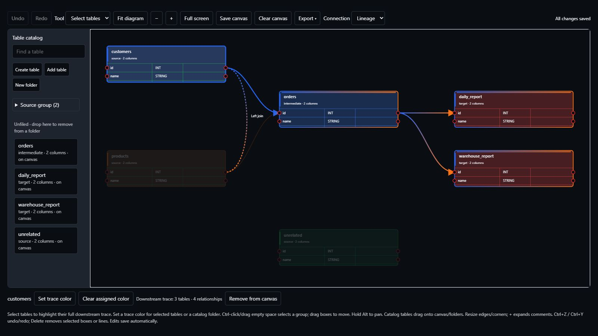

# Design lineage on a canvas

Open **Workspace → Lineage builder** in the sidebar to design tables and
column relationships, organize a diagram, and hand an editable design to another
GraveTrail user. The builder works locally without an analysis run or AI account.
Its relationships represent your authored design; source analysis continues in
**Analysis**, **Lineage**, and **Columns**.

## Use a version with the builder

This guide covers the development feature available from source commit
`a803b6e`. The older `1864dc8` checkout used by the introductory tutorials and
release v0.0.1 do not contain the builder. To reproduce this feature from source:

```sh
git clone https://github.com/SahasilAK/GraveTrail.git
cd GraveTrail
git checkout a803b6e
uv sync --locked --extra dev
uv run gravetrail-ui --home ./.dataforge
```

Open the local app, choose a workspace, then select **Lineage builder**.

| Section | Use it to |
| --- | --- |
| Schemas & data entry | Create, import, or edit permanent workspace table schemas |
| Build lineage | Add a canvas catalog, place tables, connect columns, and save a design |
| Export schemas | Export all tables, selected tables, or a source/intermediate/target group |
| Saved work | Load named designs, update saved copies, or import another user's editable JSON |



*Real builder UI in a disposable workspace with synthetic schemas. Selecting
customers highlights its downstream branches; unrelated paths fade.*

## Keep workspace schemas and the canvas catalog separate

Workspace schemas are reusable table definitions. Creating or importing them in
**Schemas & data entry** saves them in the workspace. Editing a schema preserves
its existing catalog membership.

The **Table catalog** inside **Build lineage** belongs to the current canvas.
Use its **Add table** button to search workspace schemas and explicitly add one
to this design. **Create table** in the catalog creates a workspace schema and
adds it to this catalog. Neither action places a box until you drag it onto the
canvas, or focus the catalog entry and press **Enter**.

Removing a box leaves its entry in the current catalog so it can be placed again.
**Remove from catalog** hides that entry from this catalog; the workspace schema
is still available through **Add table**.

## Create or import table schemas

1. In **Schemas & data entry → Create table**, enter a **Table name**.
2. Choose **Table role**: source, intermediate, or target. Roles use the same
   palette as the existing lineage views.
3. Choose **System / database** to get datatype suggestions, or enter a custom
   system. Suggestions cover systems such as BigQuery, Oracle, SAS, Databricks,
   Redshift, SQL Server, PostgreSQL, and Snowflake.
4. Enter column names, datatypes, and optional comments. Use **Add column** for
   additional rows, then **Create table**.

Table and column names are required. Datatypes are editable: `STRING`, `CHAR`,
`VARCHAR`, `VARCHAR(200)`, and custom type expressions are supported. Lengths and
decimal parameters are optional. You can enter `DECIMAL` or `NUMERIC` alone,
write `DECIMAL(18,2)`, or fill precision/scale for a decimal. Explicit parameters
are validated; a supplied precision with blank scale uses scale 0.

For files, choose **Import schemas**, upload files, **Preview schemas**, inspect
the preview/warnings, then add the tables. Supported inputs include SQL
`CREATE TABLE` DDL, dbt schema YAML and manifest/catalog JSON, explicit SAS
`LENGTH`/PROC SQL declarations, Informatica PowerCenter XML, generic schema JSON,
and schema CSV/TSV. Imports read declarations as text. Runtime-generated schemas
and unsupported vendor formats need a schema export or manual entry.

Imported schemas stay in the workspace until you explicitly add them to a canvas
catalog. Schema-only imports carry definitions rather than another design's
folders, placement, or trace colors.

## Build a first diagram

1. Create `raw.customers` as a source with `id` and `name` columns. Create
   `mart.customer_summary` as a target with `customer_id` and `customer_name`.
2. Open **Build lineage → Table catalog → Add table**, then add each schema.
3. Drag both catalog entries onto the canvas. Drag a box header to reposition it.
4. Set **Connection** to **Lineage**. Drag the right output port of
   `raw.customers.id` to the left input port of
   `mart.customer_summary.customer_id`. You can also click the two ports in order.
5. Repeat for the name columns. A single output can connect to multiple inputs,
   supporting branches and multiple downstream tables.
6. Select a relationship to edit its label, then **Apply label**. Use
   **Fit diagram**, zoom, and **Full screen** to present the design.

Drag box edges or corners to resize them. Cells have visible borders; comments
start collapsed. Use the **+** beside a comment, or a table's context menu, to
expand the full text. Collapse it again when you need a compact diagram.

### Add joins

Switch **Connection** to **Join**, choose a **Join type**, then connect the
right-side output ports of two columns. Choices include Inner, Left, Right,
Full outer, Cross, and Self join; **Custom…** accepts another join type.
Join labels describe the design without executing a database operation.

The **Add a relationship without dragging** expander also provides table/column
selectors, relationship kind, join type, and label fields. Add your intended
tables to the catalog before building their relationships.

### Select, move, and navigate

| Action | Control |
| --- | --- |
| Select a table or relationship | Click its box header or line |
| Select several boxes | Ctrl/Cmd-click headers, or drag a selection rectangle with **Select tables** active |
| Move selected boxes together | Drag a selected header |
| Nudge selected boxes | Focus a header and use arrow keys; Shift moves a larger step |
| Remove selected boxes or relationships | **Delete**, or the context menu; removed boxes retain their workspace schemas |
| Undo / redo canvas edits | **Ctrl/Cmd+Z**, **Ctrl/Cmd+Y**, or **Ctrl/Cmd+Shift+Z** |
| Pan temporarily | Hold **Alt** and drag; releasing Alt restores the selected tool |
| Pan continuously | Choose **Pan** from **Tool**, then drag empty canvas |
| Zoom | Mouse wheel or the **− / +** buttons |
| Center the design | **Fit diagram** |
| Finish a pending connection or clear selection | **Escape** |

Shortcuts apply while working in the canvas, outside text fields and dialogs.
Undo/redo belongs to the current editing session. Loading a design or clearing
the canvas starts a new history; saved work provides recovery across sessions.

Right-click a box, line, blank canvas, catalog entry, or folder for the relevant
selection, removal, editing, and navigation actions.

### Organize catalog folders

Use **New folder** in the catalog. Drag a catalog entry onto a folder to file it,
or onto **Unfiled** to move it out. Folders expand/collapse, and the catalog
scrolls independently for larger lists. **Find a table** filters the catalog.

## Trace and color downstream paths

Select one or several tables to highlight all their downstream lineage paths.
Unrelated paths fade, making larger designs easier to follow.

Use **Set trace color** for a selected table or group, or right-click a catalog
folder and choose **Set folder trace color**. Colors propagate downstream.
Shared paths show contributing colors where branches merge. **Clear assigned
color** removes a table's own assignment; it may still inherit upstream colors.

Tracing follows directed lineage and safely handles cycles. Join relationships
touching a traced table are highlighted; they do not turn a peer source into a
downstream lineage branch.

## Save, overwrite, and clear

Edits automatically save the active design in the workspace. **Save canvas** in
the canvas toolbar creates a named snapshot; leave **Work name** blank for an
automatic name. Within the current session, saving or loading a named design
remembers its name and offers **Overwrite saved work** or **Save as new work**.

If you enter another existing name, the dialog offers **Overwrite saved work**.
Confirm that action to replace that snapshot, choose another name, or cancel.
Changing the name cancels the previous overwrite confirmation. The canvas also
offers Save and Clear in its background context menu and in fullscreen.

**Clear canvas** saves the current design first, then clears the diagram,
relationships, folders, and this canvas's catalog entries. Workspace schemas
remain available through **Add table**. A failed save leaves the active design
intact. Use a new saved-work name when you want to keep an earlier snapshot.

To restore a design, open **Saved work**, select it, enable **Replace the current
work with this saved work**, and choose **Load saved work**. Workspace schemas
absent from that saved design remain available for future use. Earlier designs
cleared before schema preservation was added can be recovered from their saved
backup in the same section.

Permanent workspace table deletion is available in **Data management → Cleanup
& recovery → Lineage builder table schemas**, with a selection and confirmation.
It removes the selected schemas and their current relationships; named saved-work
snapshots remain available. See [data management](../DATA_MANAGEMENT.md#lineage-builder-tables-and-saved-work).

## Export a diagram, schemas, or editable work

| Where | Formats and scope |
| --- | --- |
| Canvas **Export ▾** | SVG / PNG for placed boxes and visible comment expansion; **Editable canvas (JSON)** for the complete editable builder |
| **Export & restore builder** expander | JSON, interactive HTML, Excel, CSV; choose a format, **Prepare builder export**, then download |
| **Export schemas** section | JSON, YAML, SQL DDL, CSV, Excel; all tables, searched selections, or source/intermediate/target tables |
| **Saved work** | **Export saved work JSON** downloads the selected snapshot |

SVG/PNG export the complete placed diagram rather than just the current pan/zoom
viewport. Selection/trace styling is preserved; expand comments before export if
you need their full text in the image. JSON retains full comments and schemas,
including workspace tables outside the current canvas catalog. CSV/Excel builder
exports include table schemas and relationships. Schema-only exports omit diagram
layout/relationships; SQL DDL needs a datatype for every column.

HTML is an offline interactive presentation with pan/zoom, comment expansion,
table selection tracing, and image export. Editable JSON is the handoff format
for continuing work in GraveTrail.

### Hand a design to another user

1. In the canvas, choose **Export ▾ → Editable canvas (JSON)**, or export a named
   snapshot with **Export saved work JSON**.
2. The recipient opens **Lineage builder → Saved work → Import another user's work**,
   uploads the JSON, supplies **Imported work name**, and chooses **Import as saved work**.
3. Import creates a saved copy. Select that copy, confirm replacement, then
   **Load saved work** and return to **Build lineage** to continue editing.

Exports contain the authored table/column names, comments, relationships, folders,
positions, sizes, and trace colors. Review that content before sharing. A builder
JSON transfers this design; use a [runtime backup](../DATA_MANAGEMENT.md#backup-restore-and-maintenance)
to recover the wider workspace and its imported source/analysis history.

## Current bounds and common messages

- The workspace builder supports 100 table schemas, 200 columns per table,
  2,000 relationships, 100 catalog folders, and 100 named saved works.
- **Enter a table name** or **Enter a column name** identifies a missing name;
  it does not impose a datatype length.
- **The builder changed in another session** means the active revision changed.
  Reload the current design before retrying to preserve the newer saved state.
- If **Add table** finds no match, check the workspace, search text, and whether
  the table is already in this catalog. Create/import a schema if it is missing.
