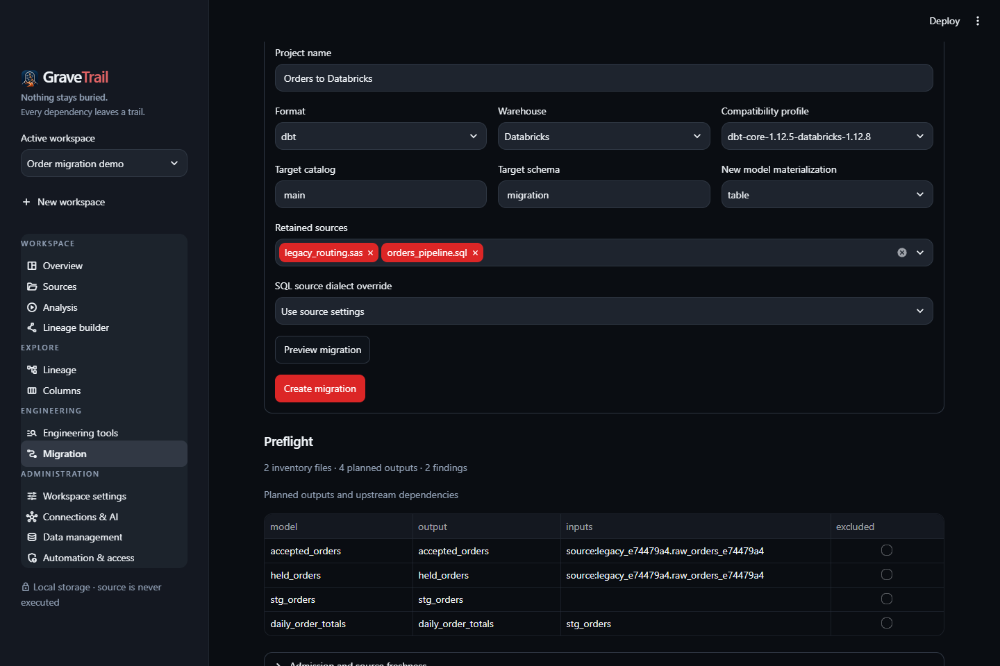
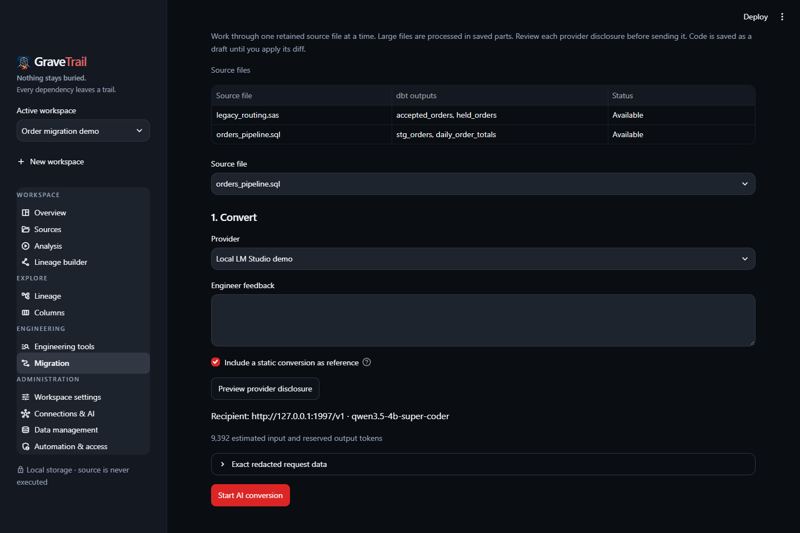
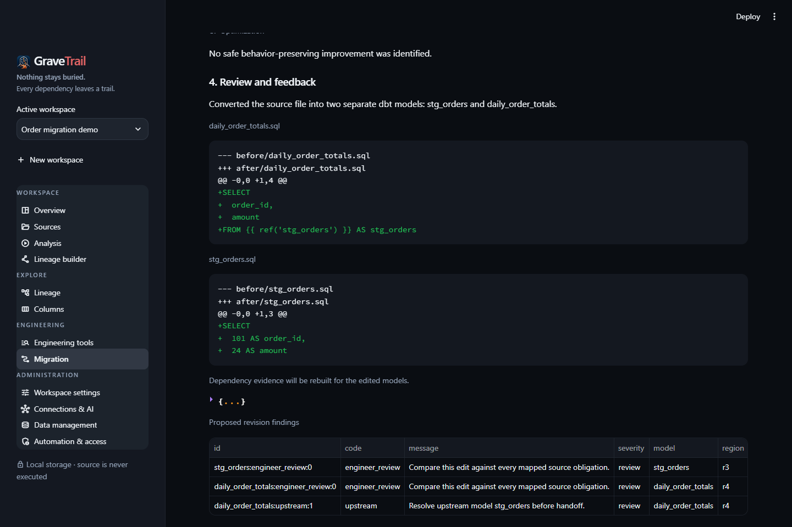
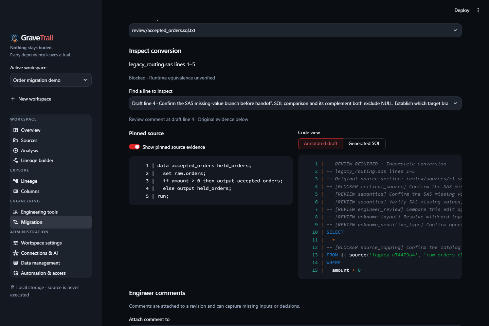
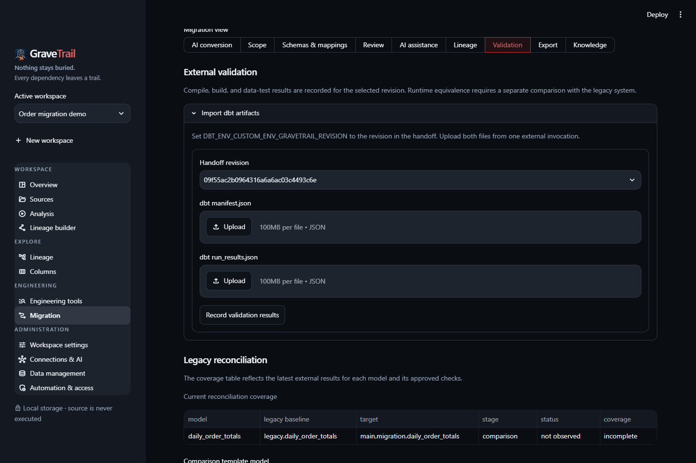
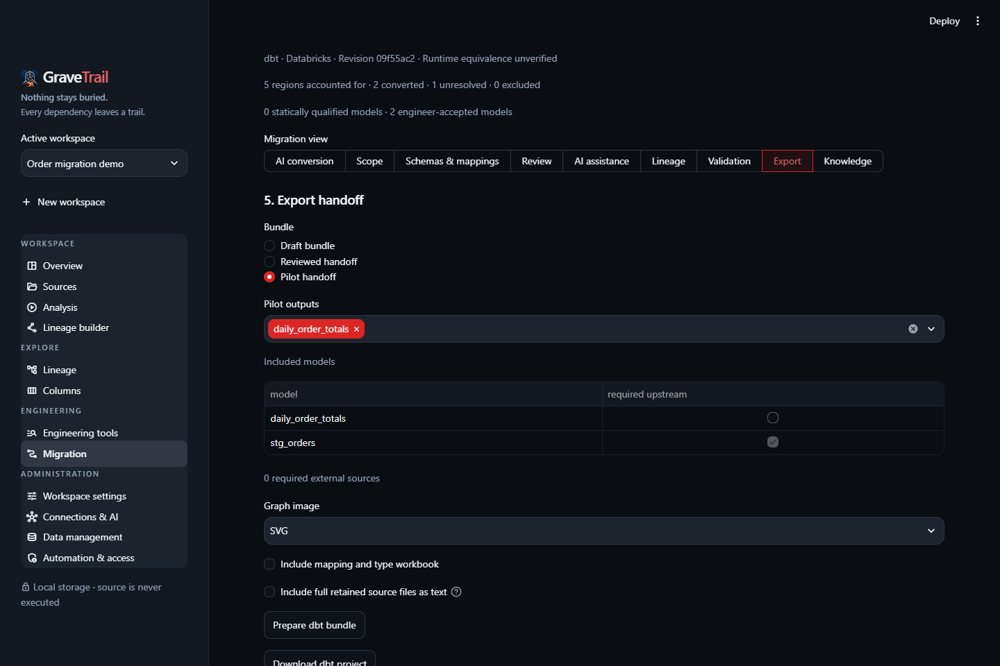

# Migrate to dbt on Databricks

Choose **Open Migration** on Overview or **Engineering → Migration** to create a workspace project
from retained sources. **Create migration** on Analysis pins the latest committed analysis.
**Migrate selection** on Lineage starts from the selected asset and includes known upstream
producers. **Create migration** in Lineage Builder pins the current design and starts a scaffold.

The guided workflow also runs through [the CLI](../CLI_GUIDE.md#guided-ai-migration) and
[MCP](../MCP_INTEGRATION.md#guided-ai-migration).

## Watch the workflow

<figure class="gt-product" markdown>

<video controls playsinline preload="none" poster="../../assets/images/gravetrail-migration-setup.png" style="width: 100%" aria-label="Guided migration from SQL and SAS setup through source comparison, dbt review and export">
  <source src="../../assets/images/gravetrail-migration-walkthrough.mp4" type="video/mp4">
  <a href="../../assets/images/gravetrail-migration-walkthrough.mp4">Download the migration walkthrough</a>
</video>

<figcaption>Captioned walkthrough of the guided workflow using synthetic orders. The app reviews two SQL outputs from one file and retains unresolved SAS work for inspection.</figcaption>
</figure>

[Follow the walkthrough step by step](#try-a-small-migration). The written instructions cover the same
controls, including offline conversion as an alternative.

## Set up a project

Choose dbt and Databricks, confirm the target catalog and schema, and preview the migration.
Read admission, planned outputs and findings before creating the project. Databricks is the
enabled warehouse. Configure a provider in **Connections & AI → Providers & routing**, then choose
**Prepare AI conversion**. Preparation maps the pinned source files and dependencies locally. In
**AI conversion**, select a file and provider. A source file can contribute several models.
Migration previews one part at a time when the whole file or stage exceeds the provider's limits.

<figure class="gt-product" markdown>

<figcaption>Preflight inventories two retained files and plans four outputs before any candidates are saved.</figcaption>
</figure>

## Run the five migration stages

<figure class="gt-product" markdown>

<figcaption>The disclosure preview identifies the recipient and the estimated request size before dispatch.</figcaption>
</figure>

1. **Convert.** Choose **Preview provider disclosure**. Check the recipient and expand
   **Exact redacted request data** before you choose **Start AI conversion**. The request
   works through the retained file's mapped outputs. For large files, approve and send each part.
   Completed parts are saved. After an interruption, preview the next part to resume. If the provider
   truncates a response, the next preview offers a smaller part. An indivisible part that exceeds
   the limit stays linked to the original source as an unresolved review item. You can include a locally
   generated static reference up front or approve it for a retry. When selected, a checked
   static reference can recover a missing or invalid AI draft. The app marks those models
   and includes them in the reviewed diff. A remaining missing output stays in the source ledger.
   SAS conversion uses statically known columns and input bindings. A literal CSV import needs
   a confirmed staged relation. Supported inline data has an optional typed reference; other
   file I/O and runtime macro bindings remain review items.
2. **Validate against source.** Preview and choose **Run source validation**. Read the AI assessment
   for each source region and the separate static SQL, dependency and schema checks. A failed check
   can lower an AI assessment. A planned upstream model can remain pending while you save a
   downstream draft. Reviewed handoff still requires the complete dependency chain. Runtime
   equivalence stays unverified.
3. **Optimize.** Preview and choose **Run optimization**, or **Continue to review without
   optimization**. Protected projections, dependencies, materialization and review comments must
   survive the edit. A rejected optimization leaves the validated draft ready for review. Skip
   optimization if the draft needs engineer input first.
4. **Review and feedback.** Inspect the combined diff and use **Revise the draft with AI feedback**
   to start another pass. Apply the reviewed diff to save the file's draft, then record engineer
   decisions in **Review**. The project keeps staged SQL and comparison findings even with provider
   chat history disabled. An upstream change marks the saved comparison stale. A file with remaining
   outputs keeps its retry controls. Previously applied sibling drafts remain available.
   Drafts that fail mechanical checks are listed as unresolved outside the applied diff. The
   siblings that pass the mechanical checks can still be saved together.
5. **Export.** Choose a draft, reviewed or pilot ZIP. Add a lineage image, a mapping workbook or
   full retained source files. Full source text uses inert `.txt` paths outside the dbt model tree.

<figure class="gt-product" markdown>

<figcaption>Applying the stage 4 diff saves a draft against the current revision. Engineer acceptance is recorded separately in Review.</figcaption>
</figure>

### Resume a file

Reopen the same project and select the in-progress file. Completed parts and stage results are
saved even with provider history disabled. After an interruption or cancellation, check the file's
stage, then preview its next disclosure. **Send next part** uses the latest preview. If a required
upstream draft or materialization setting changes, the app can mark the saved comparison stale.
Return to **AI conversion**, select the affected file, and follow the displayed stage to refresh
the comparison. Use a fresh pin whenever the request or revision changes.

### Regenerate an offline draft

**Offline static conversion → Run static conversion** is available on a new project.
To regenerate the draft after a converter update, open **Scope → Revision history** and choose
**Reconvert from pinned sources**. The job uses the project's saved source snapshot and target
profile. SQL edits, schema mappings, scope decisions, validation settings and engineer reviews
stay on their saved revisions. Use **Restore as new revision** to bring a prior draft and its
decisions back. After cancellation, choose **Reconvert from pinned sources** again to resume
from saved checkpoints for the same revision and converter version.
An older draft that linked a materialized SQL read to a later write remains available for review.
Reconvert it before making a reviewed handoff for the affected models.

## Source coverage

| Input | Initial conversion coverage |
| --- | --- |
| SQL | Candidates for relational queries, CTAS, views and statically named SELECT INTO results. An adjacent `DROP TABLE IF EXISTS` and CTAS for the same table can map to one replacement model with a lifecycle finding. T-SQL `SELECT INTO #temp` and paired SQLite temporary-table writes can become ephemeral models when one writer precedes the readers in the same script. Plain single or composite equality-key `MERGE` with unconditional same-column update and insert branches gets a SELECT draft. Confirm non-null unique keys and Delta materialization before review. Conditional mutations, repeated batches and uncertain temporary lifetimes require manual conversion. |
| SAS | Candidates for simple PROC SQL and DATA steps with literal `KEEP`, `DROP` and `RENAME`. Simple remerges get a window draft that keeps the detail rows. Literal `%LET` substitutions can be analyzed statically. A plain multi-input `SET` with an explicit `KEEP` gets a `UNION ALL` draft with input layout checks. Simple two-output IF/ELSE splits keep shared and per-output `KEEP` and `DROP` settings. Common BY-group running totals and `PROC SORT NODUPKEY` can get order-confirmed drafts. SAS match `MERGE`, dynamic macro execution, I/O and other stateful code remain review obligations with retained evidence. |
| dbt | Compatible Databricks SQL models can keep their exact bytes. The converter preserves literal references, supported materializations and aliases, and basic source/model metadata. Unsupported configuration, external packages, versioned models, tests, snapshots, macros and Python resources need review before bringing them into the active project. |
| Builder | Snapshotted tables, columns and relationships. Supply grain, projections, filters and join intent before implementing a model. |

The ledger covers retained source offsets and records exclusions, missing outputs and opaque
regions. The original analysis and the independently extracted migrated lineage have separate
views. A dependency match cannot establish equivalence.

Choose SQLite as the source dialect for SQLite scripts. Migration can draft typed literal rows
from a supported adjacent `CREATE TABLE` and `INSERT ... VALUES` pair. Check the original keys and
null constraints in Review. Attached databases and recursive or otherwise stateful loads retain
their source lines and require an engineer decision.

SQL drafts are checked for known output column order, explicit output casts, literal VALUES rows,
simple predicate values and operators, join types and keys, and ranking keys and sort directions.
The checks also flag missing operations such as grouping, joins and windows. Use Review to
inspect differences and document an equivalent rewrite. Runtime equivalence remains unverified.
Reconvert an older plan to record the additional SQL checks against its pinned source.

When SQL materializes a result before a later write to its input, map the version read at that
statement under **Schemas & mappings**. A SAS `WORK` input can bind to an earlier writer in the
same script. When multiple scripts share a SAS session, include the producer and consumer in the
migration and use the conversion contract to record the job order and select the input model.
If multiple chosen source files produce the selected `WORK` output, pick its producing SAS file
in the source selector. For a multi-input `SET`, confirm projected types on each input and review
whether downstream logic depends on SAS input order or missing-value behavior.

In **Schemas & mappings**, confirm input location and actual types. A known column with an
unknown type gets `STRING` metadata marked `assumed_string`. Wildcard outputs can have unknown
column names and unresolved layouts. The fallback adds neither SQL casts nor dbt contracts.
For positional set operations, the schema uses compatible evidence across branches. Review
mixed or unknown branch types and use explicit casts where needed.
Use the bulk mapping CSV to confirm multiple relations in one revision. Edit the physical catalog,
schema and table columns, preview the upload, then apply. Keep source keys unchanged.

## Review and assistance

<figure class="gt-product" markdown>

<figcaption>The SAS example asks an engineer to decide which branch receives missing amounts. The pinned source is visible beside the finding and draft SQL.</figcaption>
</figure>

- Open **Review** to see the converted-code inventory, confidence tier, findings and open comments.
  Choose an artifact and a finding to locate the annotation in the numbered draft. The pinned
  original appears alongside it when expanded. Post a comment against an original source line,
  a generated SQL line or a whole section. Each comment keeps the revision it was written on.
- Define a conversion contract for unresolved outputs. Select discovered inputs and add literal
  external relations when needed. Confirm any inferred location under **Schemas & mappings**.
  For an ordered SAS draft, record the contract and enter priority columns in **Draft ordered SAS
  SQL**. Preserve the directions of any original `BY` columns that follow the reset key. Confirm
  the tie-breaker identifies the original row order or survivor, then preview the diff and check
  missing-value and output-column behavior as part of the review.
- Record scope exclusions and any
  processing that stays with the legacy system. To keep consuming a deliberately excluded
  transformation, record the externally supplied relation, confirmed columns and responsible owner,
  then review a patch that changes consumers to use the new source.
- Select one or more files in **AI assistance**. Preview the exact redacted disclosure, including
  optional upstream models, against a configured provider. External requests require the workspace
  to allow external requests and full source disclosure. Large scopes must be narrowed explicitly.
  With AI history disabled, unapplied replies and proposals are available in the current session.
  Request attempts and explicitly applied revisions are saved. The project has no cumulative AI
  request or token quota. Provider context limits, disclosure settings and provider rate limits still apply.
  In structured conversion requests, each selected model requires a SQL draft or an explicit
  unresolved result. The inspector and reviewed handoff still rely on the app's validation and
  engineer decisions.
- Review generated and manual edits as diffs. **Apply reviewed diff** updates the entire proposal
  atomically against its base revision. Schema and interface changes can invalidate downstream
  reviews. Restore an earlier converted revision from **Scope → Revision history**.
- Review each remaining semantic obligation to record engineer acceptance. This is separate from
  satisfying qualified static checks. Runtime equivalence stays unverified in both cases.
- In **Knowledge**, approve a lesson with evidence, conditions, an example and a counterexample.
  Project scope is the default. Workspace scope allows matching later projects to retrieve the
  lesson. Edits and chat messages never approve lessons. Revoke an outdated version to flag
  affected edits for review.

## Export and verify

Use **Validation** to confirm unique and required columns, an optional relationship to a direct
upstream model, and a reconciliation baseline. Key columns can be composite for reconciliation.
Select non-key value columns to compare for each matched key. Numeric sum columns also receive
keyed checks when keys are confirmed.
Optional date windows use an inclusive start and exclusive end. Sum checks use an absolute
tolerance. Align legacy column names, row grain and time zones in the external comparison environment.

<figure class="gt-product" markdown>

<figcaption>The comparison plan exists for this revision. Its coverage stays incomplete until external results are imported.</figcaption>
</figure>

For a SELECT that supplies one non-null row per business key, confirm **Delta merge keys** and
review the incremental behavior. Review backfill, existing target data, late arrivals and deletes.
The configuration uses incremental merge, fails on schema changes, and disables dbt full refresh.

**Draft bundle** includes annotated SQL candidates and comment-only drafts under `review/`.
Untranslated source sections are preserved as commented text under `review/sources/`, with line
numbers and source mappings. Draft bundles can contain original source excerpts. Models that depend
on blocked outputs stay outside the active tree. **Reviewed handoff** requires structurally valid
outputs and closure, with each semantic obligation checked or accepted. Both export modes include
source maps, checks, schema provenance, lineage and the external validation checklist. Optionally
include a mapping and type workbook or SVG/PNG lineage. The ZIP manifest hashes the packaged bytes.
Engineer-accepted models with remaining review findings have a companion annotated copy under
`review/`. The active model preserves the accepted SQL bytes. **Pilot handoff** exports selected
eligible models with their transitive upstream models and required sources. The complete project's
scope and outstanding work remain visible in Migration.

<figure class="gt-product" markdown>

<figcaption>The selected SQL pilot includes its upstream model. The SAS findings remain open in the full project.</figcaption>
</figure>

The profile example contains environment-variable placeholders. New projects target dbt Core
1.12.5 and dbt-databricks 1.12.8. Existing projects retain their pinned profile. Confirm the target
profile in your controlled environment. Set the revision environment variable shown in
`migration/handoff.md`, then save `manifest.json` and `run_results.json` from the same dbt invocation.
Import them under **Validation** to record compile, build and approved data-test statuses. Earlier
revisions are labeled in the invocation history. Each upload is limited to 16 MiB. Results are external observations. Legacy
equivalence requires a separate comparison.

GraveTrail performs conversion and static inspection only. Run checks externally. Approved dbt
tests ship in `models/schema.yml` and the comparison plan ships in `migration/reconciliation.json`.
The accompanying `migration/reconciliation-results.csv` has one row per check and run stage.
Keep its revision and comparison identifiers and use the same data snapshot and date window.
Fill both relation value columns with row counts, per-column null counts, counts of key combinations
that occur more than once, and decimal sums. Row and null counts must match. Duplicate and null
key counts must be zero. Sums may differ by the approved absolute tolerance.

For confirmed keys, count distinct non-null keys that are shared, legacy-only, and target-only.
For each planned value column, count unequal values among matching keys. Treat two nulls as equal.
Fill `comparison_value` for these keyed checks. Leave the value fields blank for an unmeasured
check.

For incremental models, save the target after the initial load and again after a repeat run with
unchanged inputs. Compare each target with the same legacy baseline. In one CSV, enter the same
external `input_snapshot_id`, such as a warehouse snapshot or batch identifier, on the `row_count`
rows for `initial_load` and `repeat_run`. Use the `initial_vs_repeat` rows to compare the two saved
target outputs directly. Count initial-only keys as missing and repeat-only keys as extra. For
each planned value column, count changes among matching keys. Replay requires confirmed comparison
keys and exact agreement in the reported legacy and target metrics across the two run stages.

Upload the filled CSV from **Validation → Import comparison results**. The page reports passing,
failing and missing checks for each model. A partial upload stays incomplete. The current coverage
table uses the latest comparison for each model without combining measurements from different uploads.
Zero-row comparisons stay incomplete. Download a current template for any incremental comparison
exported before the replay checks were added. Results cover the configured scope and supplied evidence.

## Try a small migration

Save the two synthetic examples as `orders_pipeline.sql` and `legacy_routing.sas`.
Import both through **Sources**, then open **Engineering → Migration**.

```sql
CREATE VIEW stg_orders AS
SELECT 101 AS order_id, 24 AS amount;

CREATE VIEW daily_order_totals AS
SELECT order_id, amount FROM stg_orders;
```

```sas
data accepted_orders held_orders;
  set raw.orders;
  if amount > 0 then output accepted_orders;
  else output held_orders;
run;
```

1. Preview the four planned outputs and create the project. Choose **Prepare AI conversion**.
   Select `orders_pipeline.sql`, pick your provider, and preview each request before sending.
   The walkthrough enables **Include a static conversion as reference**.
   Run conversion, source validation and optional optimization. Inspect both SQL diffs and
   choose **Apply reviewed diff**.
2. Select `legacy_routing.sas` and check **Include a static conversion as reference** if you want
   the provider to see the local draft. Compare the result with the two original branches. Save the
   available draft or source comparison findings. In **Review**, choose the `accepted_orders`
   artifact and open **Show pinned source evidence**. Verify which branch receives a missing amount.
   The provider's response and the resulting findings can vary. Without a provider, choose
   **Offline static conversion → Run static conversion** on a new project and continue from **Review**.
3. In **Lineage**, find the generated edge from `stg_orders` to `daily_order_totals`.
   In **Validation**, choose `daily_order_totals`, enter `legacy.daily_order_totals` as the
   baseline, select `order_id` as the comparison key and `amount` as the keyed value, then save.
4. If the app marks the SQL file's comparison stale after saving the checks, [refresh the file](#resume-a-file).
   In **Review**, inspect each SQL model and use **Record engineer review** to confirm its
   behavior and address the listed findings. Review `stg_orders` before `daily_order_totals`.
5. In **Export**, choose **Pilot handoff** and select `daily_order_totals`. Choose **Prepare dbt
   bundle**, then **Download dbt project**. The ZIP includes both SQL models. Its manifest records
   `not_evaluated` for runtime equivalence.
