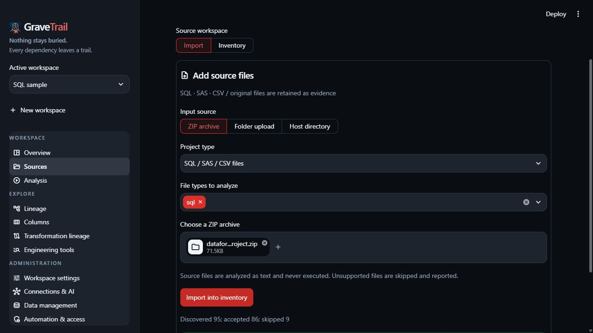

# Import and manage sources

Select/create a workspace in the sidebar, then open **Sources → Import**.

1. Choose **ZIP archive**, **Folder upload** or an authorized **Host directory**.
2. Choose **Project type**: ordinary SQL/SAS/CSV files, or a **dbt project** root
   with its YAML, macros and related resources.
3. For ordinary files, select only intended file types. Sample ZIPs include expected
   answers and supporting files; select only `sql` or `sas` for those tutorials.
4. Upload/select the source and choose **Import into inventory**.
5. Review accepted/skipped totals and diagnostics; open **Inventory**, then **Analysis**.

*Choose file types before importing; imported text is never executed.*

Host paths must remain beneath configured allowed roots. Path, size and file-count
limits apply; unsupported/unsafe files are reported. Prefer ZIP import for a first run.

Reimports update active content at the same path. Import is additive: omission does
not delete a source. Originals referenced by evidence/history remain retained.
Use [data management](../DATA_MANAGEMENT.md) for deliberate cleanup.

See [dbt import](../project-types/dbt.md) for roots, packages/artifacts and exclusions,
or the [UI reference](../USER_GUIDE.md) for inventory controls.
