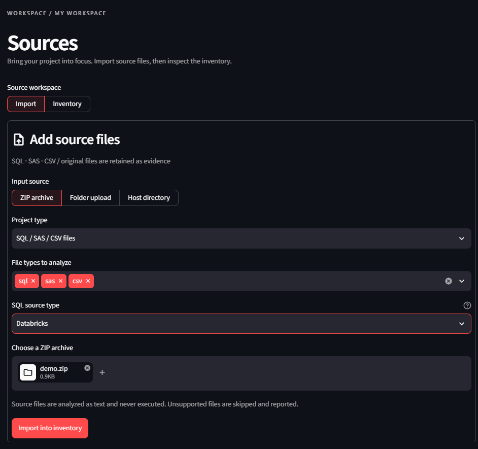

# Import and manage sources

Select/create a workspace in the sidebar, then open **Sources → Import**.

1. Choose **ZIP archive**, **Folder upload** or an authorized **Host directory**.
2. Under **Project type**, choose ordinary SQL/SAS/CSV files or **dbt project**
   to import a root with its YAML, macros and related resources.
3. For ordinary files, select the file types to analyze. When SQL is selected, set
   **SQL source type** for the batch, including SQL members of a ZIP.
4. Choose the upload or directory and select **Import into inventory**. The progress
   bar reports discovery, file checks, and saving to the workspace.
5. Expand **Skipped files** to see why entries were excluded. Review the accepted
   inventory or choose **Continue to Analysis**.

## Choose a SQL source type

**Use workspace settings** inherits the longest matching folder rule, then the
extension rule, then the workspace default. **Generic SQL** explicitly selects
the generic parser. Choose **Databricks**, **SQL Server**, or another supported
dialect when the files use its syntax.

To correct an imported file, open **Sources → Inventory → Inspect a source file**,
save the new **SQL source type**, and reanalyze. Changing the choice makes the
previous analysis stale even if the file contents stay the same. See [SQL coverage](../SQL_PARSING.md#databricks-lineage).

Host paths must remain beneath configured allowed roots. Path, size and file-count
limits apply; unsupported/unsafe files are reported. Prefer ZIP import for a first run.

Reimports update active content at the same path. Import is additive: omission does
not delete a source. Originals referenced by evidence/history remain retained.
Use [data management](../DATA_MANAGEMENT.md) for deliberate cleanup.

See [dbt import](../project-types/dbt.md) for roots, packages/artifacts and exclusions,
or the [UI reference](../USER_GUIDE.md) for inventory controls.
